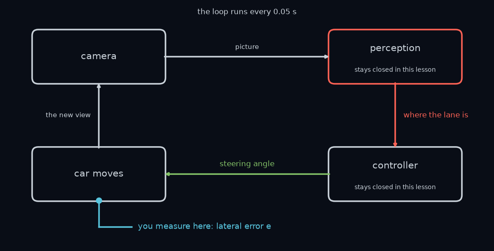
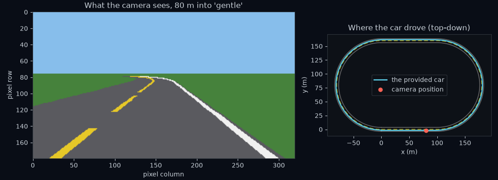
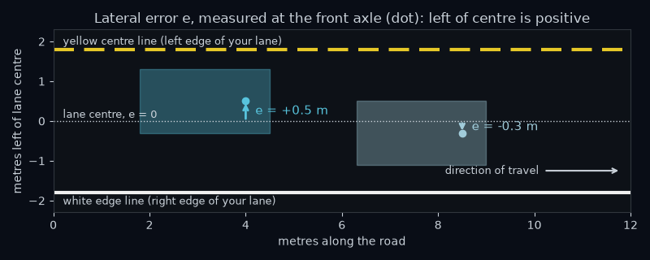
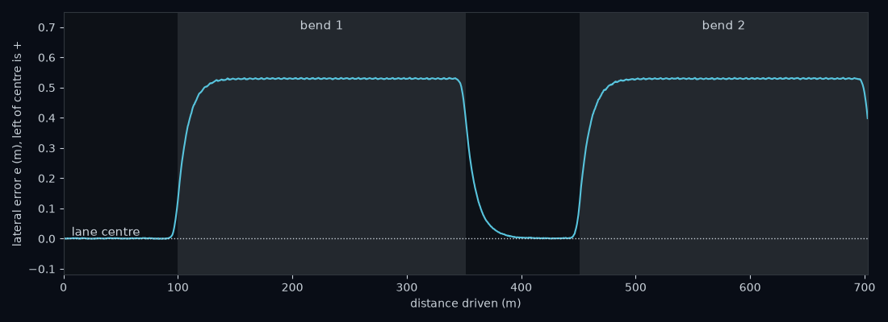
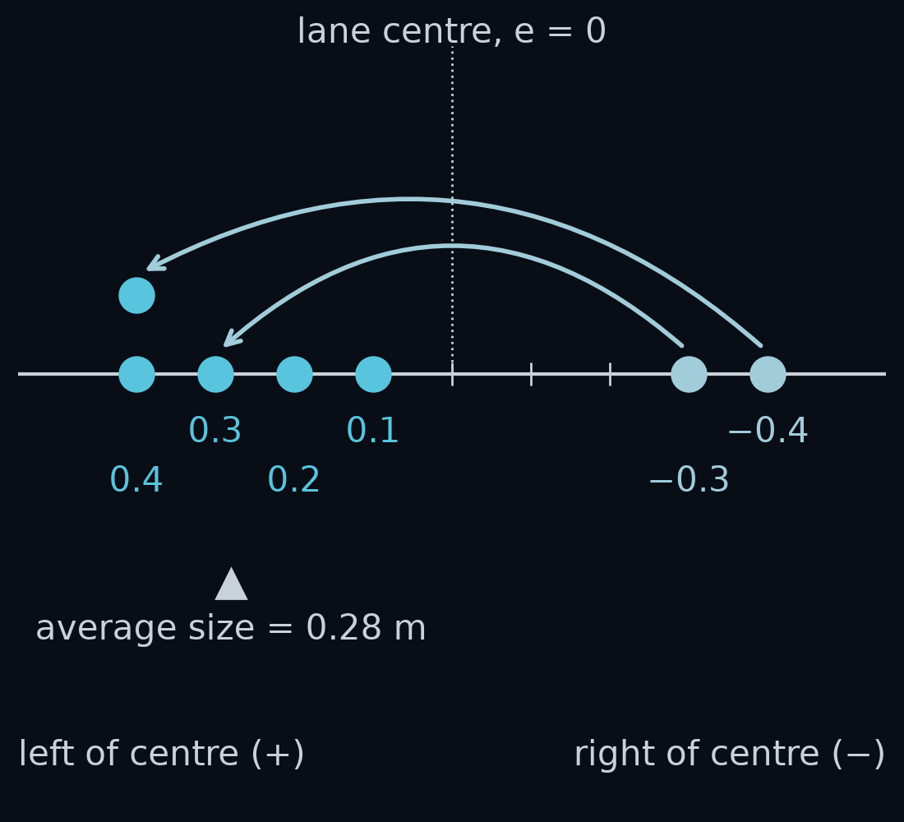
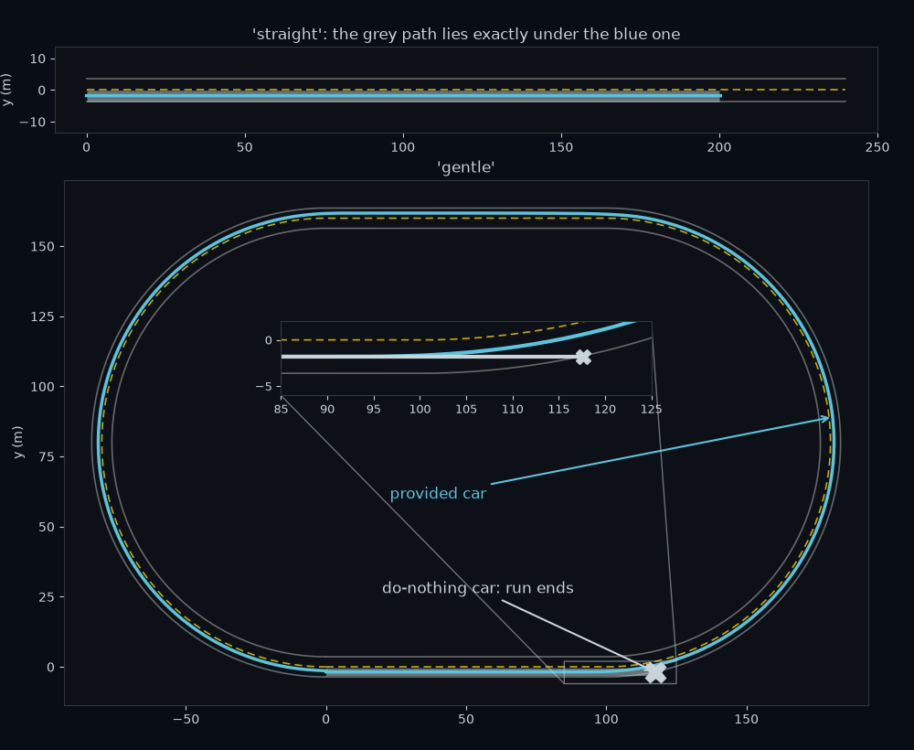
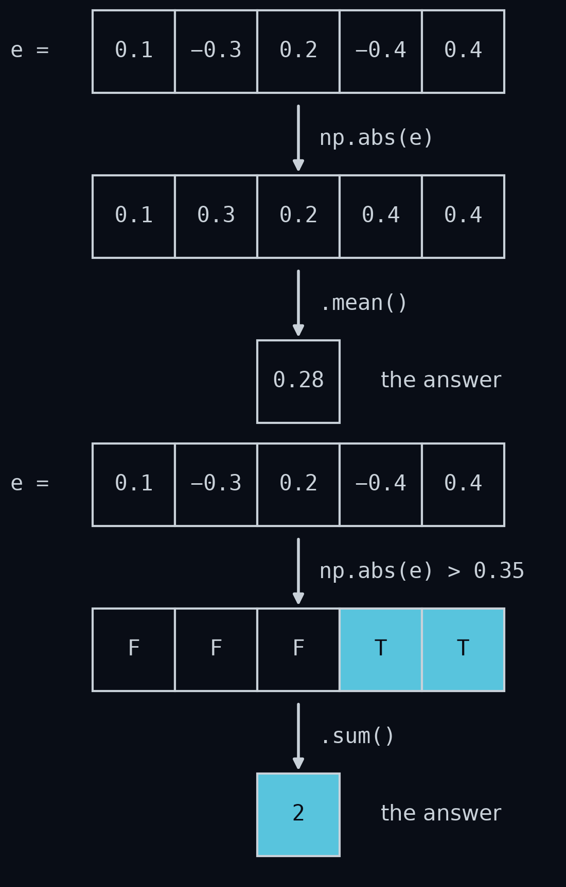

# Meet your car

## Is this car any good?

You have just been handed a car that steers itself. It rolls along a two-lane road at 8 m/s, about 29 km/h, and nobody is touching the wheel. Before you change a single line of its code, you need an answer to a plain question: is it any good?

"Good" needs a number. By the end of this lesson you will take a whole drive, nearly two thousand moments long, and boil it down to three numbers that say how well the car kept its lane. You will also know which of the three to trust for which question, and which tempting number to never trust at all.

Here is where you are heading. This is the report card for the car you were handed, after one lap of a test road:


Every number on that card comes from a recording of the drive, and in the lab you compute each one yourself. The rest of this lesson rebuilds the card, one piece at a time.

<details>
<summary>Optional: how we got 29 km/h</summary>

A speed in metres per second says how many metres you cover in one second. To say it in kilometres per hour, count kilometres instead of metres (1 km is 1000 m, so divide by 1000) and count in hours instead of seconds (1 h is 3600 s, so multiply by 3600):

$$8\ \text{m/s} = 8 \times \frac{3600}{1000}\ \text{km/h} = 8 \times 3.6\ \text{km/h} = 28.8\ \text{km/h}$$

That is about 29 km/h.

</details>

## The car you were handed

Twenty times a second, once every 0.05 seconds, the car runs the same loop:

1. The **camera** takes a picture of the road ahead.
2. The **perception box** looks at the picture and reports where the lane is.
3. The **controller box** turns that report into a steering angle.
4. The **car** moves a little, and the camera takes the next picture.



In this lesson you open neither box. You **instrument** the car instead: you record what it did and judge the result, the way a driving examiner judges a driver without reading their mind.

**Approximation.** The car lives in a flat-world teaching simulator. The road is paint on a perfectly flat plane, and the car moves like a bicycle with a 2.7 m wheelbase, the distance from its front axle to its rear axle. Real cars roll, slip and bounce. Here none of that happens, on purpose, so that every wobble you see has one cause.

**Placeholder.** Both boxes inside the provided car are stand-ins. You build your own perception box in *Your first perception box* and your own controller in *Closing the loop*.

Here is what the camera sees, and the path the car drove:



The car is tested on three roads. `straight` is 200 m of straight road. `gentle` is a stadium-shaped loop: two 100 m straights joined by two wide bends of radius 80 m. `curvy` is a 30 m straight followed by six tight quarter-circle bends of radius 20 m, alternating left and right.

**Guess first:** which road do you expect the provided car to find hardest, and why?


**Answer:** `curvy`. Its bends are a quarter of the radius of `gentle`'s, so the car must turn four times as sharply, and each bend turns the other way from the last. The provided car does not finish it. You will see exactly where it goes wrong near the end of this lesson.

<details>
<summary>Optional: how we got 702.7 m and 218.5 m</summary>

Each length is the distance along the road's centre line, from the start of the route to its end, added up piece by piece. A circle of radius $r$ has circumference $2\pi r$, where $\pi \approx 3.1416$ is the fixed ratio of any circle's circumference to its diameter. So a half circle is $\pi r$ long and a quarter circle is $\frac{\pi}{2} r$.

`gentle` is two straights of 100 m and two half-circle bends of radius $r = 80$ m:

$$2 \times 100 + 2 \times \pi \times 80 = 200 + 502.65 = 702.65 \approx 702.7 \text{ m}$$

`curvy` is a 30 m straight and six quarter-circle bends of radius 20 m:

$$30 + 6 \times \frac{\pi}{2} \times 20 = 30 + 188.50 = 218.50 \approx 218.5 \text{ m}$$

The paint of an open road runs 40 m past the end of the route, so the camera still has lines to look at as the car finishes. Those 40 m are not part of the route, which is why the figure marks the route's end with a square.

</details>

## Lateral error

Watch the car from above. The lane is 3.6 m wide, with a dashed yellow line on its left and a solid white line on its right. At some moments the car sits dead centre; at others it has drifted left or right.

At each moment you want to know one thing: how far sideways is the car from the middle of its lane? Measure it at the front axle, the line between the two front wheels, because that is where the simulator mounts the camera.

Try a number. If the front axle sits half a metre to the left of the lane's centre line, the answer is "0.5 m, to the left". Saying "to the left" every time gets tedious, so give left a plus sign and right a minus sign: +0.5 m. A car 0.3 m to the right of centre scores −0.3 m. A car exactly on the centre line scores 0.

Call this number $e$, read simply "e", for error. Its name is the **lateral error**; lateral means sideways.

The lane is 3.6 m wide, so each painted line is 1.8 m from the middle: the yellow line at $e = +1.8$ m and the white line at $e = -1.8$ m. When the front axle reaches a line, the simulator ends the run.



Left is positive everywhere in this course: for offsets, for headings, for steering angles. Almost every sign bug you will write comes from forgetting it.

Sometimes you care how far off the car is, not which side. Then you drop the sign and write $|e|$, read "the size of e". A car at −0.3 m and a car at +0.3 m both have $|e| = 0.3$ m, and the run ends when $|e|$ reaches 1.8 m.

You are not the first to pick this number. Stanford's robot car Stanley, which won the 2005 DARPA Grand Challenge desert race, steered by exactly this measurement:

> "The key error metric is the cross-track error, x(t), […] which measures the lateral distance of the center of the vehicle's front wheels from the nearest point on the trajectory." (Thrun et al., 2006, p. 684)

Cross-track error is Stanley's name for what this course calls $e$.

## A drive is a list of numbers

The simulator measures $e$ at every step, 20 times a second. One lap of `gentle` takes the provided car 88.85 s, so the whole lap is a list of 1,778 numbers, written $e_1, e_2, \ldots, e_N$, where $N = 1778$ is how many there are and the small number under each $e$ says which step it came from.

A list of measurements taken one after another in time is called a **time series**. In the lab the recording arrives as an object called `tel`, short for telemetry, the record of everything the car measured on its drive. Its lateral errors are `tel.lat`, one number per step.

**Guess first:** `gentle` turns left twice. While the car is going round a left-hand bend, do you expect $e$ to be positive (car left of centre) or negative (car right of centre)?



**Answer:** positive. In each bend the car drifts toward the inside of the turn, and the inside of a left-hand bend is on the left. On the straights $e$ falls back to almost exactly 0. Its lowest value on the whole lap is one millimetre right of centre, too small to see in the figure. Apart from that millimetre, the car spends the whole lap left of centre.

<details>
<summary>Optional: how we got N = 1778</summary>

The simulator records one value at the start of every step, beginning with step $k = 0$ at time $t = 0$. Step $k$ is recorded at time $t = 0.05\,k$ seconds, and the lap ends at the step where the car has driven the whole route, at $t = 88.85$ s. That last step is

$$k_{\text{last}} = \frac{88.85}{0.05} = 1777$$

Counting the steps $k = 0, 1, 2, \ldots, 1777$ gives $1777 + 1 = 1778$ values. There is one more value than there are 0.05 s gaps between them, just as a fence with 1777 gaps has 1778 posts.

You may notice that $88.85 \times 8 = 710.8$ m is more than the 702.7 m of the road. That is right: the car drives in the right-hand lane, which is the outside lane of `gentle`'s left-hand bends, so its own path is longer than the road's centre line.

</details>

## The tempting shortcut

You have 1,778 numbers and you want one. The obvious move is to average them. A small average sounds like a car that stays near the middle.

Try it on a short drive first. Here are five lateral errors, in metres:

$$e = (0.1,\ -0.3,\ 0.2,\ -0.4,\ 0.4)$$

**Guess first:** this car was off centre at every one of its five steps. What do you think its average is?

Add them up and divide by how many there are:

$$\frac{0.1 + (-0.3) + 0.2 + (-0.4) + 0.4}{5} = \frac{0.0}{5} = 0.0 \text{ m}$$


**Answer:** zero. A perfect score, for a car that was never once on the centre line. The errors to the left cancelled the errors to the right.

This happens on real drives too, not only on made-up ones.


The car on the right steers more sharply than the provided car. (How a steering setting like that works is the subject of *Closing the loop*; here it is simply a second car.) Its average of +0.02 m makes it look almost perfect, and far better than the provided car's +0.38 m. In fact it strays further: on a fairer measure, which you meet next, it sits 0.50 m from centre on average against the provided car's 0.38 m.

The plain average does answer a question, just a different one: on average, which side does the car favour? That is called the car's **bias**. It is worth knowing, but it is not a score, and it must never be used as one.

## Three honest numbers

The fix is to stop errors cancelling. Count every error as a cost, whichever side of the line it fell on. There are three good ways to do that, and each answers its own question.

### Mean absolute error: how far off, typically?

Drop the signs first, then average. On the five errors:

$$|e| = (0.1,\ 0.3,\ 0.2,\ 0.4,\ 0.4)$$

They add up to $1.4$, and $1.4 / 5 = 0.28$. So this car sat 0.28 m from centre, typically.



Written out in full for these five steps, the calculation is

$$\frac{|e_1| + |e_2| + |e_3| + |e_4| + |e_5|}{5} = \frac{0.1 + 0.3 + 0.2 + 0.4 + 0.4}{5} = 0.28 \text{ m}$$

For a lap of 1,778 steps you would never write out every term, so mathematicians use a shorthand:

$$\text{mean}|e| = \frac{1}{N}\sum_{t=1}^{N} |\color{#58C4DD}{e_t}|$$

Read it aloud as "one over N, times the sum, for t from 1 to N, of the size of e-t". The tall symbol $\sum$ is the Greek capital letter sigma, and it means "add up what follows", here for every step from $t = 1$ to $t = N$.

**Confusion is normal here.** Sigma is only shorthand for a long sum. If it slows you down, read it as the written-out sum above; it means exactly that.

This number is the **mean absolute error**, written mean$|e|$. Absolute is the mathematician's word for "with the sign dropped".

### Maximum absolute error: how bad was the worst moment?

Sometimes the typical moment does not matter. What matters is the single worst one, because that is when a wheel might touch the line. Take the largest of the sizes: for the five errors, $0.4$ m. The shorthand is

$$\max|e| = \max_{t} |\color{#58C4DD}{e_t}|$$

read "the largest, over all steps t, of the size of e-t". Its name is the **maximum absolute error**.

### Root mean square: how far off, counting big errors extra?

The third number squares each error before averaging, which turns every error into a positive cost and makes the big ones count for more. On the five errors:

- Square each one: $(0.01,\ 0.09,\ 0.04,\ 0.16,\ 0.16)$.
- Take the mean of the squares: they add to $0.46$, and $0.46 / 5 = 0.092$.
- Take the square root: $\sqrt{0.092} = 0.303$ m.

There is a picture behind those three steps. Squaring a length gives the area of a square with that side.


Squares of metres are square metres, and the square root brings you back to metres. That is why this number can sit beside mean$|e|$ on the same scale.

The shorthand reads from the inside out, the same order you just worked in: square, take the mean, take the root.

$$\text{RMS}(e) = \sqrt{\frac{1}{N}\sum_{t=1}^{N} \color{#58C4DD}{e_t}^{2}}$$

Its name is the steps read backwards: **root mean square**, or **RMS**.

Now look back at the report card at the top of this lesson. For the provided car's lap of `gentle`, mean$|e|$ is 0.38 m, RMS is 0.44 m and max$|e|$ is 0.53 m, and you can say what each of them means.

## Why RMS punishes big errors

Here are two five-step drives:

- Drive A: $(0.2,\ 0.2,\ 0.2,\ 0.2,\ 0.2)$. Always a little off.
- Drive B: $(0,\ 0,\ 0,\ 0,\ 1.0)$. Perfect, then one big swerve.

Both have the same mean$|e|$: $1.0 / 5 = 0.2$ m.

**Guess first:** do they have the same RMS? If not, which is bigger, and by roughly how much?


**Answer:** Drive B's RMS is more than twice Drive A's.

- A: every square is $0.04$, their mean is $0.04$, and $\sqrt{0.04} = 0.2$ m.
- B: the squares are $(0, 0, 0, 0, 1.0)$, their mean is $0.2$, and $\sqrt{0.2} = 0.447$ m.

The swerve of 1.0 m is 5 times the steady 0.2 m, but its square is 25 times as big. Squaring grows big numbers much faster than small ones, so one large error dominates the average of the squares.

That matches driving. Being 0.2 m off centre all the time never brings a wheel near a line. Being 1.0 m off for a moment might. When the worst moments matter most, look at RMS and max$|e|$, not only at mean$|e|$.

One more fact you can check on every example here: RMS is never smaller than mean$|e|$ (0.303 ≥ 0.28, and 0.447 ≥ 0.2). The two are equal only when every $|e_t|$ is the same, as in Drive A. The more uneven the errors, the wider the gap.

## Counting steps off the lane

Some questions have a yes-or-no answer at each step. "Was the car more than 0.9 m from centre just now?" The course uses 0.9 m, half the 1.8 m from the middle to a line, as its **off-lane** limit. A step is off the lane when

$$|\color{#58C4DD}{e_t}| > 0.9 \text{ m}$$

The comparison is strict: a step at exactly 0.9 m is on the limit, not over it.


To count off-lane steps, ask the question at every step and count the yeses. With the five errors and a stricter limit of 0.35 m, the sizes $(0.1, 0.3, 0.2, 0.4, 0.4)$ give no, no, no, yes, yes: 2 steps. To turn a count of steps into time, divide by 20 steps per second.

**Guess first:** the provided car leaves `curvy` 48 m into the 218.5 m route. Before it went off, how long had it spent more than 0.9 m from centre: a blink, or whole seconds?


**Answer:** whole seconds. The car spends 40 steps more than 0.9 m from centre, which is $40 / 20 = 2.0$ seconds, before it reaches the line at 48 m. All 40 are in the first bend, over the last 15 m before the car leaves, from 33 m to 48 m.

## What does doing nothing score?

Is 0.38 m good? A number means little until you have something to set it against. So score the laziest car imaginable: one that holds the wheel dead straight and never steers at all. Call it the do-nothing car.

**Guess first:** on which of the three roads, if any, does the do-nothing car get a perfect score?



**Answer:** `straight`. A car that starts in the middle of a straight lane and never turns stays in the middle, so all three of its numbers are 0.00 m, the same as a perfect driver's. That is why one road is never enough: on `straight`, a car with no steering at all is indistinguishable from a flawless one. On `gentle` the do-nothing car is gone 14.7 s into the lap, 117 m along the road, at the first bend.

Now 0.38 m has its place. A perfect car scores 0; a car that never steers crosses the painted line at the first bend. The provided car finishes the lap, but it uses up to 0.53 m of its 1.8 m of room to do it. That is the bar your own controller has to beat in *Closing the loop*.

## Arrays, not loops

In the lab, `tel.lat` is a NumPy array: a list of numbers that you can do arithmetic on all at once. You could compute mean$|e|$ with a Python loop:

```python
total = 0.0
for x in e:
    total += abs(x)
mean_abs = total / len(e)
```

NumPy lets you write the formula instead:

```python
mean_abs = np.abs(e).mean()
```



`np.abs(e)` makes a new array holding the size of every element, and `.mean()` adds them up and divides by how many there are. In the same way, `e ** 2` squares every element, `np.sqrt` takes a square root, `.max()` finds the largest element, and a comparison such as `np.abs(e) > 0.9` asks its question of every element and returns an array of `True` and `False`. Python counts `True` as 1 and `False` as 0, so `.sum()` of that array is the number of off-lane steps. Applying one operation to a whole array at once is called **vectorisation**.

Vectorised code is shorter, it reads like the maths, and it runs much faster, because the loop happens inside NumPy's compiled code instead of in Python, one element at a time. You will time the difference in the lab. The grader checks your answers against the plain-loop calculation, so the two styles must agree.

## Recap

- A drive is a time series of lateral errors $e$, one every 0.05 s, with left of centre positive.
- The plain average of $e$ lets left and right cancel. It measures the car's bias, never its quality.
- mean$|e|$ says how far off the car typically was, RMS counts big errors extra, max$|e|$ is the worst moment, and counting steps with $|e| > 0.9$ m says how long the car was nearly off the lane.

Next question: twenty times a second, the camera hands the perception box a picture. What is a picture to a computer, and how could you find a yellow line in one? That is the next lesson, *Images are arrays*.


## Go deeper

- **NumPy: the absolute basics for beginners**, sections "Array fundamentals" and "Basic array operations". The official guide to everything this lesson used: making arrays, `abs`, `mean`, `max` and comparisons.
- **CS231n Python Numpy Tutorial**, sections "Arrays" and "Array math". A compact tour from Stanford's computer-vision course. Its "Boolean array indexing" part prepares you for *Images are arrays*.
- **Thrun et al., "Stanley: The Robot that Won the DARPA Grand Challenge" (2006)**, §9.2 "Steering Control", p. 684. How the winning car of the 2005 desert race defined its cross-track error and steered to shrink it. Read the definition now, and come back for the steering law after *Closing the loop*.
