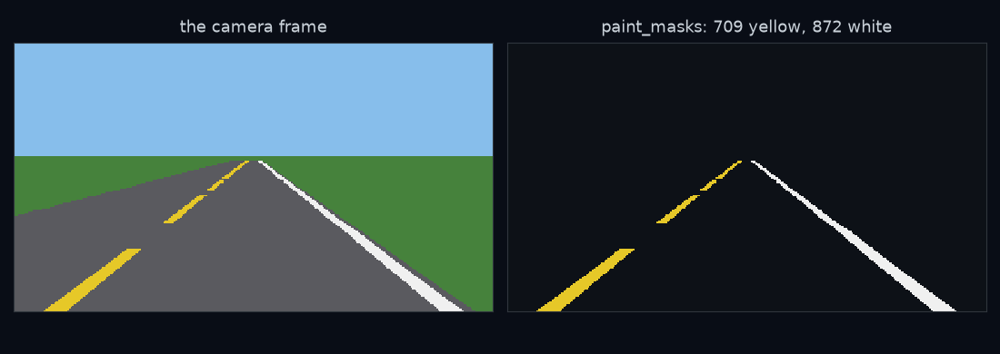
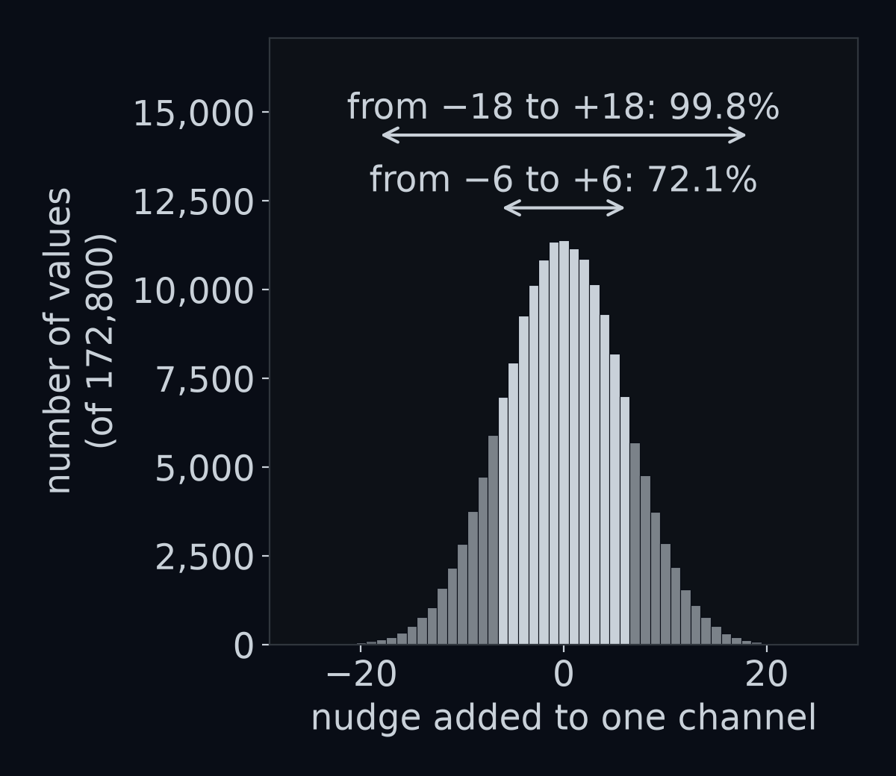
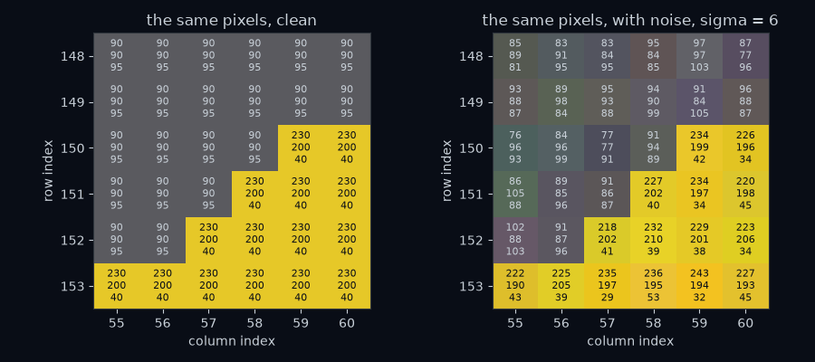
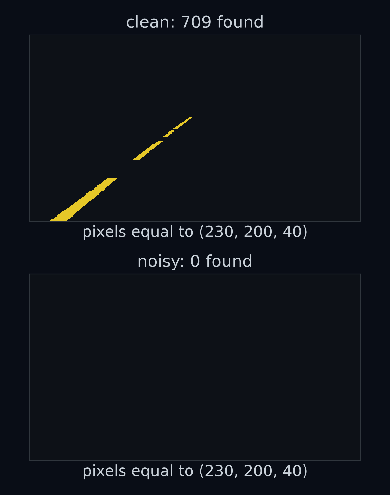
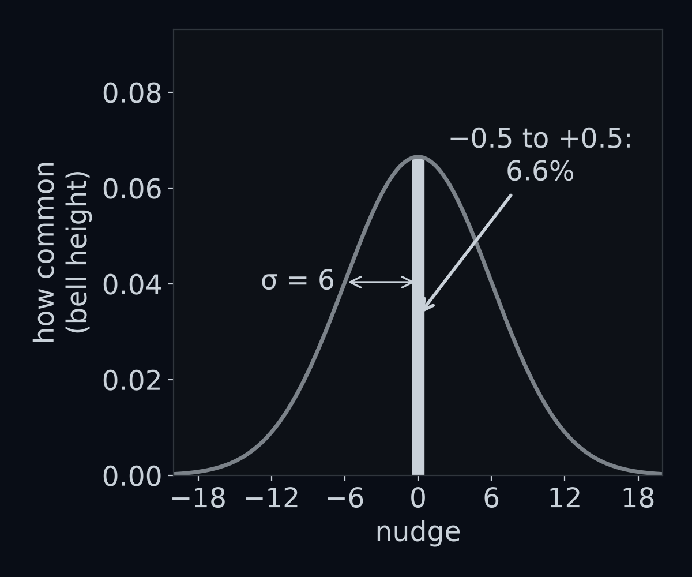
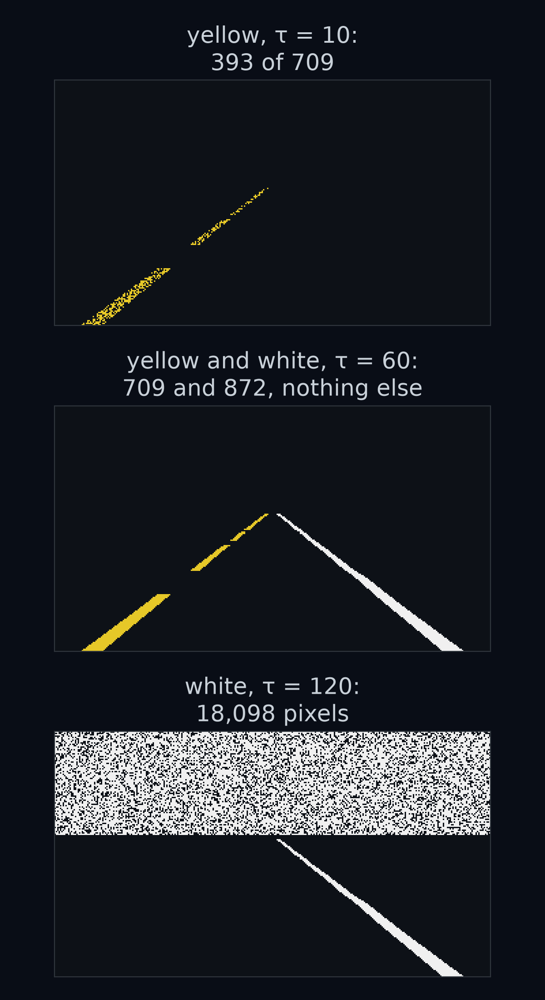
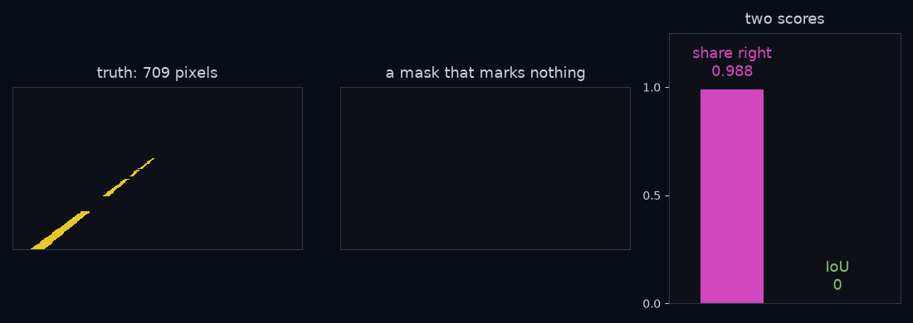
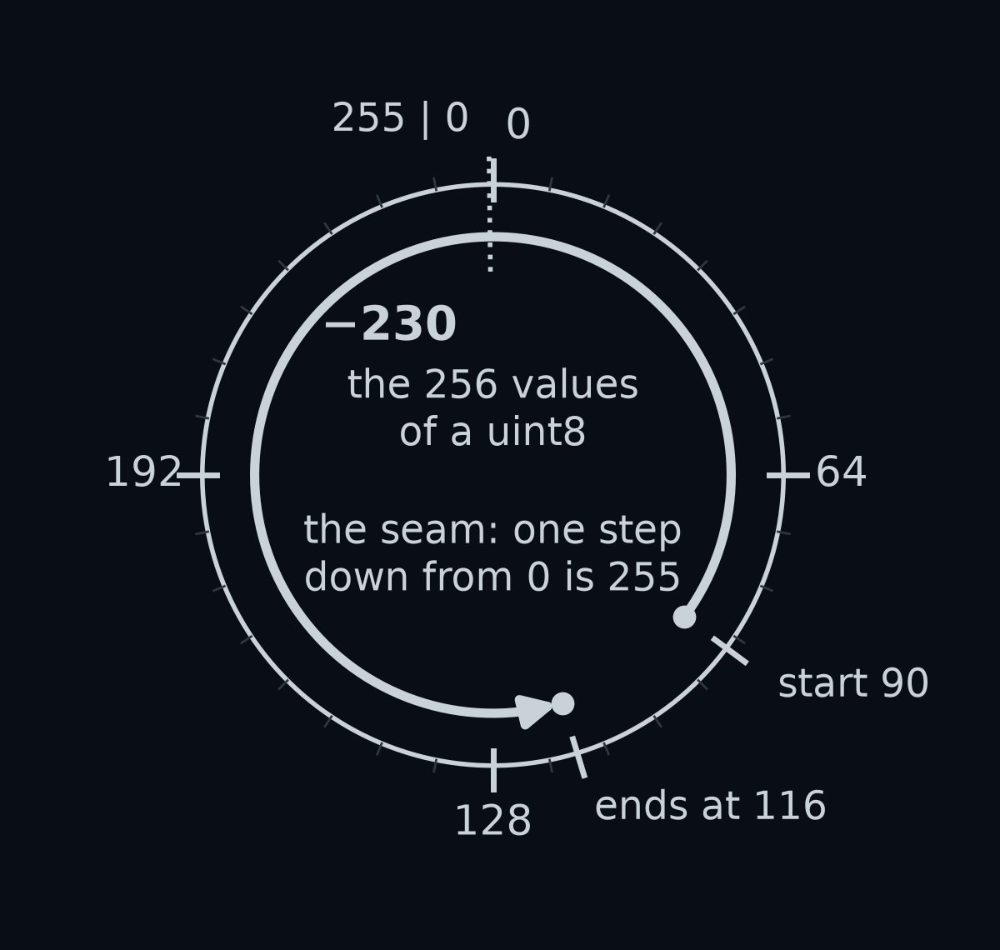

# Images are arrays

Twenty times a second, the camera on your car hands the perception box a picture of the road ahead. You can see the yellow line in that picture at a glance. The perception box cannot see anything. All it receives is a block of numbers, and somewhere in those numbers is the yellow line. Keeping the car in its lane starts with finding it.

By the end of this lesson you will write a function, `paint_masks`, that takes one camera picture and marks every pixel of yellow paint and every pixel of white paint. It has to keep working when the camera is noisy, and it is scored on six pictures taken on all three test roads.



## A frame is a grid of numbers

In 1988, Dean Pomerleau at Carnegie Mellon University taught a small neural network called ALVINN to steer the Navlab, Carnegie Mellon's autonomous test vehicle, a modified Chevy van. The network never saw the camera picture the way you do. It saw numbers:

> "The first retina, consisting of 30x32 units, receives video camera input from a road scene. The activation level of each unit in this retina is proportional to the intensity in the blue color band of the corresponding patch of the image. The blue band of the color image is used because it provides the highest contrast between the road and the non-road." (Pomerleau, 1988, p. 306)

A grid of 30 by 32 brightness values, 960 numbers, was all ALVINN ever saw of the camera picture. (The "first retina" has a partner: a smaller 8 by 32 grid from a laser range finder, each unit's activation proportional to how close that patch is.)

Your car's camera gives you a bigger grid. Each picture it takes is called a **frame**. A frame is 320 pixels wide and 180 pixels tall, and the colour of each pixel is stored as three numbers: how much red, how much green and how much blue.

**Guess first:** how many numbers make up one frame?

Multiply the three sizes: $180 \times 320 \times 3 = 172{,}800$ numbers, every 0.05 seconds. In the lab, a frame is a NumPy array with **shape** `(180, 320, 3)`. The shape lists how long the array is along each of its directions, which NumPy calls **axes**: 180 rows, 320 columns, 3 colour values.


Zoom in on the box and the picture dissolves into its numbers. The grey road pixels are all `(90, 90, 95)`. The yellow paint pixels are all `(230, 200, 40)`. The edge between them is a staircase, because a slanted line drawn on a grid of squares always is.

## Finding one pixel: row, column, channel

You pick out one number with three positions in square brackets, `frame[row, column, channel]`:

- **row** runs from 0 at the **top** of the picture to 179 at the bottom.
- **column** runs from 0 at the left edge to 319 at the right edge.
- **channel** is 0 for red, 1 for green and 2 for blue. Leave it out and you get all three.

The row comes first: `frame[row, column]` is (down, across), the opposite order from the (x, y) of a graph.

Row 0 at the top is the opposite of a graph in a maths class, where the vertical axis grows upward. Almost everyone trips on this at first. In an image, rows count down the page, like lines of text.

**Guess first:** `frame[179, 160]` is the pixel in the bottom row, halfway across. Is it sky, road or paint?

![The camera frame with its row numbers down the left side, 0 at the top and 179 at the bottom, and its column numbers along the top, 0 to 319. Three pixels are marked with their positions and colours: `frame[0, 0]` in the sky, `frame[179, 160]` on the road just ahead of the car, and one pixel of the yellow line.](figures/row_col.png)

**Answer:** road, `(90, 90, 95)`. The bottom of the frame is the road just in front of the car, and the car sits in the middle of its lane, so the middle of the bottom row lands between the two painted lines. The top-left pixel, `frame[0, 0]`, is sky: `(135, 190, 235)`.

Each channel on its own is a grid of 180 by 320 numbers, a grey picture that is bright wherever that colour is strong. `frame[:, :, 2]` takes all rows (`:` means "all of them"), all columns and channel 2, the blue one.


Yellow paint is `(230, 200, 40)`: lots of red, lots of green, very little blue. So in the blue channel the yellow line is darker than the road around it, 40 against 95. A colour is only ever a mix of the three numbers, and each channel tells part of the story. ALVINN looked at the blue channel alone, for the reason in the quote above: blue gave the most contrast between road and non-road.

Every value is a whole number from 0 to 255. The array's **dtype**, the type of number it stores, is `uint8`: an unsigned integer in 8 bits. "Unsigned" means it has no minus sign, and 8 bits can hold $2^8 = 256$ different values (2 to the power 8 is 2 multiplied by itself 8 times), 0 to 255. Here 0 means none of that colour and 255 means as much as the camera can record. Hold on to "no minus sign"; it comes back at the end of this lesson.

The simulator is a teaching world. It paints everything in exactly five colours:

| Surface | Red | Green | Blue |
|---|---|---|---|
| sky | 135 | 190 | 235 |
| grass | 70 | 130 | 60 |
| road | 90 | 90 | 95 |
| yellow paint | 230 | 200 | 40 |
| white paint | 240 | 240 | 240 |

## Slicing: taking a block of rows

You often want a block of the picture rather than one pixel. A **slice** `start:stop` takes every position from `start` up to, but not including, `stop`. So `frame[100:180]` is rows 100 to 179.

**Guess first:** what is the shape of `frame[100:180]`?

![The camera frame with two blocks of rows shaded. The top block, `frame[:76]`, rows 0 to 75, is all sky and has shape (76, 320, 3). The bottom block, `frame[100:180]`, rows 100 to 179, holds the road nearest the car and has shape (80, 320, 3).](figures/slices.png)

**Answer:** `(80, 320, 3)`. A slice from 100 to 180 holds $180 - 100 = 80$ rows. The stop is left out, so the count is simply stop minus start. Leaving `start` out means "from the beginning": `frame[:76]` is rows 0 to 75, and in this simulator they are all sky. The horizon of its flat world sits at row 75.5, and the first row that shows any road is row 79.

The paint the car needs is a thin sliver of all this. Of the frame's $180 \times 320 = 57{,}600$ pixels, 709 are yellow paint and 872 are white paint, 2.7% in all.

Part of the reason is distance. Both lines are 0.2 m wide all the way along, but the further away a piece of line is, the fewer pixels it covers. The yellow line also has gaps: it is dashed, 3.5 m of paint, then a 1.5 m gap.


The rows near the bottom of the frame carry most of the paint, and they show the road the car is about to drive on. The next lesson uses exactly those rows.

<details>
<summary>How we got 2.7%</summary>

The share of the frame that is paint is the number of paint pixels divided by the number of all pixels. The paint pixels are the yellow ones and the white ones together, $709 + 872 = 1581$. The frame has $180 \times 320 = 57{,}600$ pixels, so

$$\frac{1581}{57{,}600} = 0.02745$$

A fraction becomes a percentage when you multiply it by 100: $0.02745 \times 100 = 2.745$ per cent, which rounds to 2.7%.

</details>

## Colour is a point in space

To find paint, you need a way to ask "how close is this pixel's colour to yellow?" Three numbers can be read as a position. Treat red, green and blue as three directions, like the length, width and height of a room. Then every colour is a point inside a cube whose sides run from 0 to 255, and similar colours are points close together.


How far apart are road grey, $(90, 90, 95)$, and yellow paint, $(230, 200, 40)$? Start with two of the three directions. In red they differ by $230 - 90 = 140$, and in green by $200 - 90 = 110$. Those two differences are the sides of a right-angled triangle, because the red and green directions meet at a right angle, like two walls of a room meeting in a corner. So Pythagoras' theorem gives the distance across:

$$\begin{aligned}\sqrt{140^2+110^2} &= \sqrt{19{,}600+12{,}100}\\ &= \sqrt{31{,}700}\\ &= 178.0\end{aligned}$$

Now add the third direction. In blue they differ by $95 - 40 = 55$. The blue direction stands straight up from the red-green floor, so it is at a right angle to the whole 178.0 line too. That makes a second right-angled triangle: square the new side, add it in, take the square root.

$$\begin{aligned}\sqrt{31{,}700+55^2} &= \sqrt{31{,}700+3{,}025}\\ &= \sqrt{34{,}725}\\ &= 186.3\end{aligned}$$


That is all there is to it, for any two colours. Write a pixel's colour as $p = (p_R, p_G, p_B)$, read "p-R, p-G, p-B", its red, green and blue values. Write the colour you are looking for as $c = (c_R, c_G, c_B)$. Name the three differences $\Delta_R = p_R - c_R$, read "delta R, the red difference", and likewise $\Delta_G$ and $\Delta_B$. Then the distance between them is

$$d(p, c) = \sqrt{\Delta_R^2 + \Delta_G^2 + \Delta_B^2}$$

read "d of p and c is the square root of delta R squared, plus delta G squared, plus delta B squared". It is 0 when the two colours are identical, and it grows as they differ. Its name is the **Euclidean distance**, the ordinary straight-line distance.

**Guess first:** of the other four colours, which one is closest to yellow paint: road, grass, sky or white?


**Answer:** grass, 175.8 away, a little closer than road at 186.3. And the colour closest to white paint is sky, only 116.4 away. Keep those two colours in mind: grass and sky are the ones most likely to be mistaken for paint.

<details>
<summary>How we got 175.8 and 116.4</summary>

These come from the same distance formula. Grass is $(70, 130, 60)$ and yellow paint is $(230, 200, 40)$:

- Differences: $70 - 230 = -160$, $130 - 200 = -70$, $60 - 40 = 20$.
- Squares: $25{,}600$, $4{,}900$ and $400$. They add up to $30{,}900$.
- Square root: $\sqrt{30{,}900} = 175.8$.

Sky is $(135, 190, 235)$ and white paint is $(240, 240, 240)$:

- Differences: $135 - 240 = -105$, $190 - 240 = -50$, $235 - 240 = -5$.
- Squares: $11{,}025$, $2{,}500$ and $25$. They add up to $13{,}550$.
- Square root: $\sqrt{13{,}550} = 116.4$.

A negative difference becomes positive when you square it, so the order of subtraction does not matter. Yellow's other distances are larger: road 186.3, white 204.2 and sky 217.1. White's are larger too: yellow 204.2, road 257.0 and grass 270.9.

</details>

## Noise: no two pixels quite alike

Real cameras are not perfect. Each value comes back nudged up or down a little by electrical **noise**. The simulator imitates this when you ask it to: with `noise_sigma=6` it adds a random nudge to every channel of every pixel, then rounds the result and keeps it within 0 to 255.

The symbol $\sigma$, read "sigma", is the typical size of a nudge. Most nudges are smaller than $\sigma$, and nudges three times bigger are very rare.



The bell shape has a name, the **normal distribution**, and $\sigma$ is its **standard deviation**. You will meet both again; for now, "typical size of a nudge" is all you need.



Pixel `frame[150, 59]` was `(230, 200, 40)` and is now `(234, 199, 42)`. Its differences from yellow are 4, −1 and 2, so its distance from yellow is

$$\begin{aligned}d &= \sqrt{4^2 + (-1)^2 + 2^2}\\ &= \sqrt{16+1+4} = 4.6\end{aligned}$$

Not zero, but tiny next to the 186.3 between road and yellow.

## The tempting shortcut: exact equality

The simulator paints yellow as exactly `(230, 200, 40)`. So why not find yellow paint by asking which pixels equal it? On a clean frame that works perfectly: it finds all 709 yellow pixels and nothing else.

**Guess first:** on a frame with noise of sigma 6, how many of the 709 yellow pixels does exact equality find?



**Answer:** None of them. To equal yellow exactly, a noisy pixel needs all three of its nudges to round to 0. One nudge does that only when it lands between $-0.5$ and $+0.5$, and with $\sigma = 6$ that happens with a probability of about 0.066, roughly one time in fifteen.



All three channels at once: $0.066 \times 0.066 \times 0.066 = 0.0003$. Out of 709 yellow pixels, you would expect about 0.2 to survive: most frames have none at all, which is what the figure shows.

<details>
<summary>How we got 0.066, 0.0003 and 0.2</summary>

A channel comes back as exactly the paint value only if its nudge lies between $-0.5$ and $+0.5$, because anything in that range rounds to 0. The share of nudges that lands in a range is the area under the bell over that range. This range is only 1 wide, narrow next to the bell, so its area is very close to a rectangle: width 1 times the bell's height at its middle. That height, for standard deviation $\sigma$, is $\frac{1}{\sigma\sqrt{2\pi}}$, where $\pi$ (pi) is 3.14159…:

$$\begin{aligned}1 \times \frac{1}{6\sqrt{2\pi}} &= \frac{1}{6 \times 2.5066}\\ &= 0.06649 \approx 0.066\end{aligned}$$

The three channels get independent nudges, and the chances of independent events multiply:

$$\begin{aligned}&0.066 \times 0.066 \times 0.066 \\ &= 0.000287 \\ &\approx 0.0003\end{aligned}$$

Each of the 709 yellow pixels has that chance, so the number you expect to be exactly yellow is $709 \times 0.000287 = 0.20 \approx 0.2$.

</details>

The lesson reaches far beyond paint. Measured data never lands exactly on its ideal value, so never test it for equality: test whether it is close enough. (`frame == yellow` has a second trap. It compares channel by channel, so its answer has shape `(180, 320, 3)`, three answers per pixel. You would need `np.all(..., axis=-1)`, which asks "are all three true?" along the last axis, the colour axis, to combine them into one answer per pixel.)

## Paint is a colour threshold

"Close enough" needs a number. Choose a cut-off distance, called a **threshold** and written $\tau$, read "tau". Then a pixel counts as yellow paint when its distance from yellow is less than $\tau$:

$$d(p, c_{\text{yellow}}) < \tau$$

Asking that question of one pixel gives `True` for yes or `False` for no, the two values of the type **bool**. Asking it of every pixel gives a **mask**: an array of shape `(180, 320)` that holds one bool per pixel. A tiny picture of 2 by 2 pixels, whose top-left and bottom-right pixels are paint, gives the mask `[[True, False], [False, True]]`.


To ask 57,600 questions without a loop, NumPy has to subtract the colour yellow from every pixel at once. It does this by stretching the small array across the big one, which is called **broadcasting**. On two pixels, $(10, 20, 30)$ and $(40, 50, 60)$, taking away $(1, 2, 3)$ gives $(9, 18, 27)$ and $(39, 48, 57)$. The three numbers of yellow have the shape `(3,)`: the shape of a list of three numbers, where the comma marks it as a shape, not a number in brackets.

The subtraction leaves three differences per pixel. `np.linalg.norm(..., axis=-1)` squares them, adds them and takes the square root along one axis. `axis=-1` means "the last axis", the colour axis, and that axis disappears, leaving one distance per pixel.

With `yellow` holding the three numbers of yellow paint, the whole mask takes two lines:

```python
distance = np.linalg.norm(frame.astype(float) - yellow, axis=-1)  # shape (180, 320)
yellow_mask = distance < tau                                      # shape (180, 320), dtype bool
```

`frame.astype(float)` makes a copy of the frame that holds decimal numbers, which can be negative. You will see why that matters at the end of the lesson.

How big should $\tau$ be? Look at the distance from yellow, and from white, of every pixel in a noisy frame.

**Guess first:** paint sits within about 30 of its colour. How far away is the nearest pixel that is not paint?


The count axis is stretched so that each step up is ten times more pixels; without that, the few hundred paint pixels would be invisible next to tens of thousands of others.

In this frame, noise moved no yellow pixel more than 27.8 from yellow and no white pixel more than 24.8 from white. The nearest pixel that is *not* yellow paint is 151.2 from yellow. The nearest pixel that is not white paint is a noisy sky pixel 92.2 from white, which is no surprise: sky is the colour nearest to white. Any $\tau$ inside both gaps separates paint from everything else. The provided perception box uses $\tau = 60$.

**Guess first:** what goes wrong with $\tau = 10$ for yellow? And with $\tau = 120$ for white?



**Answer:** $\tau = 10$ is too strict: noise pushes almost half of the yellow pixels further than 10 away, so the mask keeps only 55.4% of them. $\tau = 120$ is too loose for white: it reaches past the gap to the sky, 116.4 away, and marks 18,098 pixels instead of 872. A threshold has to sit inside the gap, and the gap is set by the colour that comes closest.

## Scoring a mask: intersection over union

How good is a mask? The score this section builds is called **IoU**, short for intersection over union. The simulator knows which pixels truly are paint, so there is a correct mask to compare yours with. Call it $T$, for truth, and call yours $M$.

The obvious score is the share of pixels your mask got right.

**Guess first:** a lazy mask marks nothing at all. What share of the pixels does it get right, for yellow?



**Answer:** 98.8%. Yellow paint is only 1.2% of the frame, so a mask that marks nothing is right about every other pixel. A score that rates a useless mask at nearly 99% is no score at all.

The fix is to look only at the pixels that matter: the ones that either mask marked. Out of those, what share did both masks mark?

**Worked example.** The truth has 10 paint pixels. Your mask marks 8 of them, and it also marks 4 pixels that are not paint.

- Marked by both: 8.
- Marked by either: the 10 true pixels plus your 4 wrong ones, 14.
- Score: $8 / 14 = 0.571$.


In symbols:

$$\text{IoU}(M, T) = \frac{|M \cap T|}{|M \cup T|}$$

$M \cap T$, read "M and T", is the set of pixels marked in both masks: the **intersection**. $M \cup T$, read "M or T", is the set marked in either: the **union**. The bars $|\cdot|$ mean "how many pixels". So the score is the intersection over the union, which gives it its name, **IoU**.

In NumPy, `&` means "both" and `|` means "either", and `.sum()` counts the `True` values, because `True` counts as 1:

```python
iou = (M & T).sum() / (M | T).sum()
```

IoU is 1 only when the two masks are identical. It punishes both kinds of mistake: missed paint shrinks the top, and wrongly marked pixels grow the bottom. The empty mask scores 0, because nothing is marked by both. The grader for this lesson asks for an IoU of at least 0.85 for each of your two masks, on six noisy frames from all three roads.

<details>
<summary>How we got 1.2% and 98.8%</summary>

Yellow paint covers 709 of the 57,600 pixels, a share of $709 / 57{,}600 = 0.0123$, which is 1.2%. A mask that marks nothing is right about every pixel that is not yellow paint, which is all the rest:

$$1 - 0.0123 = 0.9877 \approx 98.8\%$$

Its IoU is 0: the intersection is 0 pixels, because the mask holds none, and the union is just the 709 true pixels, so $0 / 709 = 0$.

</details>

## The uint8 wraparound trap

Suppose you leave out `astype(float)` and subtract directly, `frame - yellow`, with both arrays stored as `uint8`. It is an easy slip, because the simulator's own colour table, `PALETTE`, is `uint8` too.

**Guess first:** road grey's red value is 90 and yellow's is 230. Stored as `uint8`, what is $90 - 230$?



**Answer:** 116. A `uint8` has no minus sign, so it cannot hold −140. NumPy wraps the result of an array subtraction around, without any error or warning: it adds or subtracts 256 until the answer fits in 0 to 255.

$$\begin{aligned}90 - 230 &= -140\\ -140 + 256 &= 116\end{aligned}$$

So road grey minus yellow comes out as `(116, 146, 55)` instead of `(-140, -110, 55)`. If you square the differences yourself with `diff ** 2`, the squares wrap the same way: $20^2 = 400$ does not fit either, and $400 - 256 = 144$.

The damage depends on the noise. A paint pixel keeps a small, correct distance only if none of its channels dipped below the paint colour. When one did, a difference of $-2$ becomes $254$, and the pixel looks nothing like paint. In the noisy frame, with the threshold of 60, that leaves 13.5% of the yellow pixels and 13.9% of the white ones, and the masks score an IoU of 0.14. The code runs, prints no error, and hands back a mask that is mostly empty.

The fix is one call: convert to a type that can go negative, `frame.astype(float)`, before you subtract. Whenever you do arithmetic on image data, convert first.

## Recap

- A frame is a `(180, 320, 3)` array of `uint8`. `frame[row, column, channel]` picks one value, row 0 is at the top, and slices like `frame[100:180]` take blocks.
- A colour is a point with three coordinates, and the distance between two colours says how alike they are. Noise means paint is never exactly its colour, so you find it with a threshold, $d < \tau$, not with `==`.
- Score a mask with IoU, not with the share of pixels right, and convert to float before you subtract.


You can now find the paint. But a mask is still 57,600 answers of yes or no, and the controller needs two numbers: how far the car is from the lane centre, and which way it points along the lane. How do you get from two masks to those two numbers?

That is the next lesson, *Your first perception box*.
