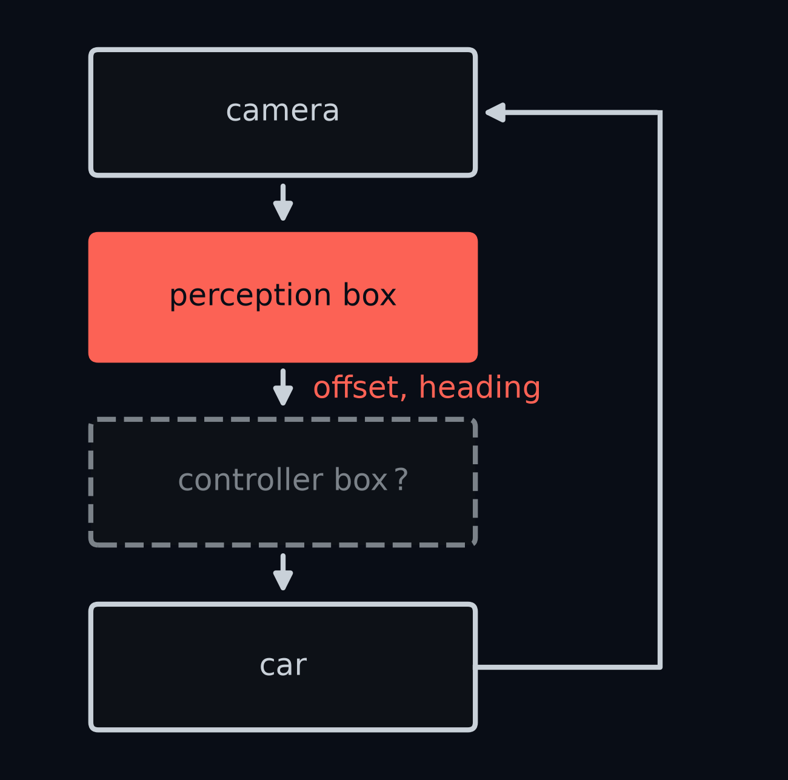

# Your first perception box

Picture the car 0.4 m to the left of the lane centre, its nose turned a little further left. The camera takes a picture, and the masks you wrote in *Images are arrays* mark every pixel of yellow paint and every pixel of white. Somewhere in those two masks is the answer to the question that lesson ended on: how far is the car from the lane centre, and which way does it point along the lane? The controller needs those two numbers twenty times a second, and a mask is not a number.

By the end of this lesson you will write `estimate_lane`, the second half of the perception box. It takes one camera frame and returns the two numbers. The lab checks it on 40 frames with the car placed off centre and turned, and then puts it in the car and drives the `gentle` loop on it.

Here is the finished box at work on that picture:

![Top: the camera frame with the car 0.4 m left of the lane centre and turned 0.05 radians to the left (radians are a unit for angles, explained in the next section). Two strips of rows are marked by dashed lines, one just ahead of the car and one further up, and a cross marks the middle of the yellow paint and of the white paint inside each strip. Bottom: the same moment seen from above. The four crosses have become four points on the road, a dot halfway between each pair marks the lane centre, and a straight line runs through those two dots back to the car. Where that line passes the car, and how it is tilted, give the box's answer: 0.39 m left of centre, turned 0.051 radians left. The truth is 0.40 m and 0.050 radians.](figures/box_result.png)

The rest of this lesson rebuilds that picture one step at a time.

## Two numbers for the controller

The first number you already know. In *Meet your car* you measured the **lateral error** $\color{#58C4DD}{e}$: how far the car's front axle is from the lane centre, sideways, with left positive. There the simulator told you $e$. The car has no simulator to ask: its perception box has only the camera frame, and must measure $e$ from the picture.

The box's measurement of $e$ is called the **offset**. A perfect box would report an offset equal to $e$ every time. In the picture above the car is at $e = +0.40$ m and the box reports an offset of +0.39 m. Keep the two names apart: $e$ is the truth, and the offset is what the box thinks.

The second number is about direction. A car exactly on the lane centre, $e = 0$, but with its nose turned toward the yellow line, is fine now and drifts left of centre as it rolls on. To see that coming, the box also reports the angle between the way the lane runs and the way the car points.

To say how big an angle is, this course uses radians, not degrees. Draw a circle around a point and turn through some angle: the turn sweeps out a curved piece of the circle, an **arc**. The angle in **radians** is the length of that arc divided by the circle's radius. On a circle of radius 1 m, an angle of 0.05 radians sweeps an arc 0.05 m long; on a circle of radius 10 m, the same angle sweeps 0.50 m. One radian sweeps an arc exactly as long as the radius.


A full turn sweeps the whole circle, whose length is $2\pi$ times the radius ($2\pi$, read "two pi", is 6.2832). So a full turn is 6.2832 radians, and since a full turn is also 360 degrees, one radian is $360 / 6.2832 = 57.3$ degrees. The short name is **rad**: 0.05 rad is 2.86 degrees.

Why radians? Because of the lower circle above: multiply a small angle in radians by a distance and you get, very nearly, a distance sideways. A car turned 0.05 rad to the left that rolls 10 m along the lane drifts about $0.05 \times 10 = 0.5$ m further left.

Now the symbol. The angle between the lane's direction and the car's direction is the **heading**, written $\color{#D147BD}{\psi}$, the Greek letter psi, read "sigh". It is positive when the car points to the left of the lane, because, as *Meet your car* said, left is positive everywhere in this course. The simulator knows the **true heading**; the box's estimate of it is **the box's heading**.


Your `estimate_lane` hands both numbers to the controller in a `LaneEstimate`: `offset_m` in metres and `heading_rad` in radians, both left positive. A `LaneEstimate` has a third field, `valid`, which gets its own section below. The provided controller box steers by the two numbers; you open it in *Closing the loop*. For now, all that matters is that it believes whatever the box tells it.

## Pixels are not metres

The box has to turn positions in the picture, rows and columns, into positions on the road, in metres. The obvious way is one scale for the whole picture: measure something of known size, and divide.

The lane is 3.6 m wide. With the car on the lane centre of the straight road, the middle of the yellow line and the middle of the white line are 190 columns apart in row 150. So one column is $3.6 / 190 = 0.0189$ m, about 1.9 cm. Now slide the car 0.5 m to the left, and watch the white line.

**Guess first:** in row 150, the white line moves about $0.5 / 0.0189 = 26.5$ columns. How far does it move in row 100, further up the picture?


**Answer:** 9.0 columns, about a third as far. Trust the single scale, and you would read row 100's shift as $9 \times 0.0189 = 0.17$ m, when the car moved 0.5 m. One scale for the whole picture is wrong by a factor of about three only 50 rows up, and the further up you look, the worse it gets.

The reason is perspective: the further away something is, the smaller it looks. Row 100 sees the road further ahead than row 150 does, so there the same 0.5 m spans fewer columns. Draw a grid of 1 m squares on the flat road and look at it through the car's camera:


So the box cannot use one scale. For every row, it needs to know how far ahead that row looks, and how many metres one column covers there. Both come from the camera's shape and position, and both need one tool from school maths: the link between a slope and an angle.

## Slopes and angles

A **slope** says how steep a line is: how far it moves one way for each step the other way, "rise over run". A line that climbs 0.5 m over a run of 10 m has a slope of $0.5 / 10 = 0.05$. A line can also fall: one that drops 0.5 m over 10 m has a slope of −0.05.

The same line has an angle, how far it is tilted from flat. Slope and angle carry the same information, and a function called the tangent converts one into the other. $\tan\theta$, read "tan theta", is the slope of a line tilted at the angle $\theta$ (theta, read "thee-ta", is the usual letter for an angle). Going the other way, $\arctan$, read "arc-tan", takes a slope and gives back the angle. In Python they are `math.tan` and `math.atan`, in NumPy `np.tan` and `np.arctan`, and all of them work in radians.

**Worked example.** The car of the last section is turned 0.05 rad left and rolls 10 m along the lane. Its path is tilted 0.05 rad from the lane, so its slope is $\tan 0.05 = 0.05004$, and after 10 m it has moved $10 \times 0.05004 = 0.5004$ m to the left. The slope and the angle are almost the same number, as the radian promised.

That is no accident. For a small angle in radians, the slope and the angle are nearly equal. The match fades as the angle grows:


Up to 0.15 rad, the largest heading the lab's Exercise A tests, the slope and the angle differ by at most 0.00114. You will use both directions: $\tan$ to find where a camera's line of sight meets the road, and $\arctan$ to turn the lane's slope into the car's heading.

## The horizon

The simulator's camera is a **pinhole camera**, the simplest model of a camera: all the light that makes the picture passes through one point, the pinhole, and each pixel sees along one straight line through that point, its **ray**. The camera sits on the front axle, 1.4 m above the road. Call that height $h$. It is tipped down by 5 degrees, its **pitch**, which in radians is $p = 0.0873$ rad.

The middle of the picture lies between pixels, at column 159.5 and row 89.5: half of 319 and half of 179. The ray through the middle is the camera's **axis**, the direction it faces. Every other ray leans away from the axis, and the further its pixel is from the middle, the more it leans.

How much it leans is set by one number, the **focal length** $f$: the distance from the pinhole to the picture, measured in pixels. Picture the frame as a screen standing $f$ pixels in front of the pinhole. A pixel $n$ rows below the middle sees along a ray that drops $n$ for every $f$ it runs forward, a slope of $n / f$, so the ray leans $\arctan(n / f)$ below the axis. For this camera, $f = 160$ pixels.


<details>
<summary>How we got f = 160</summary>

The camera's view spans 90 degrees from the left edge of the picture to the right edge, so 45 degrees each side of the axis. The picture's edge is 160 pixels from the middle: the outer edge of column 319 is at 319.5, and $319.5 - 159.5 = 160$. A ray 160 pixels out leans 45 degrees, and a 45-degree line has a slope of exactly 1, so

$$\begin{aligned}\tan 45^\circ &= 160 / f\\ 1 &= 160 / f\\ f &= 160\end{aligned}$$

Pixels are square, so the same $f$ holds for rows.

</details>

On flat ground, where is the horizon? A ray that sees the horizon runs level, parallel to the road, and never meets it. The camera's axis points 5 degrees down, so the level ray leans 5 degrees *above* the axis.

**Guess first:** the middle row is 89.5. Is the horizon above it in the picture or below it, and by how many rows?


**Answer:** above it, by 14 rows. The level ray leans 5 degrees above the axis, a slope of $\tan 5^\circ = 0.0875$, so it belongs to a pixel $160 \times 0.0875 = 14.00$ rows above the middle: row $89.5 - 14.00 = 75.5$. Every row above that sees sky, which is why *Images are arrays* found rows 0 to 75 all sky. Rows 76 to 78 see ground more than 70 m ahead, but the simulator draws only the first 70 m of road, which ends at row 78.72; so those rows show grass, and the road starts at row 79.

## Rows are distances

Now take a row below the horizon. Its ray leans below the axis by the arctan of its distance from the middle row over $f$, and the axis itself already leans 5 degrees down. Add the two and you have how steeply the ray points at the road, its angle below level, $\theta$.

A right triangle finishes the job. The ray starts 1.4 m up and meets the road some distance $d$ ahead. Over that run of $d$ it drops 1.4 m, so its slope is $\tan\theta = 1.4 / d$, and $d = 1.4 / \tan\theta$.


**Worked example: row 150.** It is $150 - 89.5 = 60.5$ rows below the middle.

$$\begin{aligned}
60.5 / 160 &= 0.3781\\
\arctan 0.3781 &= 0.3615\\
\theta &= 0.3615 + 0.0873\\
&= 0.4488 \text{ rad}\\
\tan 0.4488 &= 0.4815\\
d &= 1.4 / 0.4815\\
&= 2.907 \text{ m}
\end{aligned}$$

Row 150 sees the road 2.907 m ahead of the front axle, and its ray points 0.4488 rad, 25.7 degrees, below level. In symbols, with $v$ for the row number (the course's code calls rows $v$ and columns $u$) and $c_y = 89.5$, read "c-y", for the middle row:

$$\begin{aligned}
\theta &= p + \arctan\frac{v - c_y}{f}\\
d &= \frac{h}{\tan\theta}
\end{aligned}$$

Every row below the horizon sees the road at one distance ahead: **a row is a distance**. That holds across the whole row, not only in the middle column. `camera.pixel_to_ground(u, v)` turns a pixel into a point on the road, and for column 0, column 159.5 and column 319 of row 150 it gives the same 2.907 m ahead. The rays to the edges are longer, because they also travel 3.0 m sideways, but they land the same distance ahead.

Careful: `pixel_to_ground(u, v)` takes the column first and the row second, the opposite order from `frame[row, column]`. Swap them and you get the wrong point, or NaN (a "no number" value, explained in "What valid=False is for"), with no error message.

<details>
<summary>Optional: why a whole row lands at one distance</summary>

The rays of one row all lie in one flat sheet that fans out sideways from the pinhole, tipped down at the row's angle. A flat sheet meets the flat road along a straight line. The sheet is tipped forward, not sideways, so that line runs straight across the road, square to the car, and every point on it is the same distance ahead.

</details>

**Guess first:** rows 179 to 150 cover 0.85 m of road, from 2.06 m to 2.91 m ahead. How much road do rows 150 to 80 cover?


**Answer:** 47 m, from 2.91 m out to 50.06 m. Of the 104 rows below the horizon, 60 (58%) see the road within 5 m of the car and 82 within 10 m. Neighbouring rows at the bottom of the picture see points 2 cm apart (2.1 cm, between rows 178 and 179); around row 100 they are 39 cm apart, and around row 80, 14.3 m apart. A box that wants precise positions should look near the car. Hold on to that; it decides which rows the box uses.

## Metres per pixel

Now the columns. Within one row the road lies at one distance ahead, and the row's 320 columns spread sideways across it. How much road does one column cover?

Use the screen picture again, seen from above this time. A road point $x$ metres to the left and about $d$ metres ahead sits on a ray of slope $x / d$, so it lands $f \times x / d$ columns from the middle column. One column is therefore about $d / f$ metres of road. In row 150 that is $2.907 / 160 = 0.0182$ m; in row 100, which sees 9.09 m ahead, it is $9.091 / 160 = 0.0568$ m. That is the whole story of the slide: row 100 sees about three times as far ahead as row 150, so each of its columns covers about three times as much road, and the same 0.5 m spans about a third as many columns.

**Approximation.** The rule $d / f$ is slightly low. The exact width uses the point's distance from the camera along its tipped axis, $Z$, which is a little more than $d$, and is $Z / f$: 0.01886 m in row 150, where $d / f$ falls 3.7% short, and 0.05737 m in row 100, where it falls 1.0% short.

<details>
<summary>How we got Z for row 150</summary>

$Z$ is how far the road point lies in front of the camera, measured along the camera's axis. The axis tips down by $p$, so for a point $d$ ahead on the road and $h$ below the camera, $Z = d\cos p + h\sin p$. Here cos and sin, read "cosine" and "sine", are tan's two partners from school trigonometry; for $p = 5^\circ$, $\cos p = 0.9962$ and $\sin p = 0.0872$.

$$\begin{aligned}
d &= 2.9073\\
Z &= 2.9073 \times 0.9962\\
&\quad + 1.4 \times 0.0872\\
&= 2.8963 + 0.1220\\
&= 3.0183 \text{ m}\\
Z / f &= 0.01886 \text{ m}
\end{aligned}$$

</details>


With the exact widths, the slide predicts $0.5 / 0.01886 = 26.5$ columns in row 150 and $0.5 / 0.05737 = 8.7$ in row 100. The measured shifts were 26.5 and 9.0; in row 100 the white line is only 5 pixels wide and is drawn in whole pixels, so its middle can only land near the prediction. (In row 150 the painted lines were 190 columns apart, where the figure says 191: the renderer draws in whole pixels.)

You never do this sum by hand in code. `camera.pixel_to_ground(u, v)` does both steps exactly, row to distance and column to sideways metres, and returns `(forward, left)`: metres ahead of the front axle, and metres to the left, with right negative. Column 0 of row 150, the picture's left edge, gives left +3.009 m, and column 319 gives −3.009 m.


Mapping the picture onto the road like this, a top-down view of where every pixel lands, is the first half of the box.

## Two bands of rows

The box now knows where any pixel lies on the road. Which pixels should it use? Two needs pull in opposite directions.

To measure where the lane is beside the car, look near: the bottom rows see the road closest, where one column covers only 1 to 3 cm. To measure which way the lane runs, you need a second place along it, as far from the first as you can manage, because a direction measured between two points far apart is steadier than one measured between two points close together. But far rows are coarse: in row 95 one column covers 7.2 cm, and neighbouring rows are 63 cm apart.

The provided box settles it with two **bands**, blocks of neighbouring rows:

- the **near band**, rows 125 to 179, which sees the road 2.06 to 4.44 m ahead;
- the **far band**, rows 95 to 115, which sees it 5.59 to 11.45 m ahead.

In the code they are `NEAR_ROWS = (125, 180)` and `FAR_ROWS = (95, 116)`: a start and a stop, with the stop left out, as in a slice from *Images are arrays*.

Why a band and not a single row? The yellow line is dashed: 3.5 m of paint, then a 1.5 m gap.

**Guess first:** could a gap in the yellow line ever swallow a whole band, so that the band holds no yellow paint at all?


**Answer:** no. Each band covers more road than a gap does: the near band 2.38 m and the far band 5.86 m, against a 1.5 m gap. However the dashes fall, some paint is always inside each band. Rendering a frame with the car centred every half metre around `gentle` and along `curvy`, and every 10 cm along 10 m of `straight`, the fewest yellow pixels the near band ever held was 113 and the far band 46. A single row, by contrast, can fall into a gap: in the opening picture, rows 125 to 136 hold no yellow paint at all.

## From paint to ground points

Take one band and one line: the yellow paint in the near band of the opening picture, with the car 0.4 m left of centre and turned 0.05 rad left.

First, find its pixels. `np.nonzero(mask)` says where a mask is `True`, as two arrays: the row of every `True` pixel, and its column. They come back in the same (row, column) order as `frame[row, column]`:

```python
rows, cols = np.nonzero(yellow[125:180])  # the near band only
rows = rows + 125                         # back to image rows
```

The slice numbers its rows from 0 again, so its row 0 is image row 125; adding 125 puts them back. The near band of the opening picture holds 553 yellow pixels, in rows 137 to 179.

Second, find the middle of the patch, its **centroid**: the mean column and the mean row of its pixels, `cols.mean()` and `rows.mean()`, with the `.mean()` you used in *Meet your car*. For the near yellow paint that is column 83.02, row 159.85.

Third, put the centroid on the road: `camera.pixel_to_ground(83.02, 159.85)` gives forward 2.553 m, left +1.274 m.


Why the centroid? The paint is a thin stripe, and the middle of a thin straight stripe lies on the stripe's centre line. The simulator knows where the true yellow line is: 2.553 m ahead of the car it is at left +1.2740 m. The centroid's point is at +1.2742 m, 0.2 mm away. The near white paint, 543 pixels, gives the point forward 2.866 m, left −2.334 m, which is 1.2 cm from the true white line. That one is a little worse because near the bottom of the picture the white line runs off its right edge: rows 178 and 179 hold no white at all, so the stripe is cut off at a slant.

The lane centre is halfway between the two lines, so the box takes the point halfway between the yellow point and the white point. This is the **lane-centre point**. Call its distance ahead $d_1$ (read "d-one") and its distance to the left $c_1$ ("c-one"), with the 1 for the near band:

$$\begin{aligned}
d_1 &= \tfrac{2.553 + 2.866}{2}\\
&= 2.710 \text{ m}\\
c_1 &= \tfrac{1.274 - 2.334}{2}\\
&= -0.530 \text{ m}
\end{aligned}$$

The near lane-centre point is 2.710 m ahead and 0.530 m to the right of the car. But the yellow and white points are at different distances ahead, 2.553 m and 2.866 m. Is the point halfway between them really on the lane centre? Yes, as long as the two lines are parallel, and near the car on a straight road they are.

<details>
<summary>How we know the halfway point lies on the lane centre</summary>

Describe each line near the car by where it is sideways at each distance ahead $d$. Two parallel lines have the same slope $b$ and different starting points, $a_Y$ and $a_W$ (read "a-Y" and "a-W"): the yellow line is at $a_Y + b\,d$ and the white line at $a_W + b\,d$. The lane centre, halfway between them, is at $\tfrac{a_Y + a_W}{2} + b\,d$.

Take a yellow point at distance $d_Y$ and a white point at $d_W$. The point halfway between them is $\tfrac{d_Y + d_W}{2}$ ahead, and sideways it is at

$$\begin{aligned}
&\tfrac12(a_Y + b\,d_Y\\
&\quad + a_W + b\,d_W)\\
&= \tfrac{a_Y + a_W}{2}\\
&\quad + b\,\tfrac{d_Y + d_W}{2}
\end{aligned}$$

which is exactly where the lane centre is at that distance. The two points never needed to be the same distance ahead.

Check it on the picture: the true lane centre 2.710 m ahead is at left −0.5361 m, and the box's point is at −0.5300 m, 6 mm away. That is half of the white point's 1.2 cm.

</details>

The far band does the same with fewer pixels, because the paint looks thinner further away. Its 99 yellow pixels give the road point (7.053, +1.048), and its 104 white pixels give (7.325, −2.567). Halfway between them is the far lane-centre point, $d_2 = 7.189$ m ahead and $c_2 = -0.759$ m to the left.


## From masks to a lane estimate

Two points make a line. The box assumes the lane centre near the car is straight, and draws a line through the two lane-centre points. Its slope is rise over run, here the change sideways over the change forward ($c_2 - c_1$ reads "c-two minus c-one"):

$$\begin{aligned}
\text{slope} &= \frac{c_2 - c_1}{d_2 - d_1}\\
&= \frac{-0.759 + 0.530}{7.189 - 2.710}\\
&= -0.2295 / 4.479\\
&= -0.0512
\end{aligned}$$

The numerator is −0.2295 before the two points are rounded to −0.759 and −0.530, which is why the line shows −0.229. The slope is negative: for each metre ahead, the lane centre moves 0.0512 m further to the right.

**Carry the line back to the car.** The near point is 2.710 m ahead, and the car's front axle is at 0 m ahead. Walking back along the line those 2.710 m moves it $2.710 \times 0.0512 = 0.139$ m to the left, since a line that falls to the right going forward rises going back. Call the line's sideways position at the car $c_0$:

$$\begin{aligned}
c_0 &= c_1 - \text{slope} \times d_1\\
&= -0.530 + 0.139\\
&= -0.391 \text{ m}
\end{aligned}$$

**First sign flip.** $c_0$ says where the lane centre is, seen from the car: 0.391 m to the right. The offset says where the car is, seen from the lane centre: 0.391 m to the left. It is the same distance in the opposite direction, so the offset is $-c_0 = +0.391$ m.

**Second sign flip.** The slope says which way the lane runs, seen from the car: tilted $\arctan(-0.0512) = -0.0512$ rad, to the right. The heading is the car's direction seen from the lane, the reverse, so the box's heading is $-\arctan(\text{slope}) = +0.0512$ rad.

The truth was $\color{#58C4DD}{e} = +0.400$ m and $\color{#D147BD}{\psi} = +0.050$ rad. Unrounded, the box says +0.3911 m and +0.0512 rad: 9 mm short on the offset, and 0.0012 rad over on the heading.

<details>
<summary>Optional: where the 9 mm comes from</summary>

The near lane-centre point sits 6.1 mm left of the true lane centre (−0.5300 m against −0.5361 m), and the far point 0.8 mm left (−0.7595 against −0.7603). Carrying the line back stretches the near point's error, because the car is on the near point's side: the line pivots about points 2.710 m and 7.189 m ahead, 4.479 m apart, and the car is 7.189 m from the far one.

$$\begin{aligned}
&0.0061 \times \tfrac{7.189}{4.479}\\
&\quad - 0.0008 \times \tfrac{2.710}{4.479}\\
&= 0.0093 \text{ m}
\end{aligned}$$

So the box's line crosses the car at −0.3911 m instead of the true −0.4005 m. That true crossing is 0.5 mm more than $e$ because the box measures straight across the car's own front axle, and the car is turned 0.05 rad, so the axle meets the lane centre slightly further out than the square-on distance $e$.

</details>


The whole box is four steps:

1. **Masks.** `yellow, white = paint_masks(obs.frame)`, with your function from *Images are arrays*.
2. **Road points.** For each band and each line: the pixels with `np.nonzero`, the rows moved back by the band's start, the centroid, and `pixel_to_ground`.
3. **Lane-centre points.** In each band, halfway between the yellow point and the white point: $(d_1, c_1)$ near, $(d_2, c_2)$ far.
4. **The line.** The slope, then offset $= -(c_1 - \text{slope} \times d_1)$ and heading $= -\arctan(\text{slope})$, returned as `LaneEstimate(offset, heading, True)`.

How good must it be? The lab's Exercise A renders 40 frames on straight stretches of road, with the car up to 1 m off centre and up to 0.15 rad turned. It passes your box if at least 36 of them (90%) come within 0.25 m of the true $e$ and within 0.05 rad of the true heading. For a yardstick: the provided box's worst frame of the 40 is 0.022 m and 0.0041 rad out, so the tolerance is 11 to 12 times its worst error, and a lazy box that always answers 0 and 0 gets only 3 of the 40 frames right.

Two slips are easy to make, and both cost.

**Guess first:** suppose you forget to carry the line back, and report how far the near lane-centre point is to the side, $-c_1$, as the offset. For the opening picture that gives 0.530 m instead of 0.391 m. How many of the 40 frames still pass?


**Answer:** 22, short of the 36 needed. On the opening picture the slip puts the offset 0.13 m from the truth, and its size depends on the heading, not on the offset: the near point is about 2.7 m ahead, and a car that is turned is further from the lane centre there than at its axle. Turned 0.15 rad, that is enough to break the tolerance. The second slip is forgetting the heading's minus sign: only 8 of the 40 frames pass, the 8 in which the car is turned less than 0.025 rad, where the error, twice the heading, still fits inside 0.05 rad.

One shortcut does not cost on these frames: using the slope itself as the heading, without the arctan, passes all 40, because up to 0.15 rad the two differ by at most 0.00114. Use the arctan anyway; at 0.6 rad they differ by 0.084.

## What valid=False is for

Turn the car 0.6 rad (34.4 degrees) to the left on the straight road and look again.


With no white paint in the near band, there is no near lane-centre point, and no line. The box could still return 0 and 0, but that says "centred and pointing straight down the lane" about a car turned 0.6 rad. The honest answer is "I cannot see the lane", and that is what `valid` is for. When either line has fewer than 3 pixels (`MIN_PIXELS`) in either band, the box returns:

```python
LaneEstimate(math.nan, math.nan, False)
```

`math.nan` is **NaN**, read "not a number": a special decimal value that means "no number here". Any arithmetic with NaN gives NaN again, so a missing measurement cannot pass for a real one later on.

How far can the car turn before the box goes blind? Turned in steps of 0.01 rad on the straight road, the box first returns `valid=False` at 0.53 rad (30.4 degrees), either way. At 0.6 rad, turned left it has lost the white line in the near band; turned right, the yellow.

The provided controller holds the wheel straight, a steering angle of 0, whenever `valid` is False. It also steers 0 for an estimate of exactly 0 and 0, so with this one controller the two answers happen to drive the same. That is luck, not a reason to report 0 and 0: anything else that reads the box, another controller or a log of the drive, would be told something false. On `gentle` the question never comes up: all 1,778 frames of a lap are valid.

## Straight roads only

Exercise A tests the box on straight stretches only. The roads have bends.

**Guess first:** put the car exactly on the lane centre, pointing exactly along the lane, in a left bend of `gentle`. A box that knew the truth would say 0 and 0. What does this box say?

![The box's answers for a car placed exactly on the lane centre and pointing along the lane, 40 frames on each road, each frame a dot at its offset (across) and heading (up). The grey rectangle is Exercise A's tolerance, 0.25 m and 0.05 rad. The 40 dots from straight sit at zero. The 40 from the left bends of gentle cluster at +0.13 m and −0.065 rad, every one below the rectangle, its heading past the 0.05 rad limit. The dots from curvy land much further out: near +0.5 m and −0.25 rad on its left bends, and near −0.65 m and +0.31 rad on its right bends.](figures/centred_errors.png)

**Answer:** on the left bends of `gentle` the box says the car is 0.13 m left of centre (median +0.129 m) and pointing 0.065 rad to the right (median −0.0645 rad), when it is centred and pointing along the lane. Not one of the 40 frames is within Exercise A's 0.05 rad. On `straight`, every answer is within 0.010 m and 0.0021 rad of zero.

This is not noise. Noise, as *Images are arrays* showed, changes from pixel to pixel and frame to frame. This error is nearly the same in every frame of a bend (offsets from +0.113 to +0.160 m), and it flips sign when the bend does. In *Meet your car*, a car's **bias** was the side it favours on average. A box can have a bias too: an error that leans the same way every time in the same situation. This one has a single cause.

On a bend the lane centre is not a straight line but part of a circle, and both lane-centre points lie on that circle. A straight line through two points on a circle is a **chord**, and a chord cuts across the inside of the curve. Carried back to the car, the chord passes to the car's right, on the outside of a left bend; so the box decides the lane centre is to the car's right, and the car is to its left, and that the lane turns left, so the car points right. On a left bend, the box says "left of centre, pointing right".


How big is it? It depends on how quickly the circle curves away from straight ahead. A circle of radius $R$ that runs straight ahead past the car curves away from that straight line by about $d^2 / (2R)$ at $d$ metres ahead.

<details>
<summary>How we got d² / (2R)</summary>

Put the circle's centre $R$ to the car's left, so that the circle passes through the car heading straight ahead. A point on the circle $d$ ahead has curved some distance $y$ to the left. The point is $R$ from the centre, and it sits $d$ ahead and $R - y$ across from it, so by Pythagoras

$$\begin{aligned}
d^2 + (R - y)^2 &= R^2\\
d^2 + R^2 - 2Ry + y^2 &= R^2\\
d^2 - 2Ry + y^2 &= 0\\
2Ry &= d^2 + y^2\\
y &\approx d^2 / (2R)
\end{aligned}$$

The last step drops $y^2$, which is tiny next to $d^2$ this close to the car. **Approximation check:** for the lane centre of `gentle`, $R = 81.8$ m, and 7.2 m ahead the exact curve is 0.3175 m and $d^2 / (2R)$ is 0.3169 m.

</details>

So the near point is at $d_1^2 / (2R)$ and the far point at $d_2^2 / (2R)$, both to the left. The chord through them has

$$\begin{aligned}
\text{slope} &= \frac{d_2^2 - d_1^2}{2R\,(d_2 - d_1)}\\
&= \frac{d_1 + d_2}{2R}
\end{aligned}$$

because $d_2^2 - d_1^2 = (d_2 - d_1)(d_2 + d_1)$, a difference of two squares. Carried back to the car, the chord's $c_0$ is $d_1^2 / (2R) - \text{slope} \times d_1$, which works out to $-d_1 d_2 / (2R)$. Put those through the two sign flips:

$$\begin{aligned}
\text{offset} &\approx \frac{d_1 d_2}{2R}\\
\text{heading} &\approx -\arctan s\\
s &= \frac{d_1 + d_2}{2R}
\end{aligned}$$

**Worked example: gentle.** The road's yellow line bends with a radius of 80 m, and the car's lane, the right-hand one, runs 1.8 m outside it on a left bend, so the lane centre's radius is $R = 81.8$ m. With $d_1 \approx 2.7$ m and $d_2 \approx 7.2$ m:

$$\begin{aligned}
\text{offset} &\approx 19.44 / 163.6\\
&= 0.119 \text{ m}\\
\text{heading} &\approx -\arctan\tfrac{9.9}{163.6}\\
&= -0.0604 \text{ rad}
\end{aligned}$$

The box measured +0.129 m and −0.0645 rad. With the lane-centre points' real average distances in those frames, 2.790 m and 7.350 m, the formula gives 0.125 m and −0.0619 rad, within 4% of the measurements.


**Approximation.** The formula assumes each lane-centre point sits exactly on the lane centre. On a bend the far point sits 1.8 cm inside it on `gentle` and 8 to 13 cm on `curvy`: the paint itself curves, and the middle of a curved stripe lies inside the curve. So on `curvy`, whose lane centre has a radius of 21.8 m on left bends and 18.2 m on right bends, the offset is 9% to 15% above the formula: 0.504 m against 0.461 m on the left bends, 0.650 m against 0.566 m on the right. Part of the gap is the formula's own shortcut: on a 21.8 m circle the exact chord through points 2.73 m and 7.36 m ahead passes 0.482 m to the car's right (the chord figure), not 0.461 m. The rest is the far point's 8 cm.

A straight road is a circle too big to curve: as $R$ grows without limit, both formulas shrink to 0. That is why Exercise A tests on straight stretches only, and why this section has its name.

## Swap your perception into the car

Now put your box in the car. In the lab's Exercise B, `Car(perception=estimate_lane)` builds the provided car with your function in place of its perception box; the provided controller still steers. The check drives the `gentle` loop and passes if the car finishes it with a mean $|\color{#58C4DD}{e}|$ under 0.5 m.

What to expect: a box built as above finishes the lap in 1,778 steps, 88.85 s, with every frame valid, a mean $|e|$ of 0.376 m and a largest $|e|$ of 0.533 m. That is the lap you scored in *Meet your car* (0.38 m, at most 0.53 m), because it is the same box.


On the straights the box is right to within 4 mm (median). In the bends its offset is 0.13 m above the truth, exactly the chord bias of the last section, and the car rides on the inside of the bend, a median $e$ of +0.53 m. How much of that is the box's fault?

To find out, change only the box. A **perfect box** reads $e$ and $\psi$ straight from the simulator. No real car has one; here it is a yardstick. Same road, same seed (the seed, the number that starts the camera's random pixel noise, so the same seed gives exactly the same noisy pictures, and so the same run), same speed of 8 m/s, same provided controller: only the box differs.

**Guess first:** with the perfect box, does the mean $|e|$ on `gentle` drop a little, or a lot?


**Answer:** a lot, from 0.376 m to 0.113 m, 3.3 times smaller, with the same controller. The straights barely change (0.021 m against 0.009 m); nearly all of the difference is on the bends (0.515 m against 0.154 m). On `curvy` the box decides whether the car finishes at all. With the two-band box the car leaves the lane 48.3 m into the 218.5 m route, after 6.10 s: the failure you measured in *Meet your car*. With the perfect box, the same controller drives the whole of `curvy`, at a mean $|e|$ of 0.348 m. The chord bias, not the controller alone, puts the provided car off `curvy`.

Even with perfect numbers, the car rides 0.16 m inside the bends of `gentle` (median). That part belongs to the controller. **Placeholder:** why a controller given the truth still cuts the inside of a bend is a question for *Closing the loop*.

One last experiment shows how much the controller trusts the box. A teammate reads `estimate_lane` and decides the offset should say where the lane centre is, seen from the car. So they return $c_0$ instead of $-c_0$: one minus sign.

**Guess first:** `gentle` starts with the car on the lane centre. Does the car with the flipped box leave the lane at once, wobble around the centre, or drift away slowly and then fast?


**Answer:** slowly, then fast. A drift of about 1 cm in the first second is reported on the wrong side, so the controller steers the wrong way, the error grows, and the bigger error earns a bigger wrong push. From 2 s on, every half second the error is 1.8 to 1.9 times what it was. This is **positive feedback**: a loop in which each correction feeds the error instead of shrinking it. It ends at 5.00 s, 39.9 m in, with the car across the white line. Flip the heading's sign instead and the car is off the road sooner, at 2.70 s and 21.1 m. The lab's "Break it, fix it" hands you that teammate's code.

## Recap

- A row is a distance: $d = h / \tan\theta$, with $\theta$ the pitch plus $\arctan$ of the row's distance from the middle over $f$. A column covers about $d / f$ metres sideways, so the further up the picture, the more road each pixel covers. `pixel_to_ground(u, v)` does both exactly.
- The box finds each line's centroid in a near band and a far band, puts it on the road, takes the halfway points as two lane-centre points, and draws a line through them: offset $= -(c_1 - \text{slope} \times d_1)$, heading $= -\arctan(\text{slope})$. With a line missing from a band it says so, `valid=False`.
- On a bend the line is a chord, and the box is biased "left of centre, pointing right" on a left bend: 0.13 m and 0.065 rad on `gentle`. With the same controller, a perfect box cuts the lap's mean $|e|$ from 0.376 m to 0.113 m, and a flipped sign is positive feedback that drives the car off the road in 5 s.



Your box now hands the controller two numbers, offset and heading, twenty times a second. The provided controller turned them into a steering angle with two numbers of its own, and you have not looked inside it yet. How should two measurements become one steering command, and how hard should the car turn?

That is the next lesson, *Closing the loop*.

## Challenge problems

### Challenge: a box that sees the bend

The chord bias comes from drawing a straight line through a lane that curves, so let the box draw a curve instead. This one is hard, and everything you need is in this lesson.

Describe the lane centre, seen from the car, by where it is sideways at each distance $d$ ahead: $c(d) = a + b\,d + k\,d^2$. A curve with a $d^2$ term like this is a **parabola**.


1. A car is centred on a left bend of radius $R$, pointing along the lane. Show that $a = 0$, $b = 0$ and $k \approx 1 / (2R)$. (Use the circle from "Straight roads only".)
2. A car is at $e$ with heading $\psi$ on a straight road. Show that $a \approx -e$ and $b = -\tan\psi$. So the curve box reports offset $-a$ and heading $-\arctan b$, as the line box did, while on a bend the $k\,d^2$ term carries the curve.
3. Three points fix a parabola. Use three bands: rows 125 to 179 (2.06 to 4.44 m ahead), rows 106 to 124 (4.53 to 7.28 m) and rows 95 to 105 (7.53 to 11.45 m). Find a lane-centre point in each, and fit with `np.polyfit(ds, cs, 2)`. Mind the order it returns: $(k, b, a)$, the $d^2$ term first.
4. Predict before you run: on `gentle`, will its mean $|e|$ land nearer the perfect box's 0.113 m or the two-band box's 0.376 m?

<details>
<summary>What a working curve box measures (open after trying)</summary>

- Centred and pointing along the lane, 40 frames per road: on `straight`, median 0.009 m and 0.0037 rad; on `gentle`'s bends, 0.011 m and 0.0045 rad, against the two-band box's 0.129 m and 0.0645 rad; on `curvy`, 0.074 m and 0.0394 rad.
- Exercise A's 40 frames: all 40 pass, worst 0.056 m and 0.0212 rad. The opening picture: +0.3987 m and +0.0475 rad.
- In the car, same road, seed, speed and controller: on `gentle` a mean $|e|$ of 0.119 m, next to the perfect box's 0.113 m; on `curvy` it finishes the route, at 0.420 m, where the two-band box left the lane.
- The curve also measures the bend: $1 / (2k)$ comes out at 78.4 m on `gentle`'s bends, whose lane centre has $R = 81.8$ m.
- The third point alone is not the fix. A straight line fitted through the same three points does worse than the two-band box: 0.173 m and 0.0734 rad on `gentle`. It is the curve that removes the bias.

</details>

### Challenge: how far ahead should the far band look?


A centroid can easily be a column off. In the opening picture the far lane-centre point is at row 106.4, where one column covers 0.0455 m of road, and the near point is at row 155.2, where it covers 0.0176 m. The two points are 4.479 m apart.

1. How much does a one-column mistake at the far point change the box's heading? At the near point?
2. Now move the far point to $d_2$ metres ahead, keeping $d_1 = 2.71$ m. Using one column $\approx d_2 / f$, show that a one-column mistake there changes the heading by about $d_2 / (f\,(d_2 - d_1))$. What does that approach as $d_2$ grows?
3. On a left bend of `gentle` the chord also tilts the heading, by $\arctan\frac{d_1 + d_2}{2R}$ with $R = 81.8$ m. Compare the two errors with the far point at 7.19 m and at 11.45 m. Where should the far band look on `straight`, and where on `gentle`?

<details>
<summary>Answer (open after trying)</summary>

1. The slope changes by the sideways move over the run: $0.0455 / 4.479 = 0.0102$, and for a small angle the heading changes by the same, 0.0102 rad. At the near point, $0.0176 / 4.479 = 0.0039$ rad. The far point's columns are wider, so its mistakes cost about 2.6 times as much.
2. The far point moves $d_2 / f$ sideways over a run of $d_2 - d_1$. As $d_2$ grows, $d_2 / (d_2 - d_1)$ shrinks toward 1, so the cost approaches $1 / f = 0.00625$ rad per column and never goes below it: 0.0100 rad at 7.19 m (0.0102 with the exact column width), 0.0082 at 11.45 m, 0.0072 at 20 m and 0.0066 at 50 m. Looking further helps, less and less.
3. At 7.19 m the chord tilts the heading by 0.0604 rad, against 0.0102 per column. At 11.45 m it is 0.0863 rad, against 0.0082. Moving out saves 0.002 rad per column of mistake and adds 0.026 rad of bias. On `straight`, where there is no bias, look far, as long as the paint still gives the centroid enough pixels. On `gentle`, the bias wins and looking near is better, until a curve box like the one above removes the bias.

</details>
