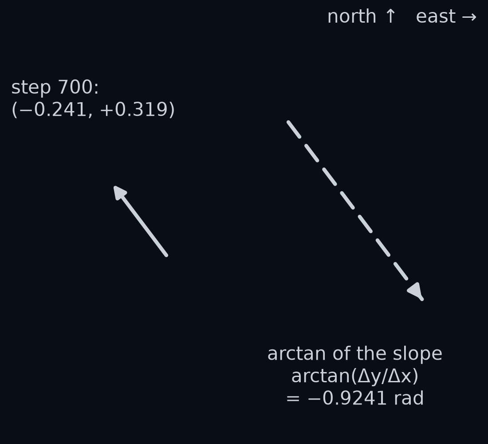
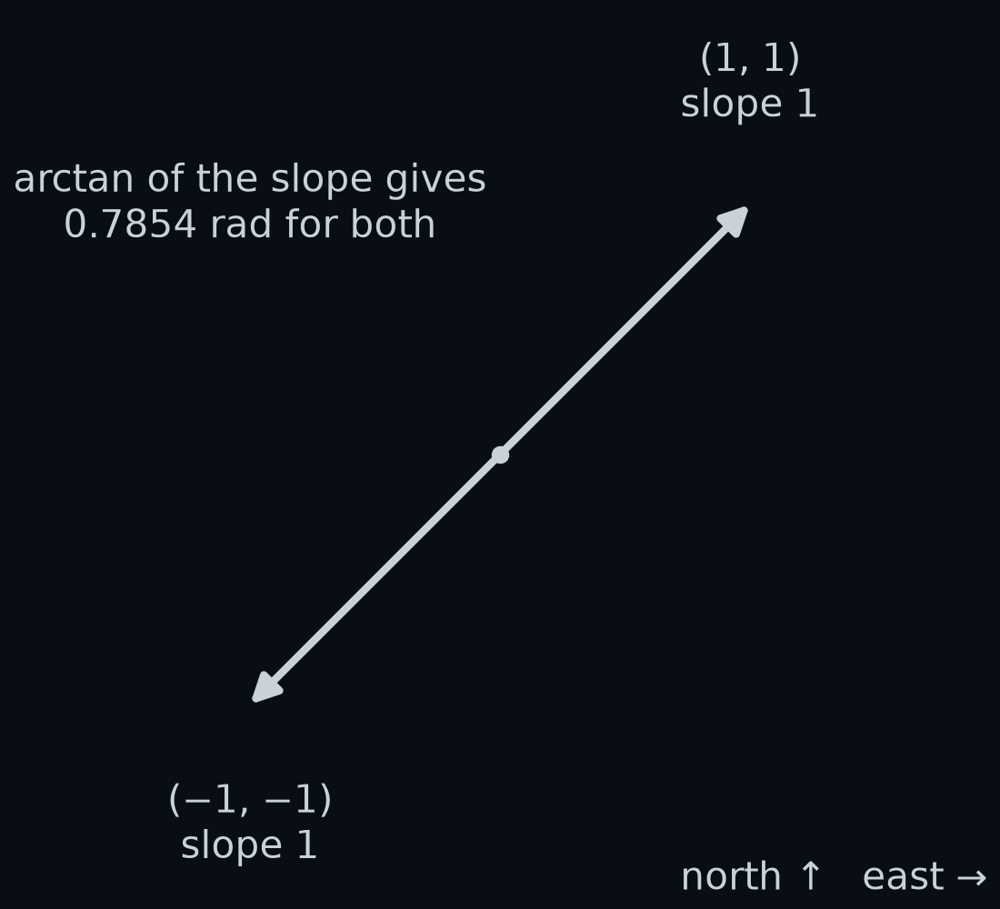
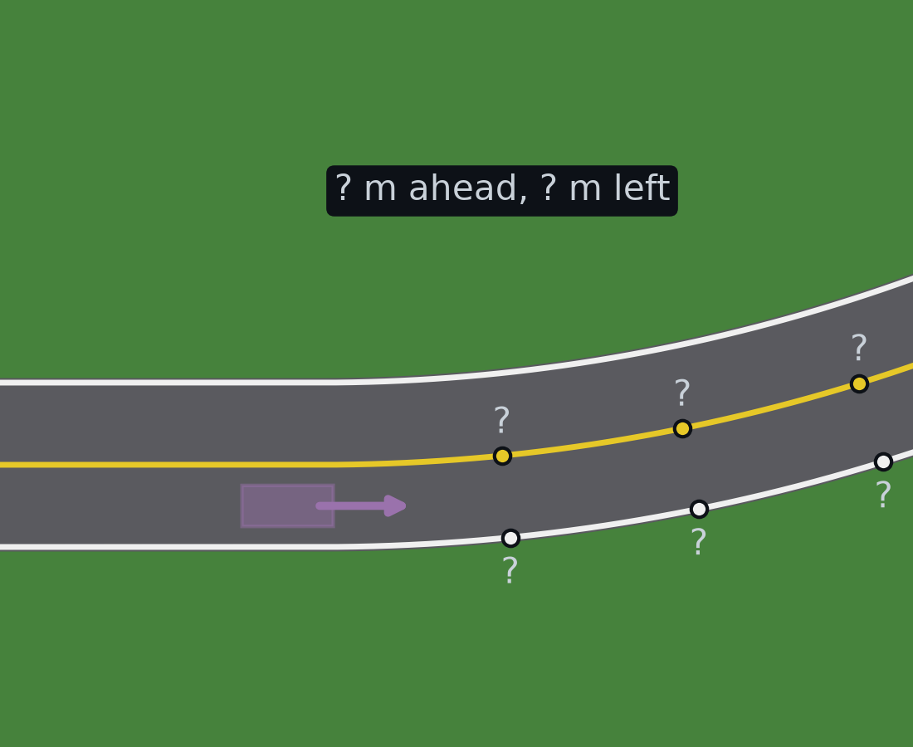

# Positions and headings

*Closing the loop* ended on a question: how do you move a point from one frame to another? In Week 1 a camera frame, and `obs.frame`, meant one picture. In this module a frame is a set of axes: a starting point and the directions you measure along from it. This lesson and the four after it answer the question. Start with the smallest version of it, from driving.

The car is on `gentle`'s first bend. Its GPS, the receiver that reports where the car is, gives you two positions one step apart. A cone stands on the grass to the right of the road. Which way is the car pointing, and how far ahead of it and how far to its left is the cone?

By the end of this lesson you will answer both questions with four short functions of your own, `heading_vector`, `direction_angle`, `wrap_angle` and `forward_left`, and you will know the trap each one avoids. The rest of this module builds on them.

Those two numbers, how far ahead and how far to the side, come from the car's logged position and yaw, the cone's position, and a few lines of arithmetic. The simulator plays the GPS: the telemetry columns `tel.x` and `tel.y` give the front axle's position at every step, exact to the last digit, like a perfect GPS. A real GPS is off by a little at every reading; the Challenge problems at the end deal with that.

## Points and arrows

To say where something is, you need a fixed starting point and two directions to count along. The simulator's choice is called the **world frame**. Its starting point, the **origin**, is where the road begins. Its x direction is the road's first direction, and its y direction is a quarter turn to the left of that. A position is then two numbers, (x, y), in metres: how far from the origin along x, and how far along y. `tel.x` and `tel.y` are the front axle's position in this frame.

To have words for directions, this course calls +x **east** and +y **north**. The world is not a map; east only means "the road's first direction", and north is a quarter turn to its left.

Every lap of `gentle` starts at (0, −1.8), facing east: the origin is on the yellow centre line, and the car's lane centre is 1.8 m to its right. The road bends left twice, so the car drives round anticlockwise, as seen from above.

Now take two positions one step apart. At step 700, 35.00 s into the lap, the front axle is at (165.021, 128.755). One step, 0.05 s, later it is at (164.780, 129.074). Subtract the first from the second, one number at a time: x changed by −0.2410 m and y by +0.3192 m. Write the two changes Δx and Δy, read "delta x" and "delta y": Δ, the Greek capital letter delta, marks a change.

Together the two changes make an **arrow** from the first position to the second: 0.2410 m west and 0.3192 m north. How long is it? The two changes are the short sides of a right-angled triangle, so Pythagoras gives its length, exactly as it gave the distance between two colours in *Images are arrays*:

$$
\begin{aligned}
&\sqrt{0.2410^2 + 0.3192^2}\\
&= \sqrt{0.0581 + 0.1019}\\
&= \sqrt{0.1600}\\
&= 0.4000\ \text{m}
\end{aligned}
$$

That is the car's speed, 8 m/s, times the 0.05 s step. All 1777 arrows between the lap's 1778 positions are between 0.39999947 m and 0.40000000 m long.

An arrow says how far and which way, but not from where. The step from 700 to 701 and an arrow with the same Δx and Δy drawn anywhere else are the same arrow, which is why the picture can draw it three times. A pair of numbers that means a move like this is called a **vector**. This lesson writes one in bold, $\mathbf{v}$, read "v", to tell it from the speed $v$ of *Closing the loop*, and writes its length $|\mathbf{v}|$, read "the length of v".

So a position says where, and a vector says how far and which way. The difference of two points is a vector.

## The heading arrow

Position says where the car is. The telemetry also says where it points, in the column `tel.yaw`. The car's **yaw** is the angle from east to the direction its body points, in radians, counted anticlockwise, so turning left makes it grow. It is written θ (theta, read "thee-ta", the usual letter for an angle, as in *Your first perception box*). The lap starts at θ = 0, facing east. Facing north is θ = π/2 = 1.5708 rad, and facing west is θ = π = 3.1416 rad.

θ is where the car points. ψ, from *Your first perception box*, is the car's yaw minus the road's direction at its position, wrapped into a half-turn either side of zero; the lane-following lessons call it "the heading". On the first straight, where the road runs east, the two are the same angle. At step 700, on the bend, θ = 2.1812 rad while ψ = −0.0325 rad.

Draw the arrow 1 m long that points where the car points. Facing east, θ = 0, it is (1, 0): 1 m east and 0 m north. Facing north, θ = π/2, it is (0, 1). Facing west, θ = π, it is (−1, 0). In between, its east part shrinks as its north part grows.

**Guess first:** at step 700 the car points at θ = 2.1812 rad, which is 125.0°. Is the arrow's east part positive or negative, and which part is bigger?

**Answer:** the east part is negative, −0.5732 m, and the north part is bigger, +0.8194 m.

The east part of a 1 m arrow at angle θ is $\cos\theta$, read "cos theta", and its north part is $\sin\theta$, read "sine theta": tan's two partners from *Your first perception box*. Between 0 and π/2 this is school trigonometry; the circle extends it to every direction. In radians, like `np.arctan`, `np.cos(2.1812)` is −0.5732 and `np.sin(2.1812)` is +0.8194.

The arrow is 1 m long, so Pythagoras gives $\cos^2\theta + \sin^2\theta = 1$ at every θ; $\cos^2\theta$, read "cos squared theta", is $(\cos\theta)^2$. At step 700: $(-0.5732)^2 + 0.8194^2 = 1.0000$.

This arrow is the car's **heading arrow**, $\hat{h}(\theta)$, read "h-hat of theta":

$$
\hat{h}(\theta) = (\cos\theta,\ \sin\theta)
$$

An arrow 1 m long is called a **unit vector**, and the hat marks one. Your first function, `heading_vector(theta)`, returns $\hat{h}(\theta)$.

One surprise in Python: `np.cos(np.pi / 2)` prints `6.123233995736766e-17`, a sliver above 0, because `np.pi` is π rounded. In prose we write the same number $6.1\times10^{-17}$ and read it "6.1 times ten to the minus 17": a decimal point, sixteen zeros, then 61. Treat it as 0.

## Which way is it pointing

Now the opening question. Suppose the GPS is all you have: two positions and no yaw. The arrow between them points the way the car moves, so its angle should be the car's direction. *Your first perception box* turned a slope into an angle with arctan, so try $\arctan(\Delta y / \Delta x)$.

Work it at step 700. The slope is $0.3192 / (-0.2410) = -1.3245$, and $\arctan(-1.3245) = -0.9241$ rad, which is −52.9°. The car's yaw is 2.1812 rad.

**Guess first:** which way does an arrow at −0.9241 rad point?

**Answer:** south-east. Its east part is $\cos(-0.9241) = +0.6026$ and its north part $\sin(-0.9241) = -0.7981$. The car moves north-west, so the formula points it backwards, 3.1053 rad off: almost exactly π, half a turn.

**Guess first:** over the whole lap, on what share of the steps will the angle from arctan of the slope point more than 1 rad away from where the car points?

**Answer:** 49.97 %, 888 of the 1777 steps. They are exactly the 888 steps on which Δx is negative, the car moving west, and every one of them is between 3.1013 rad and 3.14159 rad off. On the other 889 steps the formula is never more than 0.041 rad off.

Why? arctan only ever answers between −π/2 and π/2, a direction with an east part. Dividing Δy by Δx loses the signs: a move 1 m west and 1 m south has the slope $-1/-1 = 1$, the same as a move 1 m east and 1 m north.

The division has a second fault. A car moving due north has Δx = 0, and plain Python stops with `ZeroDivisionError: float division by zero`. NumPy instead gives an endless slope, `inf`, and a warning, and `np.arctan` of it gives π/2. The `gentle` lap never moves exactly north, but at step 569 it comes close: Δx is 0.000185 m and the slope is 2167.4.

The fix is to keep the two parts apart instead of dividing. `np.arctan2(dy, dx)`, read "a-tan-two", takes the north part and the east part separately, north part first, in the same order as the slope Δy/Δx. From their signs it knows which quarter of the circle the arrow is in, and it answers between −π and π: positive angles anticlockwise from east, up to π at west, and negative angles clockwise from east, down to −π, also at west. For the two arrows above it gives 0.7854 and −2.3562 rad. At step 700 it gives 2.2175 rad, 127.1°, north-west, 0.0363 rad from the yaw.

**Guess first:** over the whole lap, how far from the yaw is atan2's answer at worst?

**Answer:** 0.040994 rad, at step 494, in the middle of the first bend. Not 0: the section *Moving is not pointing* explains the gap.

One arrow has no direction at all. A car standing still has Δx = Δy = 0, an arrow of length 0, which points nowhere. `np.arctan2(0, 0)` returns 0.0, which means east, a confident wrong answer. Your `direction_angle` must return NaN instead, "not a number" from *Your first perception box* (`np.nan`, printed `nan`), so a parked car can never pass for one facing east. The `gentle` car never stops, so the lap has no zero arrow.

Your second function, `direction_angle(v)`, returns atan2 of an arrow's north and east parts, and `nan` for the zero arrow: for the rows (3, 4) and (0, 0) it gives 0.92729522 and `nan`.

## Angles go round

At step 700, atan2 says 2.2175 rad and the yaw says 2.1812 rad. Subtract and they are 0.0363 rad apart. Now try the last arrow of the lap, from step 1776 to step 1777. atan2 gives −0.0397 rad and the yaw is 6.2237 rad. The difference is −6.2634 rad, almost a full turn, yet the car points a little right of east in both readings.

A full turn is 2π = 6.2832 rad, and it changes nothing: θ and θ + 2π point the same way. An angle is only known up to whole turns. The simulator never takes away whole turns from the yaw. It adds each step's turn, so after one lap of left bends the yaw is 6.2264 rad. atan2, on the other hand, always answers between −π and π.

**Guess first:** on what share of the lap is atan2's answer minus the yaw, subtracted plainly, more than 1 rad from 0?

**Answer:** 40.63 %, 722 of the 1777 steps, though the two arrows never differ by more than 0.041 rad. The trouble starts on the back straight. Away from its two ends the yaw there stays between 3.1213 and 3.1421 rad, a hair either side of west, π = 3.1416. The step's arrow wobbles either side of west too, so atan2's answer flips between nearly +π and nearly −π 79 times. After the back straight the car turns through south back to east: atan2 answers between −π and 0 while the yaw keeps growing from π toward 2π, so the plain difference sits near −2π on 660 of the remaining 661 steps.

To compare two angles, bring their difference back into one turn. This is called **wrapping** an angle:

$$
\begin{aligned}
&\text{wrap}(a)\\
&= (a + \pi) \bmod 2\pi - \pi
\end{aligned}
$$

Here $a \bmod 2\pi$, read "a mod two pi", is the remainder left after taking away as many whole turns as fit. In Python it is `a % (2 * np.pi)`. For a positive divisor, Python's `%` always lands between 0 and the divisor, even for a negative `a`: `-0.3584 % 6.2832` is 5.9248.

Each step does one job. Adding π shifts the range you want, −π to π, onto 0 to 2π. Taking the remainder brings the angle into 0 to 2π. Taking π away shifts it back. Work it on the final yaw:

$$
\begin{aligned}
&6.226408 + \pi = 9.3680\\
&9.3680 \bmod 2\pi = 3.0848\\
&3.0848 - \pi = -0.0568
\end{aligned}
$$

So the lap ends with the car turned 0.0568 rad right of east, which is $2\pi - 6.226408$.

The ends of the range need care. wrap(π) is −π, and wrap(−π) is −π too. The range includes −π but not π, which is written [−π, π): a square bracket means the end is included, a round one means it is not.

The rule for the rest of the course: wrap every difference of two angles. Wrapped, atan2's answer minus the yaw is never more than 0.040994 rad over the whole lap. Your third function, `wrap_angle(a)`, does this. It must match the simulator's own wrap digit for digit, and it does if you write the formula above: on 100000 random angles from −40 to 40 (seed 1111) plus π, −π, 0 and every multiple of π from −8π to 8π, the two agree exactly.

## Ahead and to the left

Back to the cone. The world frame says where it is: (159.131, 140.083). The car wants something else: how far ahead of it the cone is, and how far to its left. Start where that is easy.

Face east, θ = 0, and put a cone 2 m east and 3 m north of the front axle, the arrow (2, 3). Forward is east and left is north, so the cone is 2 m ahead and 3 m to the left. Now turn the car to face north, θ = π/2, and keep the same arrow.

**Guess first:** facing north, how far ahead and how far to the left is the cone?

**Answer:** 3 m ahead, because north is now forward, and 2 m to the right, because east is now on the car's right. Left is positive everywhere in this course, so the left part is −2 m.

Now a rule that works at every θ. For the forward part, multiply the arrow's east part by the heading arrow's east part, its north part by the heading arrow's north part, and add:

$$
v_x\cos\theta + v_y\sin\theta
$$

Here $v_x$ and $v_y$, read "v x" and "v y", are the arrow's east and north parts. Facing north the heading arrow is (0, 1), and the rule gives $2 \times 0 + 3 \times 1 = 3$. Facing east it is (1, 0), and the rule gives 2. Both match. This multiply-and-add of two arrows is called the **dot product**, written $\mathbf{v}\cdot\hat{h}$ and read "v dot h-hat".

The left part uses the arrow that points 1 m to the car's left: the heading arrow turned a quarter turn anticlockwise. Call it the **left arrow**, $\hat{n}(\theta)$, read "n-hat of theta":

$$
\hat{n}(\theta) = (-\sin\theta,\ \cos\theta)
$$

Facing east it is (0, 1), north. Facing north it is (−1, 0), west. Both are to the car's left.

How we got the left arrow

A quarter turn anticlockwise sends east to north and north to west. An arrow with east part $a$ and north part $b$ is $a$ metres east plus $b$ metres north. After the turn, the $a$ metres east have become $a$ metres north, and the $b$ metres north have become $b$ metres west, an east part of $-b$. So $(a, b)$ becomes $(-b, a)$. Check: $(1, 0)$ becomes $(0, 1)$, and $(0, 1)$ becomes $(-1, 0)$.

The heading arrow is $(\cos\theta, \sin\theta)$, so the left arrow is $(-\sin\theta, \cos\theta)$.

The left part is the dot product with the left arrow: $\mathbf{v}\cdot\hat{n} = -v_x\sin\theta + v_y\cos\theta$. Facing north that is $-2 \times 1 + 3 \times 0 = -2$, the answer from the picture.

How we got the forward and left parts from dot products

"The cone is $a$ metres ahead and $b$ metres left" means: walk $a$ metres along the heading arrow, then $b$ metres along the left arrow, and you reach the cone. In symbols, $\mathbf{v} = a\,\hat{h} + b\,\hat{n}$.

Take the dot product of both sides with $\hat{h}$. The dot product is a multiply-and-add, so it splits over the sum:

$$
\begin{aligned}
\mathbf{v}\cdot\hat{h}
&= a\,(\hat{h}\cdot\hat{h})\\
&\quad + b\,(\hat{n}\cdot\hat{h})
\end{aligned}
$$

By Pythagoras and by cancelling,

$$
\begin{aligned}
\hat{h}\cdot\hat{h} &= \cos^2\theta + \sin^2\theta = 1\\
\hat{n}\cdot\hat{h} &= -\sin\theta\cos\theta + \cos\theta\sin\theta = 0
\end{aligned}
$$

So $\mathbf{v}\cdot\hat{h} = a$: the dot product with the heading arrow is the forward part. The same steps with $\hat{n}$ give $\mathbf{v}\cdot\hat{n} = b$, the left part.

Written in the other order, the left part is $\cos\theta\,v_y - \sin\theta\,v_x$: the heading arrow's first part times the cone arrow's second, minus the heading arrow's second part times the cone arrow's first. That pattern is called the **2D cross product**, $\hat{h}\times\mathbf{v}$, read "h-hat cross v". Its sign says the side: positive when $\mathbf{v}$ points to the left of $\hat{h}$, negative when it points to the right. The simulator uses the same cross product to decide which side of the road's centre line a point is on, before it measures $e$.

**Guess first:** the cone at step 700 is 12.77 m from the front axle. Is its forward part more or less than 12.77 m, and is its left part positive or negative?

**Answer:** less, 12.66 m, and negative, −1.67 m. With the cone arrow $(-5.8893, +11.3279)$ and the heading arrow $(-0.5732, +0.8194)$, the forward part is (the products are from the unrounded values, shown to 4 places)

$$
\begin{aligned}
&(-5.8893)(-0.5732)\\
&\quad + (11.3279)(0.8194)\\
&= 3.3759 + 9.2821\\
&= 12.6579\ \text{m}
\end{aligned}
$$

and the left part is

$$
\begin{aligned}
&(-0.5732)(11.3279)\\
&\quad - (0.8194)(-5.8893)\\
&= -6.4934 + 4.8257\\
&= -1.6678\ \text{m}
\end{aligned}
$$

The two parts are the short sides of a right-angled triangle whose long side is the cone arrow, so $12.6579^2 + (-1.6678)^2$ should equal $|\mathbf{v}|^2$. Both are 163.0043. The simulator has the same sum in `to_vehicle`, which its camera uses for every piece of road it draws; for the cone it gives the same 12.6579 and −1.6678.

Your fourth function, `forward_left(theta, v)`, returns the pair $(\mathbf{v}\cdot\hat{h},\ \hat{h}\times\mathbf{v})$ for any yaw and any world arrow.

## Moving is not pointing

atan2 of a GPS step comes within 0.041 rad of the yaw, but never exactly. At step 700 the step's arrow points 0.0363 rad to the left of the car. Why?

*Closing the loop* has most of the answer: the front axle rolls the way its front wheels point, and the wheels point δ to the left of the body. During step 700 the wheels are at δ = 0.0338 rad. That leaves 0.0025 rad.

The rest is the turn during the step. In those 0.05 s the yaw grows by Δθ = 0.00500 rad, read "delta theta". The simulator moves the front axle along a short piece of a circle, an arc, that starts in the direction θ + δ and ends in the direction θ + Δθ + δ. The straight line between the arc's two ends, its **chord**, points halfway between, so the step's arrow points at

$$
\theta + \delta + \tfrac{1}{2}\Delta\theta
$$

At step 700 that is $2.1812 + 0.0338 + 0.0025 = 2.2175$ rad, atan2's answer.

How we got the half-turn

The arc is part of a circle. Join the circle's centre to the arc's two ends: the two lines are radii, equally long, and with the chord they make a triangle with two equal sides. Its two angles at the chord are therefore equal, so the chord leaves the start of the arc at the same angle as it meets the end.

The arc's direction is always at a right angle to the radius, and it turns by $\Delta\theta$ from start to end. The chord is tilted from the start direction by some angle, and the end direction is tilted from the chord by the same angle, because the triangle is symmetric. The two add up to $\Delta\theta$, so each is $\tfrac{1}{2}\Delta\theta$.

In the simulator's step function this is one line: the step moves the front axle along the direction yaw plus half the step's turn plus the steering angle.

**Guess first:** over the whole lap, how closely does the rule θ + δ + ½Δθ match atan2's answer?

**Answer:** to 13 decimal places at every one of the 1777 steps, the largest miss is $4.4\times10^{-14}$ rad. In the bend middles the angle between moving and pointing is typically 0.0358 rad (the median): a steering angle of 0.0333 plus half a turn of 0.00247. On the straights, where the wheels are nearly straight, it is never more than 0.0091 rad. If you check this yourself, use the wheel angle the step actually used. The telemetry row for step k records the wheels before that step's steering command, so the angle used from step k to k+1 is `tel.steer[k + 1]`; with `tel.steer[k]` the rule misses by up to 0.011 rad.

So a GPS track tells you the direction the car moves, not the direction it points. On a straight the two agree to within 0.0091 rad; on a bend they differ by the wheel angle plus half a step's turn, about 0.036 rad. Run `forward_left` on every step's arrow with the yaw at its start, and the moves come out 0.3998 m forward on average and never more than 0.0164 m to the left.

**Placeholder:** to go from a GPS track to where the car points you need δ and Δθ, and how they depend on each other is the bicycle model. *Longitudinal control and vehicle motion* opens it.

## Recap

- A position is a point in the world frame; the difference of two points is a vector. The heading arrow is $\hat{h}(\theta) = (\cos\theta, \sin\theta)$.
- atan2 of the two parts, not arctan of the slope, gives an arrow's direction, and the zero arrow has none. Wrap every difference of two angles.
- The dot product with $\hat{h}$ is the forward part and the cross product $\hat{h}\times\mathbf{v}$ the left part. A GPS step points at θ + δ + ½Δθ, not at θ.

You can now move one point, the cone, from the world frame into "ahead and to the left of the car". The camera needs that for every point of every lane line, in one go. Where is every lane line in the car's own coordinates, so the camera can draw it?

That is the next lesson, *The view from the driver's seat*.

## Challenge problems

Optional and hard, using only this lesson.

1. **Yaw from a noisy GPS.** A real GPS reading is off by a random amount in x and another in y, each from a normal distribution with standard deviation σ = 0.05 m, as in *Images are arrays*, independent from reading to reading. On a straight road at 8 m/s you take the direction from the fix at step i to the fix at step i + k, k steps of 0.4 m later. Show that, for small errors, the standard deviation of the direction's error is about $\sqrt{2}\,\sigma / (0.4\,k)$ rad. What is the smallest k that brings it down to 0.01 rad? Then explain why that k fails on `gentle`'s bends even with a perfect GPS, and how large the error is there.
2. **atan2 from arctan.** Write `atan2_by_hand(v)` using only `np.arctan` of the slope and `np.where`. It must agree with `np.arctan2` in all four quarters of the circle, give ±π/2 when Δx = 0, and return `nan` for the zero arrow.

Answers

1. The arrow between the two fixes is the true move, $0.4\,k$ m along the road, plus the difference of the two readings' errors. Each error has standard deviation σ in each direction. For independent errors the squares of the standard deviations add, a rule shaped like Pythagoras', so the difference of the two errors has standard deviation $\sqrt{\sigma^2 + \sigma^2} = \sqrt{2}\,\sigma$ in each direction. Only the sideways part turns the arrow. Use the cross product with the road's direction: a sideways error $n$ tilts the arrow by about $n / (0.4\,k)$ rad, the small-angle rule from *Your first perception box*. So the standard deviation of the direction's error is

$$
\begin{aligned}
&\frac{\sqrt{2}\,\sigma}{0.4\,k}
= \frac{0.0707}{0.4\,k}
\end{aligned}
$$

Setting it to 0.01 gives $k \ge 0.0707 / 0.004 = 17.68$, so k = 18, 0.9 s apart. A simulation on `straight` (seeds 0 to 499, every start step) agrees with the formula to within 0.5 % for every k from 2 to 40, and within 1.5 % at k = 1. It measures 0.01035 rad at k = 17 and 0.00980 rad at k = 18.

On a bend, the chord over 18 steps is not the yaw. With a perfect GPS on `gentle`'s bends, the direction from fix i to fix i + 18 is, in the median, 0.0776 rad left of the yaw at fix i, nearly eight times the target. It is this lesson's rule over 18 steps: the steering angle, 0.0332 rad, plus half of the 18 steps' turn, 0.0443 rad. Comparing the chord with the yaw at the middle fix, i + 9, removes the turn and leaves 0.0332 rad, the steering angle, which no amount of GPS can see. Bigger k beats noise and loses to bends.

2. One answer: start from `np.arctan(dy / dx)`. Where dx < 0, add π if dy ≥ 0 and take away π if dy < 0. Where dx = 0, give π/2 for dy > 0, −π/2 for dy < 0, and `nan` for dy = 0. On the lab's 30 random test arrows, seed 1111, it differs from `np.arctan2` by at most $4.4\times10^{-16}$ rad, the last digit of a float.

