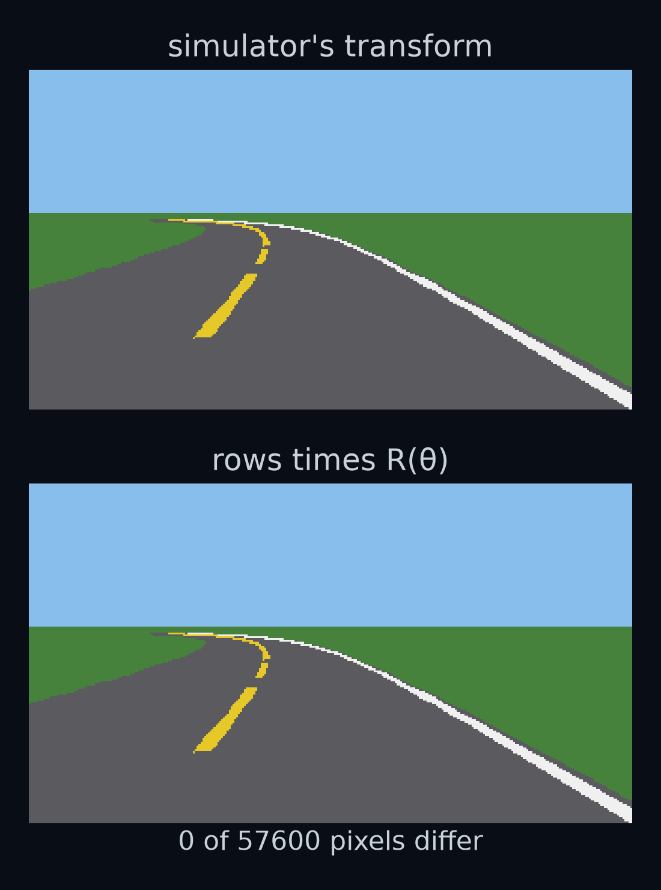

# The view from the driver's seat

*Positions and headings* ended with the camera's question. Here it is at one moment of the provided car's lap. The car is 150 m along `gentle`, 50 m into the first bend, and it points 34.1° to the left of east. Ahead of it the yellow centre line and the white edge line curve away to the left. The camera cannot use a world position. What it draws depends on how far ahead of the car each point is, and how far to its left. Where is every lane line in the car's own coordinates, so the camera can draw it?

By the end of this lesson you will write three short functions, `rotation_matrix`, `world_to_ego` and `ego_to_world`. You will check `world_to_ego` against the simulator's own version at 40 places and yaws, then plug it into the camera, so that every picture your car sees on its lap of `gentle` passes through code you wrote. On the way you meet your first matrices, and a bug that no test at the start line can catch.

![The provided car 150 m along gentle, drawn twice in two stacked panels. Top: seen from above in the world frame, east to the right and north up. The car's front axle is at (147.839, 14.299), and its own forward and left axes, x and y, are drawn in purple, turned 0.5958 rad from east. Bottom: the same lane lines in the car's own frame, with forward up the page and the car's left to the left. The lane centre, not painted and drawn as a grey dashed line in both panels, starts 0.527 m to the car's right. The lane-centre points 10, 20 and 30 m further along the lane are 0.453, 2.694 and 6.160 m to its left.](figures/result_first.png)

The bottom panel is what the camera needs, and none of its numbers can be read off the top one: the lane-centre point 10 m further along is at (156.018, 20.391) in the world frame, and nothing in that pair says "0.453 m to the left".

The bottom panel's coordinates belong to the car's own frame, called the **ego frame** ("ego" is Latin for "I"). Its origin is the front axle. Its x axis points where the car points, and its y axis is a quarter turn to the left of that. The camera is mounted at the front axle, facing forward, so this is the frame it draws from.

## Two dot products make a frame change

Start with one point, the lane-centre point 10 m further along the lane. Call its world position $\mathbf{p}$, read "p", and the car's front-axle position $\mathbf{t}$, read "t", for translation, a word explained below; it is not time. The car's position and yaw together, (x, y, θ), are called its **pose**.

The arrow from the car to the point is the difference of the two positions:

$$
\begin{aligned}
\mathbf{v} &= \mathbf{p} - \mathbf{t}\\
&= (8.179,\ 6.093)
\end{aligned}
$$

That is still in world terms: 8.179 m east and 6.093 m north. *Positions and headings* turned an arrow like this into "ahead and to the left" with two dot products. The forward part is the dot product with the heading arrow, $\hat{h}(\theta) = (\cos\theta, \sin\theta)$. The left part is the dot product with the left arrow, $\hat{n}(\theta) = (-\sin\theta, \cos\theta)$. At θ = 0.5958 rad, cos θ = 0.8277 and sin θ = 0.5612, so

$$
\begin{aligned}
\text{forward} &= \mathbf{v}\cdot\hat{h}\\
&= 8.179 \times 0.8277\\
&\quad + 6.093 \times 0.5612\\
&= 6.770 + 3.419\\
&= 10.189
\end{aligned}
$$

and

$$
\begin{aligned}
\text{left} &= \mathbf{v}\cdot\hat{n}\\
&= -8.179 \times 0.5612\\
&\quad + 6.093 \times 0.8277\\
&= -4.590 + 5.043\\
&= 0.453
\end{aligned}
$$


Those are the bottom panel's numbers for this point: 10.189 m ahead and 0.453 m to the left. Your `forward_left(theta, v)` from *Positions and headings* gives the same pair, (10.189, 0.453). It computes the left part as the cross product $\hat{h}\times\mathbf{v}$, which is the same multiply-and-add in a different order.

Changing a point's coordinates from one frame to another is called a **frame change**. A function that does one is a **transform**, and the one from the world frame to the ego frame is `world_to_ego`. So far it is two steps: subtract the car's position, then take one dot product per ego axis.

Now write the two arrows you dotted with as two rows of a grid, the heading arrow on top and the left arrow below. Write the arrow $\mathbf{v}$ as a column, its east part above its north part; (8.179, 6.093) and the column with 8.179 above 6.093 are the same arrow. Then put the answers in a column in the same order:

$$
\begin{aligned}
&\begin{bmatrix}\text{forward}\\ \text{left}\end{bmatrix}\\
&= \begin{bmatrix}\cos\theta & \sin\theta\\ -\sin\theta & \cos\theta\end{bmatrix}
\begin{bmatrix}v_x\\ v_y\end{bmatrix}
\end{aligned}
$$

A grid of numbers in rows and columns is called a **matrix**. A matrix written just before an arrow means: take the dot product of each row with the arrow, and stack the answers in the rows' order. That is the **matrix–vector product**. It is nothing but the dot products you already did, written in a stack.


`forward_left` was a matrix–vector product all along. It just never wrote the grid down.

## The rotation matrix

Now go the other way. Suppose you know the point is 10.189 m ahead of the car and 0.453 m to its left. Where is it in the world? Start at the car, walk 10.189 m along the heading arrow, then 0.453 m along the left arrow.

The first walk is 10.189 × 0.8277 = 8.433 m east and 10.189 × 0.5612 = 5.718 m north. The second is 0.453 × 0.5612 = 0.254 m west and 0.453 × 0.8277 = 0.375 m north. Add them up:

$$
\begin{aligned}
\text{east} &= 8.433 - 0.254\\
&= 8.179\\
\text{north} &= 5.718 + 0.375\\
&= 6.093
\end{aligned}
$$

That is $\mathbf{v}$ again. Add the car's position, (147.839, 14.299), and you land on the point, (156.018, 20.391).

Look at the arithmetic for a point a metres ahead and b metres left. The east part is $a\cos\theta - b\sin\theta$ and the north part is $a\sin\theta + b\cos\theta$. Each is a dot product of $(a, b)$ with a row, so the walk is another matrix–vector product, with this matrix, read "R of theta" (not the bend radius R of *Closing the loop*):

$$
\begin{aligned}
R(\theta) &= \\
&\begin{bmatrix}\cos\theta & -\sin\theta\\ \sin\theta & \cos\theta\end{bmatrix}
\end{aligned}
$$

Its first column is $(\cos\theta, \sin\theta)$, the heading arrow, and its second column is $(-\sin\theta, \cos\theta)$, the left arrow. At the scene it is

$$
\begin{bmatrix}0.8277 & -0.5612\\ 0.5612 & 0.8277\end{bmatrix}
$$

So a matrix–vector product can be read two ways. Row by row, it is dot products, which is how you compute it. Column by column, it is the first column scaled by a, plus the second column scaled by b, which is the walk. Both readings give the same numbers.


Multiplying by R(θ) takes the world's x axis, (1, 0), to the heading arrow, and the world's y axis, (0, 1), to the left arrow. Both are turned by θ anticlockwise, both are still 1 m long, and they are still a quarter turn apart. Any arrow, a times (1, 0) plus b times (0, 1), goes to a times the heading arrow plus b times the left arrow: the same arrow, turned by θ. So R(θ) is called a **rotation matrix**. Multiplying by it turns any arrow by the angle θ.

In symbols, a point whose ego coordinates are $\mathbf{q}$, read "q", is at $R(\theta)\,\mathbf{q} + \mathbf{t}$ in the world. That is `ego_to_world`. The last step, adding the same arrow $\mathbf{t}$ to every point, is a shift called a **translation**, which is why the car's position is written $\mathbf{t}$.

At yaw 0 the rotation matrix is

$$
R(0) = \begin{bmatrix}1 & 0\\ 0 & 1\end{bmatrix}
$$

It turns nothing. This matrix is called the **identity**, written I: multiplying any arrow by it gives the same arrow back. At yaw 0 the ego frame's axes are the world's, and that will matter at the end of this lesson.

## Undo is the transpose

The matrix in the first section, which took a world arrow into the ego frame, had the heading and left arrows as its rows. R(θ) has them as its columns. It is the same four numbers with the rows and columns swapped. Swapping the rows and columns of a matrix is called taking its **transpose**, written $R(\theta)^{\mathsf T}$ and read "R of theta transpose":

$$
\begin{aligned}
R(\theta)^{\mathsf T} &= \\
&\begin{bmatrix}\cos\theta & \sin\theta\\ -\sin\theta & \cos\theta\end{bmatrix}
\end{aligned}
$$


So `world_to_ego` computes $R(\theta)^{\mathsf T}(\mathbf{p} - \mathbf{t})$: subtract the car's position, then take the two dot products. `ego_to_world` computes $R(\theta)\,\mathbf{q} + \mathbf{t}$: walk along the columns, then add the car's position. Confusion is normal here. The same two arrows are rows in one matrix and columns in the other, and the whole difference between the two directions is which.

Why should the transpose undo the rotation? Walk out with R(θ) and come back with R(θ)ᵀ. Coming back takes the dot product of the walked arrow, a times the heading arrow plus b times the left arrow, with each of the two arrows. The heading arrow dotted with itself is $\cos^2\theta + \sin^2\theta$, which at the scene is 0.6851 + 0.3149 = 1. Dotted with the left arrow it is $-\cos\theta\sin\theta + \sin\theta\cos\theta = 0$. So coming back gives a × 1 + b × 0 = a forward and a × 0 + b × 1 = b left: exactly where you started.

<details>
<summary>How we got R(θ)ᵀR(θ) = I</summary>

Multiplying two matrices, the **matrix–matrix product**, dots each row of the first with each column of the second. The entry in row i and column j of the answer is row i of the first matrix dotted with column j of the second.

The rows of R(θ)ᵀ are the heading arrow and the left arrow. The columns of R(θ) are the same two arrows. So the four entries of R(θ)ᵀR(θ) are the four dot products of the two arrows with each other:

$$
\begin{aligned}
\hat{h}\cdot\hat{h} &= \cos^2\theta + \sin^2\theta\\
&= 1\\
\hat{h}\cdot\hat{n} &= -\cos\theta\sin\theta\\
&\quad + \sin\theta\cos\theta\\
&= 0
\end{aligned}
$$

The first is 1 by Pythagoras: the heading arrow is 1 m long. The same holds for $\hat{n}\cdot\hat{n}$, and $\hat{n}\cdot\hat{h}$ is the same 0. So R(θ)ᵀR(θ) has 1 on its top-left to bottom-right diagonal and 0 elsewhere, which is I. If you walk out to $\mathbf{w} = R(\theta)\,\mathbf{q}$, then

$$
\begin{aligned}
R(\theta)^{\mathsf T}\mathbf{w} &= R(\theta)^{\mathsf T}R(\theta)\,\mathbf{q}\\
&= I\,\mathbf{q} = \mathbf{q}.
\end{aligned}
$$

</details>

The computer agrees. Over 40 random yaws, no entry of R(θ)ᵀR(θ) differs from the identity's by more than $2.2\times10^{-16}$. That is the size of the rounding in the last digit the computer keeps.

The order inside `world_to_ego` matters. Turn first and subtract afterwards, $R(\theta)^{\mathsf T}\mathbf{p} - \mathbf{t}$, and the dot products are taken with the arrow from the world's origin to the point, not from the car.


**Guess first:** take 2109 points along the yellow line, the lane centre and the white line of the lap, 1 m apart, and send them into the ego frame and back out to the world. Do it at 41 poses: the scene's and 40 random ones. How far from where they started do the points land?

![Two stacked panels. Top: the lap of gentle in the world frame, its 2109 points in grey, and the same points after world_to_ego and then ego_to_world at the scene's pose, in light grey as rings on a sample of the points, landing on top of them. Bottom: at each of the 41 poses, the largest coordinate error after the round trip, on a scale where each grid line is ten times the one below. Every pose is below the dashed line at 10 to the minus 12 m. The largest error is 1.4 times ten to the minus 13 m going world to ego to world, and 8.5 times ten to the minus 14 m going ego to world to ego.](figures/round_trip.png)

**Answer:** within $1.4\times10^{-13}$ m. Going the other way, ego to world to ego, the points land within $8.5\times10^{-14}$ m. Neither is exactly 0, because every multiply-and-add rounds in the last digit. The lab's check uses a tolerance of $1\times10^{-9}$ m, thousands of times bigger than either, while the two mistakes at the end of this lesson miss it by hundreds of metres.

The scale used in that bottom panel, where each grid line is ten times the one below, is called a **log scale**. It is the way to show numbers this small next to each other.

## Every point at once

The camera never moves one point. To draw one picture, with the car parked on the lane centre 150 m along `gentle` and pointing along the road, it moves 1580 corners. The renderer paints the road as four-cornered patches called **quads**: strips of road surface, of white line, and of yellow dash. That picture needs 395 of them.

The quads come in three arrays, one for each kind. The road surface's has shape (146, 4, 2): 146 quads, 4 corners each, 2 numbers per corner. 146 strips 0.5 m long cover 73 m, from 3 m behind the car to 70 m ahead. The white line's array has the same shape, and the yellow dashes' is (103, 4, 2). So the camera calls `world_to_ego` 3 times per picture, with a whole array each time.


In NumPy a list of N points is stored as rows: shape (N, 2), one row per point, east part first. The maths above wrote arrows as columns. To use R(θ) on rows, flip the product around. A row written before a matrix is dotted with each of the matrix's columns. The columns of R(θ) are the heading and left arrows, so a row $\mathbf{v}$ times R(θ) gives $(\mathbf{v}\cdot\hat{h},\ \mathbf{v}\cdot\hat{n})$: forward, then left. That is $R(\theta)^{\mathsf T}\mathbf{v}$, written as a row.

NumPy writes the matrix product as `@`, read "at". With the car's position `t` and the points `P`, the whole frame change is `(P - t) @ rot`, where `rot = rotation_matrix(theta)`. The subtraction is broadcasting, from *Images are arrays*: `t`, shape (2,), is taken from every row. For the three lane-centre points of the opening, the rows of $\mathbf{P} - \mathbf{t}$ times R(θ) are

$$
\begin{aligned}
&\begin{bmatrix}8.179 & 6.093\\ 15.174 & 13.542\\ 21.185 & 21.805\end{bmatrix}R(\theta)\\
&= \begin{bmatrix}10.189 & 0.453\\ 20.158 & 2.694\\ 29.771 & 6.160\end{bmatrix}
\end{aligned}
$$

the forward and left parts in the bottom panel of the first figure. `@` reads a shape with more than two numbers as a stack of grids: (146, 4, 2) is 146 grids of shape (4, 2), each multiplied by `rot`. So the same line works on it and returns (146, 4, 2): every corner of every quad, in one go.

Written the maths way round in code, `rot @ rows` multiplies a (2, 2) by an (N, 2). With 5 points that fails loudly: NumPy raises a ValueError, because rot has 2 columns and the array has 5 rows.

**Guess first:** with exactly 2 points, the shapes are (2, 2) and (2, 2). Does `rot @ rows` raise an error?


**Answer:** no. Both arrays are 2 by 2, so the product is allowed, and it mixes up the two points' east and north parts without a word. The lab tests `world_to_ego` on many points at once, and on the (K, 4, 2) shape the camera uses, so this mistake cannot hide behind a lucky count.

## Swap your transform into the renderer

The camera's `render` does two things to each picture. First it moves every quad corner into the ego frame. Then it turns each ego point into a pixel, using the camera's height, pitch and focal length from *Your first perception box*, and paints the quads in order. Between the two steps it cuts away any part of a quad less than 0.3 m ahead of the car.


This is not quite the opening's moment. The car here is parked exactly on the lane centre and points exactly along the road, so that the pictures below compare like with like.

The first step is the one you can replace. Build the camera with your function, and it calls `world_to_ego((x, y, yaw), quads)` for each of the three arrays instead of its own:

```python
camera = Camera(world_to_ego=world_to_ego)
picture = camera.render(road, state)
tel = run(Car(), "gentle", camera=camera)
```

A `world_to_ego` written the matrix way, `(P - t) @ rot`, agrees with the simulator's own to within $5.68\times10^{-14}$ m at 40 random poses.

**Guess first:** on the provided car's lap of `gentle`, how many camera pictures come out different through it?



**Answer:** none. Of 178 pictures, one every 10 steps of the lap, not one pixel differs. The renderer rounds every corner to a whole pixel, and a difference of $5.68\times10^{-14}$ m moves no corner across a rounding boundary. So the car drives exactly the same lap, step for step: 1778 steps, 702.7 m in 88.85 s, with a mean $|e|$ of 0.376 m. Every picture it saw went through the transform.

In the lab you do this with your own `world_to_ego`, and the check runs the car through `gentle` with it.

## A test at yaw 0 proves nothing

Two mistakes are easy to make in `world_to_ego`, and both look reasonable:

```python
(P - t) @ rot.T   # the swap: R(θ) where R(θ)ᵀ belongs
P - t             # no rotation at all
```

At yaw 0 the rotation matrix is the identity, so R(0)ᵀ = R(0) = I, and both mistakes give the right answer. The first test anyone writes, a car at the start of the road facing east, passes all three. Here is a point 4 m ahead and 1 m left of a car at (10, 5), at four yaws. The right answer is (4.000, 1.000) every time.

| yaw (rad) | the swap | no rotation |
|---|---|---|
| 0 | (4.000, 1.000) | (4.000, 1.000) |
| π/2 = 1.5708 | (−4.000, −1.000) | (−1.000, 4.000) |
| π = 3.1416 | (4.000, 1.000) | (−4.000, −1.000) |
| −3π/4 = −2.3562 | (−1.000, 4.000) | (−2.121, −3.536) |

The swap passes at π as well. R(θ) and R(θ)ᵀ differ only in the signs of the two sin θ entries, and sin π = 0. At π/2 and −3π/4, sin θ is far from 0, and both mistakes are caught.

**Guess first:** parked on the lane centre 150 m along `gentle`, at yaw 0.6254 rad, which mistake changes more of the camera picture?


**Answer:** the swap. The renderer can also report what each pixel shows: sky, grass, road, yellow line or white line. Through the swap, 33.9% of the pixels show something different from the right picture; with no rotation, 20.0%. A test at this pose would catch both mistakes at once. Now park the car at seven places along the lap and count again.


The start of the lap is the worst place to test a transform. The yaw is 0 there, and at 100 m, where the bend begins, it is still only 0.0006 rad: the swap changes 0.3% of the picture and no rotation 0.1%.

**Guess first:** the swap changes 0.0% of the picture at the start line. Give the provided car the swapped transform and start it on `straight`, the road that never turns. How long will it last?


**Answer:** 2.95 s. On a road with no bend at all, the swapped car crosses the yellow line 22.8 m from the start. On `gentle` it lasts 2.80 s and 21.7 m. No rotation, which changes the picture less than the swap at 150 m and more at 260 m, drives the whole straight road within 0.003 m of the lane centre. It leaves `gentle` at 116.6 m, 16.6 m into the first bend, once the road starts to turn and the car's yaw with it.

Why does the swap fail where the road is straight? θ is where the car points; ψ, the heading from *Your first perception box*, is the yaw minus the road's direction, wrapped. On `straight` the road points east, so θ is ψ itself, and once the car moves it is small but never exactly 0. Swap the signs of the sin θ entries and you have the right transform for a car pointing at −θ. So the perception box sees the lane as if the car pointed the other way.


Park the car on `straight` 50 m from the start, 0.3 m left of the lane centre, pointing 0.05 rad right. Through the right transform the box reads an offset of 0.3063 m and a heading of −0.0517 rad. Through the swap it reads 0.2964 m and +0.0506 rad. The offset hardly changes; the heading's sign flips.


The controller steers by the rule from *Closing the loop*, with the box's heading in place of ψ:

$$
\begin{aligned}
\delta = -(&k_{\text{off}}\cdot\text{offset}\\
&+ k_{\text{head}}\,\psi)
\end{aligned}
$$

With that sign flipped, a car pointing a little to one side is told it points to the other, so it steers further the way it already points and the error feeds itself. After the first step e is $2.51\times10^{-5}$ m. It changes sign and grows to 0.0382 m at 1.00 s and 0.2724 m at 2.00 s; then it swings back across the lane centre and leaves the lane at 2.95 s.

So a test of a transform needs yaws where sin θ is well away from 0, like π/2 and −3π/4, and many random poses. The lab checks the four yaws in the table and 40 random poses against the simulator's own transform; at those 40, the swap is off by up to 704 m and no rotation by up to 751 m.

## Recap

- The ego frame has its origin at the front axle, x forward and y left. A world point $\mathbf{p}$ is at $R(\theta)^{\mathsf T}(\mathbf{p} - \mathbf{t})$ in it: subtract the car's position, then take the dot products with the heading and left arrows.
- R(θ) has the heading and left arrows as its columns and turns every arrow by θ. Its transpose undoes it, R(θ)ᵀR(θ) = I, so `ego_to_world` is $R(\theta)\,\mathbf{q} + \mathbf{t}$. With points stored as rows, `(P - t) @ rot` moves them all at once.
- At yaw 0, R(0) = I, so a test there proves nothing. The swap also passes at π, changes 0.0% of the picture at the start line, and still puts the car off `straight` after 2.95 s, because it flips the sign of the heading the box reads.


You can now put every lane line into the car's own frame, and the camera draws it. The simulator needs two other numbers about the car at every step. One is how far it has got along the road, which decides when the lap is finished. The other is how far it is from its lane centre, the e that grades every drive. Neither is a world coordinate, and neither is an ego coordinate. How far along the road is the car, and how far from its lane centre?

That is the next lesson, *The road's own coordinates*.

## Challenge problems

Both problems explain the swapped car's run on `straight`.


1. **Why the swap flips the heading.** For small angles cos θ ≈ 1 and sin θ ≈ θ, an approximation; at 0.02 rad, cos θ = 0.9998 and sin θ = 0.0200.
   - (a) Show that R(θ) = R(−θ)ᵀ for every θ. Write R(θ)ᵀ and R(θ) for a small θ, and explain why, on `straight`, the swapped box reads the heading as −ψ while the offset hardly changes. Compare with the parked car's numbers above, and with a second parked car pointing 0.02 rad left.
   - (b) On a straight, the car's yaw changes at $v\,\delta / L$ radians per second, with v = 8.0 m/s and L = 2.7 m, the wheelbase from *Meet your car*. Leave out the offset term and show that, with the swap, ψ grows by a factor of $\mathrm{e}$ every 0.125 s, where $\mathrm{e}$ is the number 2.718 from *Closing the loop*, not the lateral error $e$, while the right transform shrinks it just as fast. Fitting the swapped car's own steps gives a growth of 2.387 per second instead. Which part of the answer is right, and which is not?
   - (c) Optional.
     <details>
     <summary>Optional (c): the matrix form, with the fact it needs</summary>

     Keep both terms. Using the front-axle model, the lateral error $e$ changes at $v(\psi + \delta)$ metres per second. Write both rates as a matrix times (e, ψ), and use this fact, stated without proof, to find how fast the swapped car's error grows and how often it swings. For a matrix [[a, b], [c, d]], write tr = a + d and det = ad − bc. If (tr/2)² is less than det, the motion is a swing whose size grows like $\mathrm{e}^{(\mathrm{tr}/2)\,\text{time}}$ and which repeats every 2π/√(det − (tr/2)²) seconds. If (tr/2)² is bigger than det, there is no swing: the motion is two exponentials, with rates tr/2 + √((tr/2)² − det) and tr/2 − √((tr/2)² − det) per second. Compare with the fit.

     </details>
2. **Turns add up.** Using the angle-sum rules, cos(a + b) = cos a cos b − sin a sin b and sin(a + b) = sin a cos b + cos a sin b, show that R(a)R(b) = R(a + b). Then show that the car's heading arrow, sent into its own ego frame, is (1, 0) at every pose.

<details>
<summary>Answers</summary>

1. (a) cos(−θ) = cos θ and sin(−θ) = −sin θ, so R(−θ) has the signs of its sin θ entries flipped, and its transpose flips their places back: R(−θ)ᵀ is R(θ), entry for entry. The swap uses R(θ) where R(θ)ᵀ belongs, which is the right transform for a car at yaw −θ. For small θ,

$$
\begin{aligned}
R(\theta)^{\mathsf T} &\approx \begin{bmatrix}1 & \theta\\ -\theta & 1\end{bmatrix}\\
R(\theta) &\approx \begin{bmatrix}1 & -\theta\\ \theta & 1\end{bmatrix}
\end{aligned}
$$

On `straight` the road points east, so θ = ψ, and the swapped picture is drawn for a car pointing at −ψ: the box reads the heading as −ψ. The offset is where the lane centre is beside the car, and the small θ entries hardly move a point that is beside it, so the offset barely changes. Parked 0.3 m left at ψ = −0.05 rad, the box reads (offset, heading) = (0.3063, −0.0517) through the right transform and (0.2964, 0.0506) through the swap. At ψ = +0.02 rad it reads (0.2984, 0.0197) and (0.3016, −0.0201).

(b) With the swap the box's heading is −ψ, so the rule steers $\delta = -k_{\text{off}}\,\text{offset} + k_{\text{head}}\,\psi$. Leaving out the offset term, $\delta = k_{\text{head}}\,\psi$ and the yaw changes at

$$
\begin{aligned}
\frac{v\,k_{\text{head}}}{L}\,\psi\\
&= \frac{8.0 \times 2.7}{2.7}\,\psi\\
&= 8.000\,\psi
\end{aligned}
$$

per second. A quantity that grows at a fixed fraction of itself per second is an exponential growth, the mirror of *Closing the loop*'s decay: it multiplies by $\mathrm{e}$, the number 2.718 from there, not the lateral error, every 1/8.000 = 0.125 s. With the right transform the sign is −8.000 and it shrinks by the same factor. The sign is right: the swap makes the error grow. The speed is not: the fit gives 2.387 per second, and the error takes far longer than 0.125 s to grow by a factor of $\mathrm{e}$. The offset term, which this model left out, holds it back.

(c) With the swap, the two rates are

$$
\begin{aligned}
\text{rate of } \color{#58C4DD}{e} &= -2.800\,\color{#58C4DD}{e}\\
&\quad + 29.600\,\color{#D147BD}{\psi}\\
\text{rate of } \color{#D147BD}{\psi} &= -1.0370\,\color{#58C4DD}{e}\\
&\quad + 8.000\,\color{#D147BD}{\psi}
\end{aligned}
$$

For example, 29.600 = v(1 + k_head) = 8.0 × 3.7, and 1.0370 = v k_off / L = 2.8 / 2.7. Here tr = −2.800 + 8.000 = 5.200 and det = 8.296. (tr/2)² = 6.760, det minus that is 1.536, and its square root is 1.239. So the error grows at 2.600 per second and swings with a period of 2π/1.239 = 5.07 s. With the right transform the matrix is [[−2.800, −13.600], [−1.0370, −8.000]], tr = −10.800 and det is again 8.296; (tr/2)² is now bigger than det, there is no swing, and the two rates are −0.832 and −9.968 per second: both negative, so every error dies away.

The same two rules applied the way the simulator does, one 0.05 s step at a time, give 2.393 per second and 4.93 s. Fitting the swapped car's own steps from 0.40 s to 2.30 s gives 2.387 per second and 4.87 s, so the model is close.


The model holds until the wheels hit their limit of 0.05 rad per step, first at 2.70 s. After that the wheels can no longer follow the rule, and the car leaves the lane at 2.95 s.

2. The entries of R(a)R(b) are the rows of R(a) dotted with the columns of R(b). Top left: cos a cos b − sin a sin b = cos(a + b). Bottom left: sin a cos b + cos a sin b = sin(a + b). Top right: −cos a sin b − sin a cos b = −sin(a + b). Bottom right: −sin a sin b + cos a cos b = cos(a + b). So R(a)R(b) = R(a + b): two turns in a row are one turn by the sum. Over 40 random pairs of angles the computer agrees to within $4.4\times10^{-16}$.

The heading arrow is the first column of R(θ), which is R(θ) times (1, 0). Into the ego frame it goes by R(θ)ᵀ, which is R(−θ) by Problem 1. So it comes out as R(−θ)R(θ) times (1, 0) = R(0) times (1, 0) = (1, 0). Every car points along its own x axis. At 40 poses `world_to_ego` puts the point 1 m ahead of the car, $\mathbf{t} + \hat{h}$, within $1.4\times10^{-14}$ of (1, 0). Pass the point, not the arrow: `world_to_ego` subtracts $\mathbf{t}$ first.

</details>
