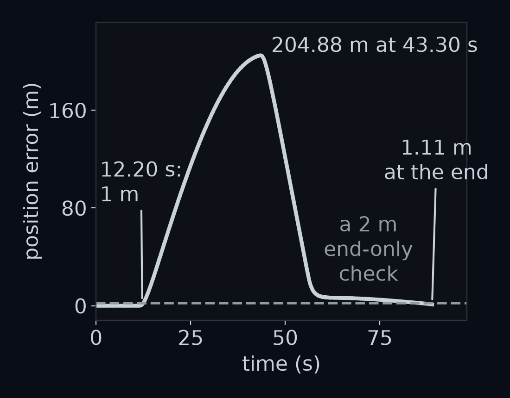

# Poses you can chain

You are driving `gentle` when the car enters a tunnel and the GPS goes quiet. Nothing tells you where you are any more. Two sensors still work: the wheels count how far the car rolls, and the steering sensor reports the wheels' angle. Every 0.05 s they say how the car moved since the last step: about 0.4 m forward, a hair to the left, a sliver of turn. If the car knows only how it moved since the last step, can it still know where it is?

Pretend the whole lap is the tunnel: 1777 steps, 88.85 s. By the end of this lesson you will write `relative_pose`, which turns two poses into the step between them, and `dead_reckon`, which chains the 1777 steps back into the lap. Then you will see what a tiny error in every step does to the answer.


That gap is $1.5 \times 10^{-12}$ m (Python prints `1.5e-12`): the rebuilt lap is exact, and the gap is only the rounding in the computer's last digits. This lesson builds the tool that does it, one idea at a time.

## A pose is a frame

In *The view from the driver's seat* you described the car by its pose, three numbers $(x, y, \theta)$: where its front axle is in the world frame, and which way it points, its yaw. At step 400, 20.00 s into the lap, the simulator's record says $(154.6587,\ 19.8543,\ 0.704)$. The car is on the first bend, pointing 0.704 rad, 40.33°, left of east. Here θ is the yaw. The heading $\color{#D147BD}{\psi}$, from *Your first perception box*, is the yaw minus the road's direction, wrapped into −π to π.

A pose also places a frame. Put the ego frame's origin at $(x, y)$ and turn its forward axis to θ, and you have the car's own frame at that moment.

A cone stands 10 m ahead of the car and 2 m to its left, $(10, 2)$ in the ego frame. Where is it in the world? You know the recipe: `ego_to_world` rotates, then adds. To rotate, walk 10 m along the car's forward axis, $(\cos\theta, \sin\theta) = (0.7623, 0.6473)$, and 2 m along its left axis, $(-0.6473, 0.7623)$:

$$\begin{aligned}x &: 10 \times 0.7623\\ &\quad - 2 \times 0.6473 = 6.33\\ y &: 10 \times 0.6473\\ &\quad + 2 \times 0.7623 = 8.00\end{aligned}$$

Then add the car's position:

$$\begin{aligned}x &= 6.33 + 154.66\\ &= 160.99\\ y &= 8.00 + 19.85\\ &= 27.85\end{aligned}$$


Rotate, then add: two operations for one frame change. This lesson chains frame changes, from the rear axle to the car, from the car to the world, from one step to the next. Written as rotate-then-add pairs, even two of them nest awkwardly: $R(\theta_1)(R(\theta_2)\mathbf p + \mathbf t_2) + \mathbf t_1$. One small trick turns each pair into a single multiplication.

Give the point a third entry, a 1: $(10, 2, 1)$. Give the rotation matrix a third column holding the car's position, and a third row $(0, 0, 1)$:

$$T = \begin{bmatrix}\cos\theta & -\sin\theta & x\\ \sin\theta & \cos\theta & y\\ 0 & 0 & 1\end{bmatrix}$$

Now multiply $T$ by $(10, 2, 1)$ row by row, as in *The view from the driver's seat*. The first row gives $10\cos\theta - 2\sin\theta + x$: the rotate and the add, in one row. The 1 at the end of the point is what picks up the position. The third row gives $0 \times 10 + 0 \times 2 + 1 \times 1 = 1$, so the answer keeps its trailing 1, ready for the next matrix.

**Guess first:** what does each column of $T$ contribute to the answer?


**Answer:** a matrix times a vector is the matrix's columns, each scaled by one entry of the vector and added. The first two columns are the ego frame's forward and left axes, written in world coordinates, just as the columns of $R(\theta)$ were. The third is where the ego frame's origin sits. So the matrix is the ego frame from the step-400 figure, written as nine numbers. The code gives (160.987, 27.8514), and it matches rotate-then-add exactly.

Look at the bottom row too. The axis columns end in 0, so the trailing 1 never adds a position to them: an axis is an arrow, which turns but has no place. The origin column ends in 1: it is a point. Send $(1, 0)$ through $T$ both ways to see the difference. *The camera's point of view* leans on it.


This matrix takes a point in ego coordinates and returns it in world coordinates. It is written $T_{\text{world}\leftarrow\text{ego}}$ and read "T, world from ego": the point comes in on the right, in ego coordinates, and leaves on the left, in world coordinates. Writing a point with a trailing 1 is called using **homogeneous coordinates**, and $T$ is a **homogeneous transform**, or just a **transform**.

In the lab you write `pose_to_matrix(pose)`, which builds $T$, and `matrix_to_pose(T)`, which reads the pose back: $x$ and $y$ from the third column, and $\theta$ as $\operatorname{atan2}$ of `T[1, 0]` and `T[0, 0]`, the first column's north and east parts. Round trips through the two are exact, with one trap. As *Positions and headings* showed, atan2 answers only between −π and π, while the simulator never wraps its yaw, which reaches 6.2264 rad by the end of the lap. Whenever the yaw is above π, the two differ by 6.2832 rad, a full turn. Wrap the difference before comparing, and they agree to 0.0.

![The car's yaw over the 88.85 s lap, in radians. In grey, the yaw from the simulator's record, which climbs to 6.2264 rad and never wraps. In orange, θ read back by matrix_to_pose, which follows it up to π. At step 1021, 51.05 s in, the orange line first jumps from 3.1412 down to −3.1416. On the back straight the yaw wobbles across π 39 times, as in Positions and headings, so the orange line flips between π and −π until step 1118, 55.90 s in. From there it runs a full turn, 6.2832 rad, below the grey one.](figures/wrap_trap.png)

## Subscripts that cancel

The ego frame's origin is the front axle. The rear axle, 2.7 m behind it (the wheelbase $L$, first used in *Closing the loop*), gets a frame of its own: the **rear frame**, with its origin at the rear axle and its axes pointing the same way as the ego frame's. Its pose in the ego frame is $(-2.7, 0, 0)$, so

$$T_{\text{ego}\leftarrow\text{rear}} = \begin{bmatrix}1 & 0 & -2.7\\ 0 & 1 & 0\\ 0 & 0 & 1\end{bmatrix}$$

read "T, ego from rear". It turns nothing and moves every point 2.7 m back.

Where is the rear axle in the world at step 400? In its own frame the rear axle is the origin, $(0, 0, 1)$. First take it to the ego frame: $T_{\text{ego}\leftarrow\text{rear}}$ times $(0, 0, 1)$ is its third column, $(-2.7, 0, 1)$. Then take that to the world with $T_{\text{world}\leftarrow\text{ego}}$:

$$\begin{aligned}x &= 154.6587\\ &\quad - 2.7 \times 0.7623\\ &= 152.601\\ y &= 19.8543\\ &\quad - 2.7 \times 0.6473\\ &= 18.107\end{aligned}$$

The rear axle is 2.7 m behind the front one, along the car's forward axis, as it should be.


You can also multiply the two matrices first, to get one matrix that goes straight from the rear frame to the world. A matrix times a matrix works column by column: each column of the product is the left matrix times that column of the right one.

- The first two columns of $T_{\text{ego}\leftarrow\text{rear}}$ are $(1, 0, 0)$ and $(0, 1, 0)$. Their trailing 0s skip the position, so they come out as the first two columns of $T_{\text{world}\leftarrow\text{ego}}$: the car's own axes.
- Its third column, $(-2.7, 0, 1)$, is the point you just moved. It comes out as $(152.601, 18.107, 1)$.

$$\begin{aligned}&T_{\text{world}\leftarrow\text{rear}}\\ &= \begin{bmatrix}0.76 & -0.65 & 152.60\\ 0.65 & 0.76 & 18.11\\ 0 & 0 & 1\end{bmatrix}\end{aligned}$$

Its pose is $(152.601, 18.107, 0.704)$: the same yaw as the car, with the origin 2.7 m further back. In NumPy the product is `T_world_ego @ T_EGO_REAR`, where `@` is the matrix product, and it agrees with the two-step route to 0.0 m.

Now look at the names:

$$\begin{aligned}&T_{\text{world}\leftarrow\text{ego}}\\ &\quad \cdot T_{\text{ego}\leftarrow\text{rear}}\\ &= T_{\text{world}\leftarrow\text{rear}}\end{aligned}$$

The two inner names, ego and ego, meet and cancel, leaving the outer two. That is the whole rule for chaining frames: write the transforms so that neighbouring names match, and the product is named by the first and the last.


If the inner names do not match, as in $T_{\text{ego}\leftarrow\text{rear}} \cdot T_{\text{world}\leftarrow\text{ego}}$, the product means nothing. It would feed world coordinates into a matrix that expects rear-frame ones. NumPy will multiply the numbers anyway, so the names are your only check.

## Order matters

Numbers can be multiplied in either order: $2 \times 3 = 3 \times 2$. Transforms hide a trap here. Take two moves, each written as a pose:

- $A = (1, 0, \pi/2)$: drive 1 m forward, and end a quarter turn to the left;
- $B = (1, 0, 0)$: drive 1 m forward.

With names, $A \cdot B$ is $T_{\text{start}\leftarrow a} \cdot T_{a\leftarrow b}$: $B$ is measured from wherever $A$ left the car. So $A \cdot B$ means "do $A$, then $B$", and $B \cdot A$ means "do $B$, then $A$".

**Guess first:** does the order of the two moves matter? The quick answer adds their parts: $(1 + 1,\ 0 + 0,\ \pi/2 + 0) = (2, 0, \pi/2)$, whichever order you add them in.


**Answer:** yes. Do $A$ then $B$: drive 1 m east, turn to face north, drive 1 m north, and you end at $(1, 1)$. Do $B$ then $A$: drive 2 m east, then turn, and you end at $(2, 0)$. The two ends are $\sqrt{2} = 1.4142$ m apart. Adding the parts gave $(2, 0)$, the $B$-then-$A$ answer, and it can never give the other one, because addition ignores order.

The matrices agree with the figure. With $\cos 90° = 0$ and $\sin 90° = 1$:

$$A = \begin{bmatrix}0 & -1 & 1\\ 1 & 0 & 0\\ 0 & 0 & 1\end{bmatrix}$$

$$B = \begin{bmatrix}1 & 0 & 1\\ 0 & 1 & 0\\ 0 & 0 & 1\end{bmatrix}$$

The third column of $A \cdot B$ is $A$ times $B$'s third column, $(1, 0, 1)$. Row by row: $0 - 0 + 1 = 1$, then $1 + 0 + 0 = 1$, then 1. That is the point $(1, 1)$. The third column of $B \cdot A$ is $B$ times $(1, 0, 1)$: $1 + 0 + 1 = 2$, then 0, then 1, the point $(2, 0)$.

Both products have the same first two columns, $(0, 1, 0)$ and $(-1, 0, 0)$, so both end facing north. Turns on their own add up in any order. What the order changes is where the driving happens.

Two operations **commute** when their order does not matter, as $2 \times 3$ and $3 \times 2$ do. Transforms do not commute in general, which is why the names matter: they tell you which order is right.

## Undoing a pose

Now go the other way, from a point's world coordinates to the car's. World coordinates go in and ego coordinates come out, so the transform is $T_{\text{ego}\leftarrow\text{world}}$. Undo the two operations in reverse order: first take away the car's position, then undo the turn.


You wrote exactly that in *The view from the driver's seat*: `world_to_ego` computes $R(\theta)^{\mathsf T}(\mathbf p - \mathbf t)$, where $\mathbf t$ is the car's position and the transpose $R(\theta)^{\mathsf T}$ undoes the turn $R(\theta)$. Multiplied out, that is $R(\theta)^{\mathsf T}\mathbf p - R(\theta)^{\mathsf T}\mathbf t$: a turn, then a fixed shift, which fits the same 3×3 pattern:

$$\begin{aligned}&T_{\text{ego}\leftarrow\text{world}}\\ &= \begin{bmatrix}R^{\mathsf T} & -R^{\mathsf T}\mathbf t\\ 0\quad 0 & 1\end{bmatrix}\end{aligned}$$

The top left is a 2×2 block: the turn, undone. The top right is a column of two numbers: the car's position, turned into the car's own axes and negated. The bottom row stays $(0, 0, 1)$. This transform undoes $T_{\text{world}\leftarrow\text{ego}}$, so it is also written $(T_{\text{world}\leftarrow\text{ego}})^{-1}$, read "the inverse of T, world from ego". Inverting swaps the two names.

<details>
<summary>How we got the inverse's third column</summary>

The ego coordinates of a world point $\mathbf p$ are $R(\theta)^{\mathsf T}(\mathbf p - \mathbf t)$. Multiplying the bracket out gives two terms. The first, $R(\theta)^{\mathsf T}\mathbf p$, depends on the point: it is the turn, and it fills the top-left block. The second, $-R(\theta)^{\mathsf T}\mathbf t$, is the same for every point: it is the shift, and it fills the third column, where the point's trailing 1 picks it up. So the inverse is a turn by $R(\theta)^{\mathsf T}$ followed by a shift of $-R(\theta)^{\mathsf T}\mathbf t$.

</details>

Try it on $A = (1, 0, \pi/2)$, the frame 1 m east of the start, facing north. Its turn is $R(\pi/2) = [[0, -1], [1, 0]]$, so $R(\pi/2)^{\mathsf T} = [[0, 1], [-1, 0]]$. Its position is $\mathbf t = (1, 0)$, so $R^{\mathsf T}\mathbf t = (0, -1)$ and $-R^{\mathsf T}\mathbf t = (0, 1)$:

$$A^{-1} = \begin{bmatrix}0 & 1 & 0\\ -1 & 0 & 1\\ 0 & 0 & 1\end{bmatrix}$$


Its pose is $(0, 1, -\pi/2)$. Stand at $(1, 0)$ facing north: the start lies 1 m to your left, to the west, and its forward axis, east, points to your right.

Check it by multiplying. $A^{-1}$ times $A$'s third column, $(1, 0, 1)$, gives $(0 + 0 + 0,\ -1 + 0 + 1,\ 1) = (0, 0, 1)$. The first two columns come back as $(1, 0, 0)$ and $(0, 1, 0)$. So $A^{-1}A$ is the **identity matrix** $I$, with 1s down its diagonal and 0s elsewhere, which leaves every point where it is.

**Guess first:** at step 400 the car is on the first bend, pointing 40° left of east. Where is the world origin, the start of the road's centre line, as seen from the car: in front or behind, to the left or to the right?


**Answer:** behind and to the left. `invert_pose(T)`, the closed form you write in the lab, puts $(-130.7431, 84.9692)$ in the third column: the world origin is 130.74 m behind the car and 84.97 m to its left. Over every pose of the lap, `invert_pose(T) @ T` equals $I$ to within $2.2 \times 10^{-16}$. Taking world points into the car's frame with it matches `world_to_ego` to $1.1 \times 10^{-13}$ m. NumPy's general inverse, `np.linalg.inv`, agrees to $5.7 \times 10^{-14}$, but the lab asks for the closed form: it says what undoing a pose means.

## What the car felt between two steps

Back in the tunnel. The car no longer knows its pose at step $k$, $T_{\text{world}\leftarrow k}$. Its wheels and steering measure something else: where the car is now, in the frame it had one step ago. That is a transform too, $T_{k\leftarrow k+1}$, read "T, k from k plus 1". The names say how to get it:

$$\begin{aligned}&T_{\text{world}\leftarrow k} \cdot T_{k\leftarrow k+1}\\ &= T_{\text{world}\leftarrow k+1}\end{aligned}$$

Multiply both sides on the left by $T_{k\leftarrow\text{world}}$, the inverse of $T_{\text{world}\leftarrow k}$. On the left side the two cancel to $I$, which leaves

$$\begin{aligned}&T_{k\leftarrow k+1}\\ &= T_{k\leftarrow\text{world}}\\ &\quad \cdot T_{\text{world}\leftarrow k+1}\end{aligned}$$

In code that is `relative_pose(T_world_a, T_world_b)`, which returns `invert_pose(T_world_a) @ T_world_b`. You write it in the lab.

Step 100, 5.00 s in, is on the first straight. The record gives the pose $(40.0000, -1.7987, 0.00008)$ at step 100 and $(40.3999, -1.7979, 0.00036)$ at step 101. In the world the car moved 0.39999 m east and 0.00082 m north. Seen from the car, `relative_pose` reports 0.4000 m forward, 0.00079 m left and a turn of 0.00027 rad (from the unrounded yaws).

**Guess first:** why is the left part, 0.00079 m, smaller than the northward shift, 0.00082 m?

![One step of the car, step 100 on the first straight, zoomed in, with the angles drawn many times larger than they are. The car's frame at step 100 in purple and at step 101 in light purple. The step's arrow is split along the step-100 frame's axes into 0.4000 m forward and 0.00079 m left, and the turn between the two frames is labelled 0.00027 rad in orange and drawn as an arc between the two forward axes, extended. The same arrow is also split along the light grey world axes into 0.39999 m east and 0.00082 m north.](figures/one_step.png)

**Answer:** the car already points 0.00008 rad left of east, so its forward axis leans slightly north. A small angle in radians times a distance is a sideways distance (*Your first perception box*), so $0.00008 \times 0.4 = 0.00003$ m of the northward shift is really forward motion. The rest, $0.00082 - 0.00003 = 0.00079$ m, is to the car's left.

Why does a car that points almost straight ahead move left at all? Because moving is not pointing (*Positions and headings*). The front axle rolls the way its wheels point, and during step 100 they point 0.00184 rad of steering, plus about half the step's turn, 0.00014 rad, left of the car's forward axis. So the left part is $0.4 \times (0.00184 + 0.00014) = 0.00079$ m.

Working out how a vehicle moved from its own wheels and steering is called **odometry**, and each $T_{k\leftarrow k+1}$ is one odometry step. Over the lap the steps average 0.3998 m forward and 0.00350 rad of turn. Each step's left part never exceeds 0.01639 m.

**Guess first:** add up the turns of all 1777 steps. What do you get?


**Answer:** 6.2264 rad, the car's yaw at the end of the lap, 0.0568 rad short of a full turn, 6.2832 rad. Adding up the turns gives the yaw, because turns add in any order. The forward parts add up to 710.49 m. They do not give the position, though: each forward step points a different way.

**Approximation.** These steps come from the simulator's record, so they are exact: they match its motion rule to $4.9 \times 10^{-14}$ m. A real car's wheels slip and its sensors read off, so the Drift section below adds an error. **Placeholder.** You write the motion rule itself, from speed and steering to a step, in *Longitudinal control and vehicle motion*.

## Dead reckoning

Now run the steps forwards. At the tunnel mouth the car knows its pose, $(0, -1.8, 0)$, as the matrix $T_{\text{world}\leftarrow 0}$. Then it feels step 0. The names say how to combine them:

$$\begin{aligned}&T_{\text{world}\leftarrow 1}\\ &= T_{\text{world}\leftarrow 0} \cdot T_{0\leftarrow 1}\end{aligned}$$

Then $T_{\text{world}\leftarrow 2} = T_{\text{world}\leftarrow 1} \cdot T_{1\leftarrow 2}$, and so on. Each new step goes on the right, because each is measured in the frame the car had just before it.

`dead_reckon(T_world_start, steps)` does this. It returns all 1778 poses as one array of shape (1778, 3, 3): the start, then each running product. The first figure of this lesson was its answer. No pose is more than $1.5 \times 10^{-12}$ m or $5.3 \times 10^{-15}$ rad from the truth. Rebuilding where you are by chaining your own steps from a known start is called **dead reckoning**.

**Guess first:** skip the matrices and add each step's forward, left and turn straight onto $x$, $y$ and $\theta$. What does the rebuilt lap look like?


**Answer:** a straight line. Adding the forward part to $x$ assumes that forward is always east. The rebuilt car ends at $(710.49, 16.26)$: the 710.49 m the car drove, all laid out eastwards, 710.66 m from where the car really is. The sum is right only while the car points east. At the end of the first straight, step 250, it is 0.060 m off.

**Guess first:** now multiply in the other order, $T_{k\leftarrow k+1} \cdot T_{\text{world}\leftarrow k}$, so each step goes on the left. The inner names, $k+1$ and world, do not match. How far from the truth does the rebuilt car end the lap?


**Answer:** 1.11 m. That looks nearly right, and it is badly wrong. A step on the left is applied in the world's frame, so each step turns the car's position about the world origin, not about the car. By step 866, 43.30 s in, the car has turned 2.9984 rad, almost half a turn (π is 3.1416). The rebuilt car is at $(-95.12, 179.01)$ while the true one is at $(108.95, 160.77)$: 204.88 m apart. By the end the turns add up to almost a full turn, the spin nearly undoes itself, and the rebuilt car comes back close to the truth (challenge 4 shows why). Its yaw is right all lap, to $2.7 \times 10^{-15}$ rad, because turns add in any order.



This is why the lab checks every step, to within $1 \times 10^{-6}$ m and $1 \times 10^{-9}$ rad, and not just the end. The wrong order is more than 100 m off for 562 of the 1778 poses. An end-only check is easy to fool: a "dead reckoning" that never moves the car at all ends just 0.401 m from the truth, because a lap ends near where it starts. Its worst pose is 210.47 m off.

## Drift

So far the steps were exact. A real car's are not: its wheels slip a little, and its steering sensor reads a little off. Model that with the simplest error there is: each step's turn is off by a random amount. Each amount is drawn from the bell-shaped normal distribution of *Images are arrays*, with standard deviation $\sigma$ ("sigma", the typical size of a nudge) of 0.0001 rad, or 0.0057°. That is about 3% of an average step's turn, and every step's error is drawn fresh, on its own.

Each run starts its random draws from a seed (*Your first perception box*), so the same seed replays the same draws. Each seed here is one possible trip through the tunnel, with its own 1777 errors. The measurements use 500 seeds, numbered 0 to 499.

**Guess first:** with 0.0001 rad of error per step, how far off is the rebuilt car at the end of the lap: millimetres, centimetres or metres?


**Answer:** most of a metre. Seed 0 ends 0.688 m from the truth. Over 500 seeds the RMS end error, the root mean square of *Meet your car*, is 0.608 m. Half the seeds end within 0.493 m, and the worst ends 2.098 m away. Ten times the error per step, $\sigma = 0.001$ rad, gives about ten times the drift: an RMS end error of 6.078 m, 9.994 times as much.

How does the error build up over the lap?


It grows for most of the lap. A yaw error does not stay put: a car whose yaw is 0.0001 rad off drives every later step slightly sideways, and each later step adds a yaw error of its own. The yaw errors themselves add up. After the lap their spread is 0.00424 rad, and the challenge problems at the end show why that is $\sigma\sqrt{N}$, 0.00422 rad. Near the end of the lap the position error eases a little, as the car comes back toward its start. The challenge problems explain why.

**Guess first:** keep driving round the tunnel. Does the error settle after a few laps?


**Answer:** no. The RMS end error is 0.608 m after one lap, 1.236 m after four and 2.454 m after sixteen. Four times the laps gives twice the error (2.03 and 1.98 times), with no sign of stopping.

An error that keeps growing because each estimate is built on the one before is called **drift**. ROS, the software framework many robots run on, says this plainly of its odometry frame: a robot's pose in it "can drift over time, without any bounds" (REP 105). The same document calls that frame "an accurate, short-term local reference". Dead reckoning is good over a few steps and never over a long tunnel.

**Placeholder.** The fix is to correct the estimate with something that does not drift: a GPS fix when the tunnel ends, or the lane lines in the camera. Combining a drifting estimate with such corrections is the subject of *State estimation*.

## The rear axle is a frame too

The rear frame from earlier in this lesson does not belong to any one step. It is fixed to the car's body and moves with it, so the same $T_{\text{ego}\leftarrow\text{rear}}$ works at every step. Such a frame is called **body-fixed**. One product gives the rear axle's pose at all 1778 steps at once:

```python
T_world_rear = T_world_ego @ T_EGO_REAR
```

Here `T_world_ego` holds the lap's 1778 poses, with shape (1778, 3, 3), and `@` multiplies each of them by `T_EGO_REAR`. The result agrees with doing them one at a time to 0.0 m.

**Guess first:** on `gentle`'s bends the front axle rides about half a metre left of the lane centre, toward the inside of the bend (*Closing the loop*). Where does the rear axle ride: on the same line, nearer the lane centre, or further inside?

![A stretch of the first bend, straightened out, with the sideways distances drawn 20 times larger, on axes of equal scale. The lane centre is in grey. The front axle's path in purple and the rear axle's path in light purple, with the car drawn at one step as a bar 2.7 m long from rear axle to front axle, so it runs from the light purple path to the purple one. The bar is stretched sideways by the same 20 times as the paths; its real angle to the lane is 0.95°. The light purple path runs inside the purple one, toward the bend's centre.](figures/rear_axle_paths.png)

**Answer:** further inside. Measured the same way as $\color{#58C4DD}{e}$, at the rear axle instead of the front, the rear axle's mean lateral error in the middle of the first bend is 0.5746 m, against 0.5298 m for the front. The rear rides 0.045 m further in.

*Closing the loop* drew the triangle a bend makes: the turning point, the rear axle and the front axle, with a right angle at the rear axle and the front axle's radius $R$ as the longest side. The side from the turning point to the rear axle is then the rear axle's radius, and by Pythagoras it is $\sqrt{R^2 - L^2}$, shorter than $R$. In the middle of the first bend the front axle rides 0.5298 m inside the 81.8 m lane centre, so $R = 81.27$ m:

$$\begin{aligned}\sqrt{R^2 - L^2}\\ &= \sqrt{81.27^2 - 2.7^2}\\ &= 81.225\text{ m}\\ R - 81.225\\ &= 0.045\text{ m}\end{aligned}$$

That is the measured gap.

**Guess first:** where on the lap are the two axles furthest apart?


**Answer:** just after the first bend ends, as the car straightens out: at step 893, 44.65 s in, the rear axle is 0.123 m further left than the front. On the straights the two agree to 0.0004 m on average. Over the lap, the rear axle's mean $|\color{#58C4DD}{e}|$ is 0.406 m and its largest 0.576 m, against 0.376 m and 0.533 m at the front. Both *Longitudinal control and vehicle motion* and *Lateral control* build on `T_EGO_REAR`.

## Recap

- A pose $(x, y, \theta)$ is a 3×3 transform $T_{\text{world}\leftarrow\text{ego}}$ that works on points with a trailing 1. Neighbouring names cancel, the order matters, and the closed-form inverse swaps the names.
- Odometry measures $T_{k\leftarrow k+1} = T_{k\leftarrow\text{world}} \cdot T_{\text{world}\leftarrow k+1}$. Dead reckoning multiplies the steps on the right and rebuilds `gentle` to $1.5 \times 10^{-12}$ m. The wrong order ends 1.11 m off but is 204.88 m off mid-lap, so check every step.
- A turn error of 0.0001 rad per step drifts 0.608 m RMS in one lap and keeps growing: 2.454 m after 16 laps.


Every frame in this lesson lay flat on the road, and a 3×3 matrix with a trailing 1 moved points between them. The camera's frame does not lie flat. It sits 1.4 m up and is tipped 5° down, so getting from what the camera sees to a place on the road takes one more transform: a 4×4 matrix, built with the same trailing 1. Given how the camera is mounted, where on the road is the thing a pixel sees?

That is the next lesson, *The camera's point of view*.

## Challenge problems

Use one fact without proof: when you add errors that are random and drawn independently, their squared spreads add. Two errors of spread σ add up to an error of spread $\sqrt{2}\,\sigma$.

1. **Yaw drift.** Each step's turn error has spread σ, drawn independently. Show that after $k$ steps the yaw error has spread $\sigma\sqrt{k}$. Check it against the measured 0.00424 rad at the end of the `gentle` lap, with $\sigma = 0.0001$ rad.
2. **The straight-road law.** On `straight` every step is $\ell = 0.4$ m forward ($\ell$, read "ell", for a step's length). Show that after $N$ steps the sideways error has spread about $\sigma\,\ell\,N^{3/2}/\sqrt{3}$, using the sum of the first $N-1$ squares, $(N-1)N(2N-1)/6$. Predict it for the 501 steps of `straight` and for the 1777 steps of `gentle`.


3. **The loop beats the law.** Your prediction for `gentle` is far bigger than the measured 0.608 m. Explain why. Hint: a yaw error at step $j$ turns the whole rest of the path about the car's position at step $j$.
4. **Why the wrong order comes home.** In the wrong order, show that the position follows $\mathbf p_{k+1} = R(\Delta\theta_k)\,\mathbf p_k + \mathbf s_k$, where $\mathbf s_k$ is the step's (forward, left) and $\Delta\theta_k$ its turn. Use it to explain the 204.88 m in mid-lap and the 1.11 m at the end.

<details>
<summary>Answers</summary>

1. After $k$ steps the yaw error is the sum of $k$ independent errors, each of spread σ. Their squared spreads add to $k\sigma^2$, so the spread is $\sigma\sqrt{k}$. For the lap, $0.0001 \times \sqrt{1777} = 0.00422$ rad, against 0.00424 rad measured over 500 seeds. On `straight` it is 0.002238 rad against 0.002239 rad.

2. After step $m$ the yaw is off by $\Theta_m$, the sum of the first $m$ turn errors. The next step of length $\ell$ then moves the car $\ell\,\Theta_m$ sideways, a small angle times a distance. So after $N$ steps the sideways error is $\ell\,(\Theta_1 + \Theta_2 + \dots + \Theta_{N-1})$. The error of step $j$ is inside every $\Theta$ from $\Theta_j$ on, so it is counted $N - j$ times. Its share has spread $\ell\,\sigma\,(N - j)$, and the squared spreads add to $\ell^2\sigma^2$ times the sum of the first $N-1$ squares, $(N-1)N(2N-1)/6$. For large $N$, $(N-1)N(2N-1)$ is about $2N^3$, so the spread is about $\sigma\,\ell\,\sqrt{N^3/3} = \sigma\,\ell\,N^{3/2}/\sqrt{3}$. For 501 steps it predicts 0.25897 m. The exact sum gives 0.25859 m, and the measured RMS over 500 seeds is 0.26579 m, 2.6% above the law. On axes where each equal step multiplies the value by the same factor, a **log scale**, a law like $N^{3/2}$ is a straight line whose slope is the power, 3/2. The measured spread rises with slope 1.525 from $N = 50$ on. For `gentle`'s 1777 steps the law predicts 1.729 m.


3. A yaw error $n_j$ at step $j$ turns everything the car does afterwards about the place it was then, $\mathbf p_j$. Turning by a small angle about $\mathbf p_j$ moves the end point by $n_j$ times its distance from $\mathbf p_j$, $|\mathbf p_N - \mathbf p_j|$, its lever. Adding the squared spreads, the end error's spread is $\sigma\sqrt{\sum_j |\mathbf p_N - \mathbf p_j|^2}$. That gives 0.618 m for `gentle`, against the measured 0.608 m. On a straight the lever is $(N - j)\,\ell$, which gives problem 2 back. On the loop the car comes back near its start, so no lever is longer than the loop is wide. Their RMS is 146.62 m, against 410.03 m on a straight of the same 1777 steps. The same sum, taken at every step, follows the measured drift curve to within 5.9% after step 50. It peaks at 0.716 m at step 1490, where the measured RMS peaks at 0.712 m at step 1485, and it eases off as the car comes home.

4. The wrong order computes $S_k \cdot T_{\text{world}\leftarrow k}$, where $S_k$ is the step's matrix. Its third column is $S_k$ times $(\mathbf p_k, 1)$: the step's turn applied to the old position, plus the step's (forward, left) added straight onto world $x$ and $y$. That is $\mathbf p_{k+1} = R(\Delta\theta_k)\,\mathbf p_k + \mathbf s_k$, and its yaw, $\theta_k + \Delta\theta_k$, is right. Now turn each position back by the yaw so far, $\mathbf q_m = R(-\theta_m)\,\mathbf p_m$. Then $\mathbf q_{m+1} = \mathbf q_m + R(-\theta_{m+1})\,\mathbf s_m$: a path driven with every turn reversed, almost the true lap's mirror image. (The left parts are not mirrored, which moves its end by 0.307 m.) So the wrong-order car is that mirror lap, spun about the world origin by the yaw so far, $\mathbf p_m = R(\theta_m)\,\mathbf q_m$; the measured positions match this to $8.2 \times 10^{-13}$ m. At step 866 the yaw is 2.9984 rad, almost half a turn, so the mirror lap is spun almost to the other side of the origin, 204.88 m from the truth. At the end the yaw is 6.2264 rad, almost a full turn, so the spin nearly vanishes. The mirror lap, like the true one, ends near its start, and the car lands 1.11 m from the truth.

</details>
