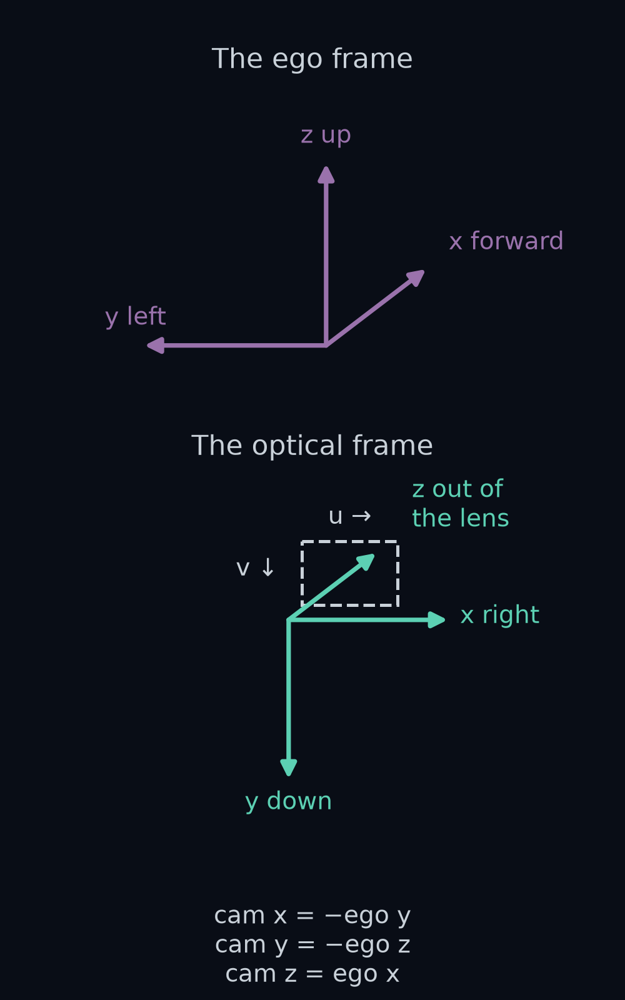
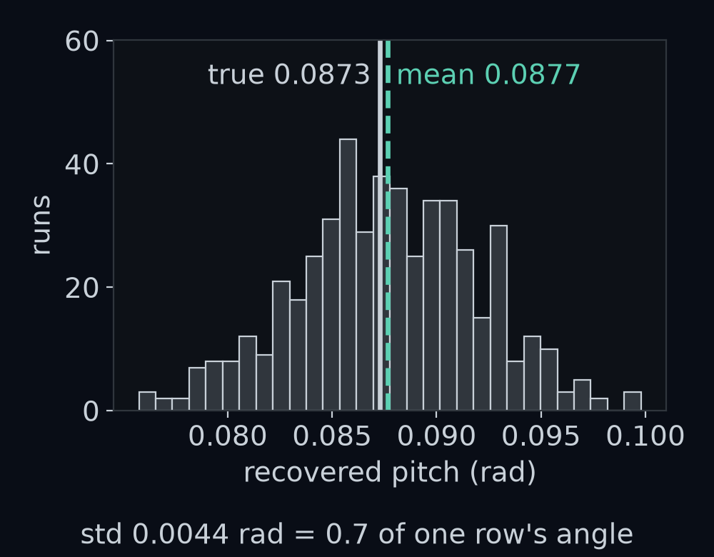
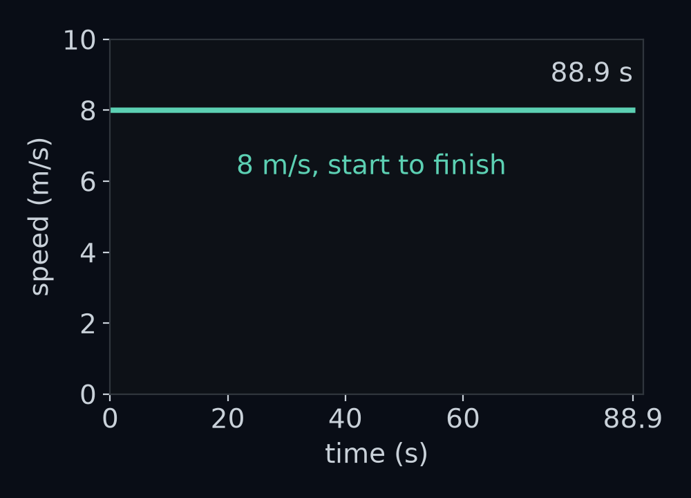

# The camera's point of view

You are bolting the camera onto the car. The spec sheet says it sits 1.4 m above the road at the front axle, tipped 5 degrees down, and every distance your perception box has measured since *Your first perception box* trusts those two numbers. Nobody has checked them against the picture. Given how the camera is mounted, where on the road is the thing a pixel sees?

By the end of this lesson you will write the camera's **mount**, where it sits on the car and how it is tipped, as one 4 by 4 matrix, `T_ego_cam`, and send any pixel's line of sight to the road with `ray_to_ground`. Then the simulator draws every camera picture through two pieces of your code, the `world_to_ego` you wrote in *The view from the driver's seat* and your mount, and the car still drives `gentle`.

![Top: one camera picture from the first bend of gentle, drawn by the simulator. Bottom: the same moment drawn through the world_to_ego you wrote and the mount you write in this lesson. In 18 pictures sampled along the lap, not one of the 57,600 pixels differs, and the lap matches step for step: 1778 steps, and a mean distance from the lane centre of 0.376 m. That 0.376 m is the provided car's own error: with the simulator's own camera it takes the same 1778 steps and gets the same 0.376 m, so a correct camera adds none.](figures/result_first.png)

## A third axis

The ego frame from *The view from the driver's seat* has two axes, x forward and y left, with its origin on the road under the front axle. The camera's lens is 1.4 m above that origin, and no amount of forward or left says "above". The ego frame needs a third axis, z, and you have to choose which way it points.

Up or down, both give three axes at right angles to each other. Engineers pick one with a rule: curl the fingers of your right hand from x toward y, and z is the way your thumb points. Curl them from forward toward left and your thumb points up. A frame built this way is called **right-handed**.

The same choice falls out of arithmetic. *Positions and headings* gave you the 2D cross product of two arrows **a** and **b**, $a_x b_y - a_y b_x$, read "a-x b-y minus a-y b-x", which is positive when **b** is to the left of **a**. In 3D the cross product of two arrows is a third arrow, at right angles to both, and its z part is exactly that 2D cross product. For forward, (1, 0, 0), and left, (0, 1, 0), the z part is 1 × 1 − 0 × 0 = 1.

**Guess first:** forward × left has a z part of +1. Which way does the whole arrow point? And which way does left × forward point?

**Answer:** forward × left is (0, 0, 1), straight up, so z points up. Swap the order and left × forward is (0, 0, −1), straight down: like the 2D cross product, the 3D one changes sign when its two arrows swap. In this frame the lens is the point (0, 0, 1.4): 0 m ahead, 0 m left and 1.4 m up.

How we got the 3D cross product

Each part of **a** × **b** is a 2D cross product of the other two axes, taken in the order y then z, z then x, and x then y:

$$
\begin{aligned}
(\mathbf{a}\times\mathbf{b})_x &= a_y b_z - a_z b_y \\
(\mathbf{a}\times\mathbf{b})_y &= a_z b_x - a_x b_z \\
(\mathbf{a}\times\mathbf{b})_z &= a_x b_y - a_y b_x
\end{aligned}
$$

For **a** = (1, 0, 0) and **b** = (0, 1, 0): the x part is 0 × 0 − 0 × 1 = 0, the y part is 0 × 0 − 1 × 0 = 0, and the z part is 1 × 1 − 0 × 0 = 1. `np.cross([1, 0, 0], [0, 1, 0])` gives `[0, 0, 1]`, and `np.cross([0, 1, 0], [1, 0, 0])` gives `[0, 0, -1]`.

The rule also fixes which way a turn counts as positive. Point your right thumb along an axis, and your fingers curl the positive way round it. With the thumb up the z axis, the fingers carry forward toward left. So a positive turn about z is a turn to the left, the same direction as a positive yaw θ (read "theta"), the angle the car points in *Positions and headings*.

## Turning about each axis

The camera is not level. It is tipped forward, so the lens looks a little down at the road. That tip is a turn about the car's y axis, the line through the camera from its right side to its left. A car can turn about each of its three axes, and each turn has a name: about z it **yaws**, turning left or right; about y it **pitches**, nose down or nose up; about x it **rolls**, leaning to one side.

You already have the yaw matrix. *The view from the driver's seat* turned 2D points with R(θ). A turn about z leaves the height alone, so the 3D yaw matrix is R(θ) with a row and a column added for z:

$$
\begin{aligned}
&R_z(\theta) = \\
&\begin{bmatrix} \cos\theta & -\sin\theta & 0 \\ \sin\theta & \cos\theta & 0 \\ 0 & 0 & 1 \end{bmatrix}
\end{aligned}
$$

Read $R_z(\theta)$ "R z of theta", the turn by θ about z. 150 m along `gentle` the provided car's yaw is 0.591 rad. The top-left 2 by 2 of $R_z(0.591)$ matches R(0.591) to the last digit, and up, (0, 0, 1), stays (0, 0, 1).

The tip is a turn about y by an angle φ, read "phi". Aircraft texts and vehicle texts that follow the ISO 8855 standard write roll as φ and pitch as θ; this course spent θ on the car's yaw first, so here φ is pitch. The same pattern of cos and sin moves to the x and z rows:

$$
\begin{aligned}
&R_y(\varphi) = \\
&\begin{bmatrix} \cos\varphi & 0 & \sin\varphi \\ 0 & 1 & 0 \\ -\sin\varphi & 0 & \cos\varphi \end{bmatrix}
\end{aligned}
$$

*Your first perception box* called this angle the pitch and wrote it p. From here on it is φ, because a bold **p** now names a point. The camera's pitch is still 5 degrees: φ = 0.0873 rad, with cos φ = 0.9962 and sin φ = 0.0872.

**Guess first:** put your right thumb along y, to the car's left. Does a positive turn about y tip the nose down or up?

**Answer:** down. With your thumb pointing left, your fingers curl from up toward forward and from forward toward down. Multiply forward, (1, 0, 0), by $R_y(\varphi)$ and you get the matrix's first column, (cos φ, 0, −sin φ) = (0.9962, 0, −0.0872): the nose drops 0.0872 m for every 0.9962 m it reaches ahead. **Positive pitch is nose down**, which is why the 5 degrees in *Your first perception box* was a positive 0.0873 rad. Flip the sign and the nose rises, to (0.9962, 0, +0.0872).

The third turn, roll, leaves forward alone and tips left toward up. For a roll angle α, read "alpha":

$$
\begin{aligned}
&R_x(\alpha) = \\
&\begin{bmatrix} 1 & 0 & 0 \\ 0 & \cos\alpha & -\sin\alpha \\ 0 & \sin\alpha & \cos\alpha \end{bmatrix}
\end{aligned}
$$

These are the three **rotation matrices** about the axes, and in code they are `rot_x`, `rot_y` and `rot_z`. Each takes an angle in radians and returns a 3 by 3. Each column is where one axis ends up: the first column of $R_y(\varphi)$ is where forward goes.

## The camera's own axes

A camera does not count in forward, left and up. Its picture runs in columns and rows: the column number u grows to the right, the row number v grows downward, and the lens looks out along its axis. So the camera has its own frame, with x to the right across the picture, y down it, and z out through the lens. This is the **optical frame**, "cam" for short. In Week 1 a camera frame, and `obs.frame`, meant one picture, but here a frame is a set of axes; "camera picture" still means what the camera records.

For a camera that looked level and straight ahead, the two frames would differ only in their labels. Take a point 10 m ahead of the lens, 2 m left and level with it. In the optical frame it is 2 m to the *left* of the picture's x direction, so its cam x is −2; it is level, so its cam y is 0; and it is 10 m out along the lens, so its cam z is 10. The relabelling is one fixed matrix, B:

$$
B = \begin{bmatrix} 0 & -1 & 0 \\ 0 & 0 & -1 \\ 1 & 0 & 0 \end{bmatrix}
$$

B times (10, 2, 0) is (−2, 0, 10). Each row of B picks one ego number: cam x is minus left, cam y is minus up, and cam z is forward.

B carries ego numbers to cam numbers. To carry cam numbers back, use its transpose, $B^\top$, read "B transpose": the same move that undid R(θ) in *The view from the driver's seat*. $B^\top$ times B is the 3 by 3 identity, the matrix that changes nothing. The columns of $B^\top$ are the cam axes written in ego numbers.

Now tip the camera. Start from the level camera, $B^\top$, then pitch it down by φ about the car's y axis:

$R_{\text{ego}\leftarrow\text{cam}} = R_y(\varphi)\,B^\top$

Read the subscript "ego from cam": this matrix takes a direction written in cam numbers and gives it in ego numbers, and the subscripts chain as in *Poses you can chain*. Its columns are the tipped camera's axes in the ego frame:

$$
\begin{bmatrix} 0 & -0.0872 & 0.9962 \\ -1 & 0 & 0 \\ 0 & -0.9962 & -0.0872 \end{bmatrix}
$$

Cam x is still the car's right, (0, −1, 0). Cam z, the lens axis, is (0.9962, 0, −0.0872), forward and dipping: the nose from the last section. Cam y, down the picture, is (−0.0872, 0, −0.9962), nearly straight down and leaning back by the same 5 degrees.

**Guess first:** *Poses you can chain* showed that order matters. Multiply the other way round, $B^\top R_y(\varphi)$. Which way does that camera look?

**Answer:** level, and 0.0873 rad, 5 degrees, to the right: its lens axis is (0.9962, −0.0872, 0). Written on the right, $R_y(\varphi)$ turns about the *camera's* y axis, which points down, so the 5 degrees became a turn of the head instead of a nod. The pitch has to turn the car's axes, so it goes on the left.

## One 4×4 for the mount

The turn is half the mount. The other half is where the lens is: 1.4 m above the ego origin, **t** = (0, 0, 1.4), read "t", the mount's shift. *Poses you can chain* packed a 2D turn and shift into one 3 by 3 matrix with a trailing 1. In 3D the same trick gives a 4 by 4:

$$
\begin{aligned}
&T_{\text{ego}\leftarrow\text{cam}} = \\
&\begin{bmatrix} R_{\text{ego}\leftarrow\text{cam}} & \mathbf{t} \\ 0\;\;0\;\;0 & 1 \end{bmatrix}
\end{aligned}
$$

Read $T_{\text{ego}\leftarrow\text{cam}}$ "T, ego from cam". With h = 1.4 m for the height, and s = sin φ and c = cos φ to keep the matrix narrow, in full it is:

$$
\begin{bmatrix} 0 & -s & c & 0 \\ -1 & 0 & 0 & 0 \\ 0 & -c & -s & h \\ 0 & 0 & 0 & 1 \end{bmatrix}
$$

To use it, write a point in the optical frame as four numbers, its three coordinates and a 1, and multiply. The lens itself, (0, 0, 0, 1), comes out at (0, 0, 1.4, 1): the trailing 1 picks up the last column. In code this is `T_ego_cam(height_m, pitch_rad)`.

The renderer needs the other direction. It knows road points in the ego frame and must find them in the optical frame. That is the inverse, $T_{\text{cam}\leftarrow\text{ego}}$, and *Poses you can chain* gave its closed form: transpose the turn, and make the new last column $-R_{\text{ego}\leftarrow\text{cam}}^\top\mathbf{t}$. Here that column is $(0,\ h\cos\varphi,\ h\sin\varphi)$ = (0, 1.3947, 0.122). It says where the ego origin, the road right under the lens, sits in the optical frame: 1.3947 m down the picture and 0.122 m out along the lens axis.

How we got the inverse's last column

The rows of $R_{\text{ego}\leftarrow\text{cam}}^\top$ are the columns of $R_{\text{ego}\leftarrow\text{cam}}$: (0, −1, 0), (−sin φ, 0, −cos φ) and (cos φ, 0, −sin φ). Multiply each by **t** = (0, 0, h):

$$
\begin{aligned}
&(0,\ -h\cos\varphi,\ -h\sin\varphi)
\end{aligned}
$$

Change the signs and you have $(0,\ h\cos\varphi,\ h\sin\varphi)$: 1.4 × 0.9962 = 1.3947 and 1.4 × 0.0872 = 0.122. Multiplying $T_{\text{cam}\leftarrow\text{ego}}$ by $T_{\text{ego}\leftarrow\text{cam}}$ gives the 4 by 4 identity to within $2.3\times10^{-18}$, and the closed form matches `np.linalg.inv` exactly.

The last step, from the optical frame to a pixel, belongs to the camera, and it is given. A point at cam (x, y, z) lands at

$$
\begin{aligned}
u &= c_x + f\,x / z \\
v &= c_y + f\,y / z
\end{aligned}
$$

with focal length f = 160 px and middle column and row $(c_x, c_y)$ = (159.5, 89.5), read "c-x, c-y", the numbers from *Your first perception box*. The module *Camera geometry* opens this step up; here you use it as it is.

Work one point by hand: the road 10 m straight ahead, ego (10, 0, 0). The rows of $T_{\text{cam}\leftarrow\text{ego}}$ give cam x = 0, cam y = −10 × 0.0872 + 1.3947 ≈ 0.523, and cam z = 10 × 0.9962 + 0.122 = 10.084. So u = 159.5, and v = 89.5 + 160 × 0.523 / 10.084 ≈ 97.8. The renderer's `ground_to_pixel(10, 0)` says (159.5, 97.8002).

**Guess first:** push 200 random road points, 2 to 60 m ahead and up to 8 m to either side, through your $T_{\text{cam}\leftarrow\text{ego}}$ and the pinhole step. How far from the renderer's own pixels will they land?

**Answer:** 0.0 px, in u and in v. The renderer's formula is this same turn, shift and divide, written out for one camera. The same arithmetic shows what the camera cannot see. The road right under the lens, cam (0, 1.3947, 0.122), would land at row 89.5 + 160 × 1.3947 / 0.122, about 1918, far below the picture's last row, 179. So the bottom row sees the road 2.06 m ahead, and no pixel sees the road right under the lens.

## Points move, directions only turn

The lens axis is not a place. It is a direction: it says which way the camera looks, not where anything is. Where does it point in the ego frame?

Moving between frames treats the two differently. A point turns and shifts, because the origin moved. A direction only turns: the direction "straight down the lane" is the same whether you stand at the lens or at the ego origin.

The fourth number does this for you. Write a point with a 1 at the end, the trailing 1 from *Poses you can chain*, and the multiply adds the last column, **t**. Write a direction with a 0 at the end, and the last column is multiplied by 0 and drops out. That fourth number is called w: w = 1 for a point, w = 0 for a direction.

The lens axis in the optical frame is (0, 0, 1). As a direction, with w = 0, the mount turns it to (0.9962, 0, −0.0872), the third column of the turn. As a point, with w = 1, it comes out at (0.9962, 0, 1.3128): the place 1 m out along the axis from the lens, a fine answer to a different question.

**Guess first:** treat (0.9962, 0, 1.3128) as the direction anyway. Which way does the camera now seem to look? And how many of the picture's 57,600 pixel rays would point down at the road?

**Answer:** 0.92 rad, 53 degrees, *above* level, and none of the 57,600. Every pixel's ray picks up the lens's 1.4 m of height as if it belonged to the direction, so even the bottom row's ray climbs. With w = 0, every pixel from row 76 down, 33,280 of them, meets the road. In code the two moves are `transform_points(T, p)`, which uses w = 1, and `transform_directions(T, r)`, which uses w = 0 and so only the turn.

The same mistake moves the horizon. The car's forward direction, (1, 0, 0), sent into the optical frame with w = 0, is (0, −0.0872, 0.9962). The pinhole step puts it at row 89.5 + 160 × (−0.0872 / 0.9962) = 75.5, the horizon row of *Your first perception box*, where the flat road meets the sky. With w = 1 it lands at row 276.6, below the bottom of the picture.

## Where a pixel's ray meets the road

Back to the question this lesson opened with. In the first picture of `gentle`, the white edge line crosses row 150 between columns 249 and 260, centred on column 254.5. Where on the road is that paint?

Each pixel sees along one **ray**, a line out of the lens. The pixel's ray in the optical frame is given by `pixel_ray(camera, u, v)`:

$$
\begin{aligned}
\mathbf{r}_{\text{cam}} &= (a,\ b,\ 1) \\
a &= (u - c_x) / f \\
b &= (v - c_y) / f
\end{aligned}
$$

Read a and b as how far right of the middle column and how far below the middle row the pixel is, in units of f. For column 254.5 and row 150, a = 95 / 160 = 0.5937 and b = 60.5 / 160 = 0.3781.

A ray is a direction, so it goes into the ego frame with w = 0: **r** = $R_{\text{ego}\leftarrow\text{cam}}\,\mathbf{r}_{\text{cam}}$, read "r", the ray in ego numbers:

$$
\begin{aligned}
r_x &= \cos\varphi - b\sin\varphi \\
r_y &= -a \\
r_z &= -(\sin\varphi + b\cos\varphi)
\end{aligned}
$$

For the paint, **r** = (0.9632, −0.5937, −0.4638): forward, to the right and down. Now walk along it from the lens, **t**. After λ steps, read "lambda", you are at **g** = **t** + λ**r**, read "g" for ground. Each step drops 0.4638 m and the lens starts 1.4 m up, so you reach the road, height 0, when

$$
\begin{aligned}
\lambda &= -t_z / r_z \\
&= 1.4 / 0.4638 \\
&\approx 3.018
\end{aligned}
$$

That puts the paint at **g** = (3.018 × 0.9632, 3.018 × −0.5937, 0) = (2.907, −1.792, 0): 2.907 m ahead and 1.792 m to the right, on the white line, which the road paints 1.7 to 1.9 m right of the lane centre.

λ is not new. The ray's cam z is 1, so λ steps along it carry you λ metres out along the lens axis, and 3.0183 is the Z of *Your first perception box*, row 150's road point measured along the camera's axis. If $r_z$ is 0 or positive, the ray is level or climbing and never meets the road. That is every pixel above the horizon, and there the answer is NaN. Finding where a line meets a flat surface this way is called **ray–plane intersection**, and `ray_to_ground(T_ego_cam, ray_cam)` does it for the road, the plane z = 0.

**Guess first:** the renderer's `pixel_to_ground` is a closed formula written for this one camera, while `ray_to_ground` works for any mount. Over 200 random pixels below the horizon, how far apart will their answers be?

**Answer:** 0.0 m, forward and sideways, and 200 random pixels above the horizon all give NaN. The figure shows why "a row is a distance" from *Your first perception box* holds across the whole row. The forward part, $\lambda r_x$, uses only b, the row. The sideways part, $-\lambda a$, grows in step with the column. In the middle column, where a = 0, the forward distance is $h / \tan(\varphi + \arctan b)$, the formula from that lesson: 2.9073 m for row 150 and 11.4537 m for row 95.

How we got the middle-column formula

Write β, read "beta", for arctan b, so b = sin β / cos β. With a = 0, the forward distance is $\lambda r_x$ and λ = h / (−r_z):

$$
\begin{aligned}
x &= h\,\frac{\cos\varphi - b\sin\varphi}{\sin\varphi + b\cos\varphi} \\
&= h\,\frac{\cos(\varphi+\beta)}{\sin(\varphi+\beta)} \\
&= h / \tan(\varphi + \beta)
\end{aligned}
$$

The middle step multiplies top and bottom by cos β and uses the angle-sum rules from school trigonometry, cos φ cos β − sin φ sin β = cos(φ + β) and sin φ cos β + cos φ sin β = sin(φ + β). For row 150, φ + β = 0.0873 + 0.3615 = 0.4488 rad, and 1.4 / tan 0.4488 = 2.9073 m.

## A camera mounted wrong

Now the bracket. Suppose it goes on so that the camera is tipped 5 degrees *up* instead of down. The perception box does not know. It still turns pixels into road points as if the camera were tipped 5 degrees down, so the picture and the measurement disagree.

**Guess first:** tilt the camera 5° up instead of down. Which road will show it, `straight` or `gentle`?

The box still places those far-band rows 5.59 m to 7.11 m ahead, so road truly 70 m away is put 7.11 m away. Every row lies about its distance. What matters is whether the lie changes the two numbers the controller gets.

**Answer:** only `gentle`. Tipped up, the car finishes `straight` with a mean distance from the lane centre of 0.004 m, against 0.000 m with the spec mount. It leaves `gentle` on the left at 86.3 m, 10.85 s in, 13.7 m *before* the first bend even starts. A level camera finishes `straight` with 0.016 m and leaves `gentle` at 123.0 m, 23 m into the bend.

Why before the bend? Hold the car on the lane centre of `gentle`, pointing along it, and read the box. With the spec camera its heading ψ (read "psi"; the yaw minus the lane's direction, wrapped, as in *Your first perception box*) stays within 0.002 rad of the truth, 0, all the way. Tipped up, it reads −0.002 rad at 20 m along, where the bend is still out of sight, then grows as the bend comes into view.

The road is drawn 70 m ahead, so the bend is in the picture from 30 m along. Tipped up, the far band sees the start of the bend 20 to 70 m ahead but places it 5.6 to 7.1 m ahead. A lane that will start curving left 60 m away looks like a lane swinging sharply left right in front of the car. The box reports that the car points right of the lane, the controller steers left, and the car drifts left until it leaves.

The drive itself shows the same split. At 70 m along, the car is truly 0.505 m left and points 0.038 rad left. Through the spec camera, that same pose reads 0.498 m and +0.040 rad. Through the tipped-up camera it reads 0.744 m and −0.102 rad: right about the side, wrong about the heading.

In the lab you swap your `world_to_ego` and your mount into the renderer. With the right sign, no sampled picture differs. Flip the sign of φ inside your `T_ego_cam` and all 18 pictures differ and the car would leave `gentle` at 86.3 m, exactly like the bracket tipped up: a sign error in the mount *is* a camera mounted wrong. (The grader catches both first, saying your camera tips up or your turn is a roll, before any picture or drive.) Put `rot_x` where `rot_y` belongs and the camera rolls 5 degrees instead of pitching. It finishes `straight` 0.341 m right of the centre, after a mean of 0.314 m, and leaves `gentle` at 119.1 m.

Height errors are kinder. A camera truly 1.2 m up sees row 150's road 2.492 m ahead. The box assumes 1.4 m and follows the same ray to 2.907 m, 7/6 as far, because the two triangles have the same shape.

Every road point scales by 7/6, forward and sideways alike, and scaling keeps angles. For a car truly 0.4 m left and pointing 0.05 rad left, the box reads its heading as 0.0519 rad through the 1.2 m camera and 0.0512 rad through the spec camera. The car finishes `gentle` with a mean distance from the centre of 0.286 m at 1.2 m and 0.472 m at 1.6 m, against 0.376 m for the spec mount.

Measuring the mount's real height and pitch, so that the box's numbers match the picture, is called **calibration**. The first challenge problem does it with four painted marks.

## Challenge problems

1. **Calibrate the mount.** You paint four marks on flat ground at (3, 1), (3, −1), (8, 1) and (8, −1) m, forward and left of the ego origin, and find them in the picture: the near pair in row 147.789 and the far pair in row 103.291. Recover the pitch and the height, knowing neither. Hint: for a guessed pitch, a mark x m ahead in a row with ratio b implies a height of $x\tan(\varphi + \arctan b)$. Only the right pitch makes the near and far marks imply the same height.
2. **One pixel of error.** Your mark finder reads every row 1 px too large. How far off is the pitch you recover? Compare it with the angle between the rays of two neighbouring rows.
3. **The w = 1 ray.** Show that with w = 1, no pixel ray in the picture points down. From which row would a ray have to come?
4. **A low camera.** Show that a camera truly h m up, read as if 1.4 m up, places every road point at 1.4 / h times its true distance, forward and sideways alike.

Answers

**1.** Call the gap the far pair's implied height minus the near pair's. At pitch 0 the near marks imply 1.0929 m and the far marks 0.6895 m, a gap of −0.4034 m. The gap is −0.1715 m at φ = 0.05 and +0.2873 m at φ = 0.15, so the answer lies between. Bisection halves that bracket again and again, each time keeping the half whose ends have gaps of opposite sign. Halve it until the bracket is tiny and φ = 0.087266 rad, where the four marks agree on h = 1.4000 m.

**2.** Every row +1 px gives φ = 0.08051 rad, off by −0.00675 rad, and h = 1.3955 m. Neighbouring rows' rays differ by 0.00551 rad at row 147.8, by 0.0062 rad at row 103.3, and by 1/f = 0.00625 rad at the middle row, so one pixel costs about one row's angle. With that pitch, row 115 would be placed 5.757 m ahead instead of 5.592 m. With random row errors of standard deviation 0.5 px, the spread measure from *Images are arrays*, 500 calibrations recover the pitch with a standard deviation of 0.0044 rad and the height with 0.020 m.

**3.** With w = 1 the ray picks up **t**, so its height part is $1.4 - (\sin\varphi + b\cos\varphi)$. That is negative only when b > (1.4 − sin φ) / cos φ, which is row 300.4. The bottom row, 179.5, has b = 0.5625, so no pixel's ray points down.

**4.** The box computes λ from its assumed 1.4 m, so its ground point is $(1.4/h)$ times the one the ray truly reaches, and both the forward and the sideways parts scale by the same factor. Over 200 random road points the box's forward and sideways distances are 1.166667 times the truth for h = 1.2 and 0.875 times for h = 1.6, with no exceptions. Scaling a picture keeps its angles, which is why the heading survives.

## Recap

- The ego frame is right-handed in 3D: x forward, y left, z up. Positive pitch, about y, is nose down; the camera's φ is 0.0873 rad.
- The mount $T_{\text{ego}\leftarrow\text{cam}}$ packs $R_y(\varphi)\,B^\top$ and **t** = (0, 0, 1.4). Points take w = 1, directions w = 0, and with the pinhole step it reproduces the renderer to 0.0 px.
- A pixel's ray meets the road at λ = −t_z / r_z. Flip the pitch sign and the car still drives `straight`, but leaves `gentle` at 86.3 m.

Every lap in this course, on every road, has run at 8 m/s. The scenario starts the car at that speed, and the provided speed controller holds it there, bend or no bend. Who chose 8 m/s, and how would the car reach a different speed, hold it, or slow down for a bend? That is the next module, *Longitudinal control and vehicle motion*.
